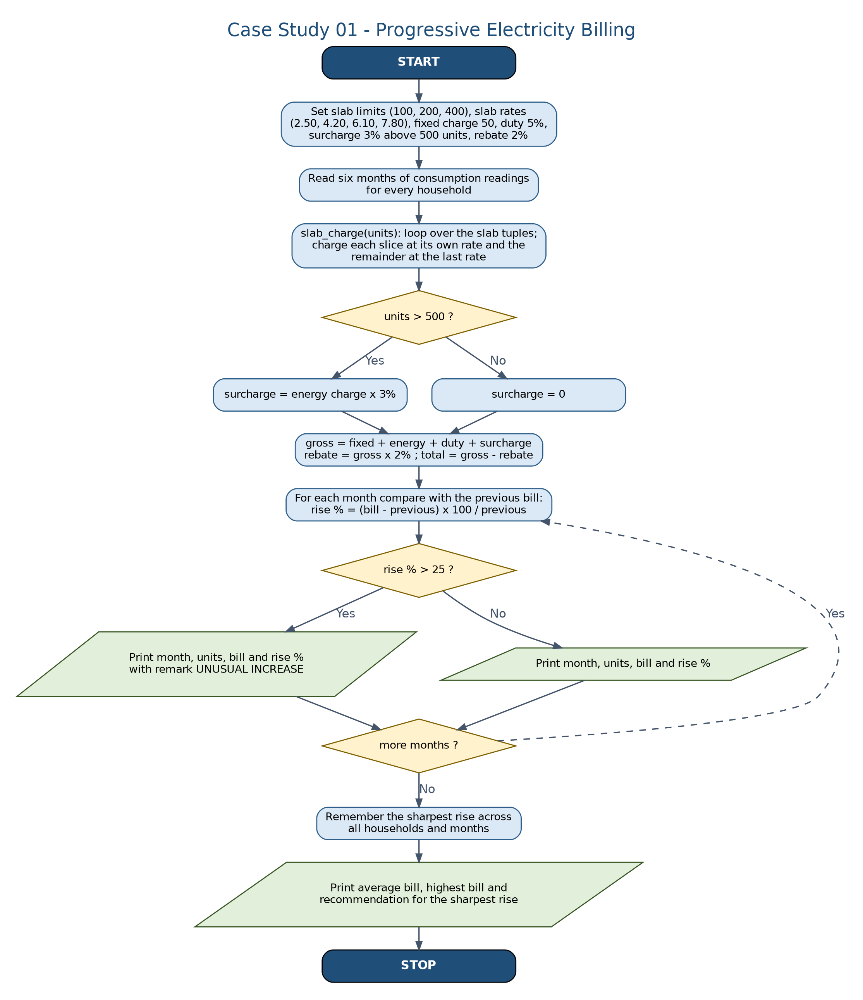
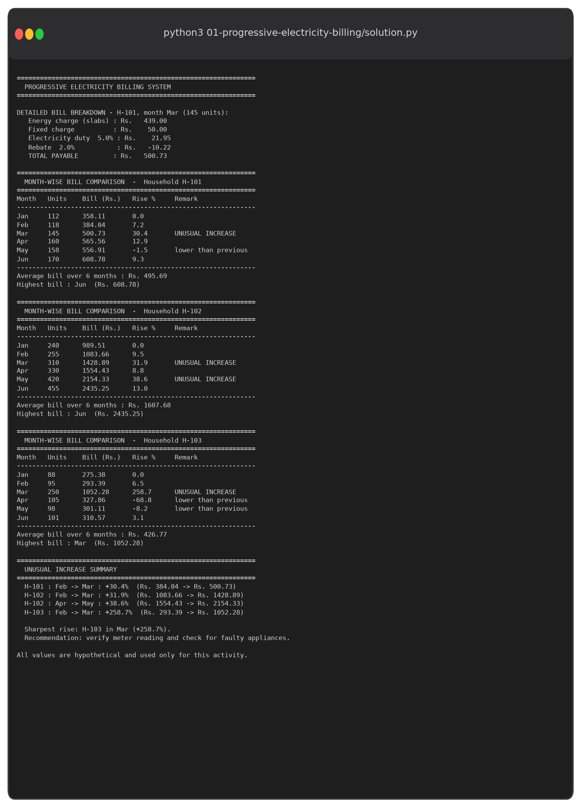

# Case Study 01 — Progressive Electricity Billing

## Problem statement

Calculate household electricity bills using multiple consumption slabs, fixed charges, surcharges and rebates, then compare bills across several months and identify unusual increases.

## Objectives

To apply progressive (slab-wise) charging with conditional statements and loops; to compute duty, surcharge and rebate components using operators; to store monthly readings in lists and slab rules in tuples and unpack them cleanly; and to flag month-on-month bill rises beyond a given percentage.

## Assumptions

- One unit = one kWh and all readings are in whole units.
- Tariff slabs (monthly): first 100 units at Rs 2.50, next 100 at Rs 4.20, next 200 at Rs 6.10, above 400 at Rs 7.80.
- Fixed charge Rs 50 per month; electricity duty 5% of energy charge.
- A surcharge of 3% of the energy charge is applied when consumption exceeds 500 units.
- A prompt-payment rebate of 2% is allowed on the gross bill (fixed + energy + duty + surcharge).
- A month-on-month bill rise greater than 25% is treated as an *unusual increase*.
- All readings and names are hypothetical.

## Algorithm

```
1. START
2. Define constants: FIXED_CHARGE=50, SLAB_LIMITS=(100,200,400),
   SLAB_RATES=(2.50,4.20,6.10,7.80), DUTY=5%, SURCHARGE=3% above 500 units,
   REBATE=2%, UNUSUAL_RISE=25%
3. DEFINE FUNCTION slab_charge(units)
   3.1 charge ← 0, remaining ← units, lower ← 0
   3.2 FOR i ← 0 to len(SLAB_LIMITS)-1 DO
       (upper, rate) ← (SLAB_LIMITS[i], SLAB_RATES[i])
       IF remaining <= 0 THEN BREAK
       slab_units ← min(upper - lower, remaining)
       charge ← charge + slab_units * rate
       remaining ← remaining - slab_units
       lower ← upper
   END FOR
   3.3 IF remaining > 0 THEN charge ← charge + remaining * SLAB_RATES[last]
   3.4 RETURN charge
4. DEFINE FUNCTION compute_bill(units)
   4.1 energy ← slab_charge(units)
   4.2 duty ← energy * 5 / 100
   4.3 IF units > 500 THEN surcharge ← energy * 3 / 100 ELSE surcharge ← 0
   4.4 gross ← FIXED_CHARGE + energy + duty + surcharge
   4.5 rebate ← gross * 2 / 100 ; total ← gross - rebate
   4.6 RETURN (total, breakdown lines)
5. FOR each household DO
   5.1 bills ← empty list ; rises ← empty list
   5.2 FOR each month index i DO
       bill ← compute_bill(CONSUMPTION[i])
       IF i = 0 THEN rise ← 0 ELSE rise ← (bill - bills[i-1]) * 100 / bills[i-1]
       IF rise > 25 THEN remark ← "UNUSUAL INCREASE"
       PRINT month, units, bill, rise, remark
   5.3 PRINT average bill and highest bill
6. Scan every month pair of every household:
   IF rise > 25% THEN PRINT the jump and remember the sharpest one
7. PRINT recommendation for the sharpest rise
8. END
```

## Flowchart



## Pseudocode

```
BEGIN PROGRESSIVE_ELECTRICITY_BILLING

    CONST FIXED_CHARGE    ← 50
    SLAB_LIMITS           ← (100, 200, 400)
    SLAB_RATES            ← (2.50, 4.20, 6.10, 7.80)
    CONST DUTY_PERCENT    ← 5
    CONST SURCHARGE_PCT   ← 3
    CONST SURCHARGE_LIMIT ← 500
    CONST REBATE_PERCENT  ← 2
    CONST UNUSUAL_RISE    ← 25

    FUNCTION slab_charge(units)
        remaining ← units ; charge ← 0 ; lower ← 0
        FOR i ← 0 TO LENGTH(SLAB_LIMITS) - 1 DO
            IF remaining <= 0 THEN EXIT FOR
            upper ← SLAB_LIMITS[i]
            use ← MINIMUM(upper - lower, remaining)
            charge ← charge + use * SLAB_RATES[i]
            remaining ← remaining - use
            lower ← upper
        END FOR
        IF remaining > 0 THEN charge ← charge + remaining * SLAB_RATES[LAST]
        RETURN charge
    END FUNCTION

    FUNCTION compute_bill(units)
        energy ← slab_charge(units)
        duty   ← energy * DUTY_PERCENT / 100
        IF units > SURCHARGE_LIMIT THEN
            surcharge ← energy * SURCHARGE_PCT / 100
        ELSE
            surcharge ← 0
        END IF
        gross  ← FIXED_CHARGE + energy + duty + surcharge
        rebate ← gross * REBATE_PERCENT / 100
        RETURN (gross - rebate)
    END FUNCTION

    FOR each household IN HOUSEHOLDS DO
        bills ← [] ; previous ← 0
        FOR i ← 0 TO LENGTH(MONTHS) - 1 DO
            bill ← compute_bill(CONSUMPTION[household][i])
            IF i = 0 THEN
                rise ← 0
            ELSE
                rise ← (bill - previous) * 100 / previous
            END IF
            IF rise > UNUSUAL_RISE THEN
                PRINT "UNUSUAL INCREASE"
            END IF
            PRINT MONTHS[i], consumption, bill, rise
            APPEND bill TO bills
            previous ← bill
        END FOR
        PRINT AVERAGE(bills), MAXIMUM(bills)
    END FOR

    Find the highest rise across all households and months
    PRINT that household, month and percentage with a recommendation
END
```

## Python source code

```python
"""
Case Study 01: Progressive Electricity Billing
------------------------------------------------
Calculate household bills using multiple consumption slabs, fixed charges,
surcharges and rebates, then compare bills across several months and
identify unusual increases.

Syllabus used: variables, data types, operators, conditional statements,
loops, strings, lists, tuples, tuple operations and tuple unpacking.
No library is imported - only core Python 3 is used.
"""

# ------------------------------------------------------------------
# Tariff and policy constants (hypothetical values for this study)
# ------------------------------------------------------------------
FIXED_CHARGE = 50.0            # Rs. meter / fixed charge per month
SLAB_LIMITS = (100, 200, 400)  # slabs: 0-100, 101-200, 201-400, above 400
SLAB_RATES = (2.50, 4.20, 6.10, 7.80)   # Rs. per unit in each slab
DUTY_PERCENT = 5.0             # electricity duty applied on slab charge
SURCHARGE_PERCENT = 3.0        # extra surcharge when usage > 500 units
SURCHARGE_LIMIT = 500
REBATE_PERCENT = 2.0           # prompt-payment rebate on the total
UNUSUAL_RISE_PERCENT = 25.0    # month-on-month rise treated as unusual

HOUSEHOLDS = ["H-101", "H-102", "H-103"]

# Consumption in units for six successive months (index 0 = month 1)
MONTHS = ["Jan", "Feb", "Mar", "Apr", "May", "Jun"]
CONSUMPTION = [
    (112, 118, 145, 160, 158, 170),   # H-101 - gently rising
    (240, 255, 310, 330, 420, 455),   # H-102 - sudden summer jump
    (88, 95, 250, 105, 98, 101),      # H-103 - one abnormal month
]


def slab_charge(units):
    """Progressive slab calculation using a loop over the slab tuples."""
    remaining = units
    charge = 0.0
    lower = 0
    for i in range(len(SLAB_LIMITS)):
        upper = SLAB_LIMITS[i]
        rate = SLAB_RATES[i]
        if remaining <= 0:
            break
        slab_units = upper - lower
        if remaining < slab_units:
            slab_units = remaining
        charge += slab_units * rate
        remaining -= slab_units
        lower = upper

    if remaining > 0:                      # last open-ended slab
        charge += remaining * SLAB_RATES[-1]

    return charge


def compute_bill(units):
    """Return (bill_amount, breakdown_lines) for one month's consumption."""
    lines = []

    energy = slab_charge(units)
    duty = energy * DUTY_PERCENT / 100.0

    surcharge = 0.0
    if units > SURCHARGE_LIMIT:
        surcharge = energy * SURCHARGE_PERCENT / 100.0

    gross = FIXED_CHARGE + energy + duty + surcharge
    rebate = gross * REBATE_PERCENT / 100.0
    total = gross - rebate

    lines.append("Energy charge (slabs) : Rs. %8.2f" % energy)
    lines.append("Fixed charge          : Rs. %8.2f" % FIXED_CHARGE)
    lines.append("Electricity duty %4.1f%% : Rs. %8.2f" % (DUTY_PERCENT, duty))
    if surcharge > 0:
        lines.append("Surcharge %4.1f%%        : Rs. %8.2f" % (SURCHARGE_PERCENT, surcharge))
    lines.append("Rebate %4.1f%%           : Rs. %8.2f" % (REBATE_PERCENT, -rebate))
    lines.append("TOTAL PAYABLE         : Rs. %8.2f" % total)

    return round(total, 2), lines


def compare_months(household, readings):
    """Print the month-wise comparison and flag unusual increases."""
    print("\n" + "=" * 62)
    print("  MONTH-WISE BILL COMPARISON  -  Household %s" % household)
    print("=" * 62)
    print("%-7s %-8s %-12s %-10s %s" % ("Month", "Units", "Bill (Rs.)", "Rise %", "Remark"))
    print("-" * 62)

    bills = []
    rises = []
    for i in range(len(readings)):
        units = readings[i]
        bill, _ = compute_bill(units)
        bills.append(bill)

        if i == 0:
            rise = 0.0
        else:
            prev = bills[i - 1]
            rise = (bill - prev) * 100.0 / prev
        rises.append(rise)

        remark = ""
        if i > 0 and rise > UNUSUAL_RISE_PERCENT:
            remark = "UNUSUAL INCREASE"
        elif i > 0 and rise < 0:
            remark = "lower than previous"

        print("%-7s %-8d %-12.2f %-10.1f %s" % (MONTHS[i], units, bill, rise, remark))

    print("-" * 62)
    avg = sum(bills) / len(bills)
    print("Average bill over %d months : Rs. %.2f" % (len(bills), avg))

    highest_index = 0
    for i in range(1, len(bills)):
        if bills[i] > bills[highest_index]:
            highest_index = i
    print("Highest bill : %s  (Rs. %.2f)" % (MONTHS[highest_index], bills[highest_index]))

    return bills, rises


def main():
    print("=" * 62)
    print("  PROGRESSIVE ELECTRICITY BILLING SYSTEM")
    print("=" * 62)

    # sample month-wise detail for the first household, full breakdown
    print("\nDETAILED BILL BREAKDOWN - H-101, month Mar (145 units):")
    _, lines = compute_bill(145)
    for line in lines:
        print("   " + line)

    all_bills = []
    for i in range(len(HOUSEHOLDS)):
        bills, rises = compare_months(HOUSEHOLDS[i], CONSUMPTION[i])
        all_bills.append(bills)

    # ------- which household had the sharpest single jump? -------
    print("\n" + "=" * 62)
    print("  UNUSUAL INCREASE SUMMARY")
    print("=" * 62)
    worst_household = ""
    worst_rise = 0.0
    worst_month = ""
    for i in range(len(HOUSEHOLDS)):
        for j in range(1, len(MONTHS)):
            rise = (all_bills[i][j] - all_bills[i][j - 1]) * 100.0 / all_bills[i][j - 1]
            if rise > UNUSUAL_RISE_PERCENT:
                print("  %s : %s -> %s : %+.1f%%  (Rs. %.2f -> Rs. %.2f)"
                      % (HOUSEHOLDS[i], MONTHS[j - 1], MONTHS[j], rise,
                         all_bills[i][j - 1], all_bills[i][j]))
                if rise > worst_rise:
                    worst_rise = rise
                    worst_household = HOUSEHOLDS[i]
                    worst_month = MONTHS[j]

    if worst_rise > 0:
        print("\n  Sharpest rise: %s in %s (%+.1f%%)."
              % (worst_household, worst_month, worst_rise))
        print("  Recommendation: verify meter reading and check for faulty appliances.")
    else:
        print("  No month showed an unusual increase.")

    print("\nAll values are hypothetical and used only for this activity.")


if __name__ == "__main__":
    main()
```

## Test cases

| # | Test | Expected | Result |
|---|------|----------|--------|
| T1 | 50 units, first slab only | Rs 125.00 | PASS |
| T2 | 100 units, exact slab boundary | Rs 250.00 | PASS |
| T3 | 250 units across three slabs | Rs 975.00 | PASS |
| T4 | 500 units including last slab | Rs 2670.00 | PASS |
| T5 | No surcharge at exactly 500 units | duty + fixed − rebate only | PASS |
| T6 | Surcharge applied at 501 units | 3% of energy charge added | PASS |
| T7 | Zero consumption | fixed − rebate = Rs 49.00 | PASS |
| T8 | 181 units costs more than 180 units | strictly increasing | PASS |
| T9 | H-103 March jump | rise > 25% flagged | PASS |
| T10 | H-103 April | bill falls back below March | PASS |

All 10 tests pass when `test_cases.py` is run.

## Output screenshot



## Conclusion

The program computes progressive slab-wise bills correctly and the breakdown shows how each component (energy, fixed, duty, surcharge, rebate) contributes to the total. Comparing six months of readings highlighted the abnormal spikes — H-103's March bill was 258.7% higher than February and settled back to normal in April, while H-102 showed a genuine summer trend. The whole study needed only tuples, lists, loops, conditionals and arithmetic operators from the syllabus.
