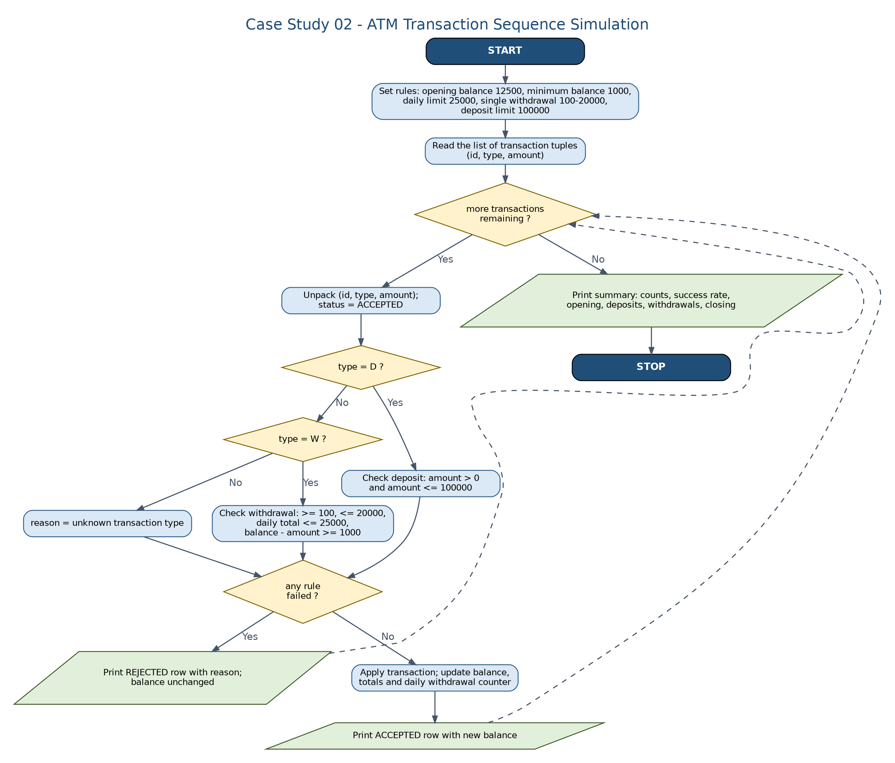
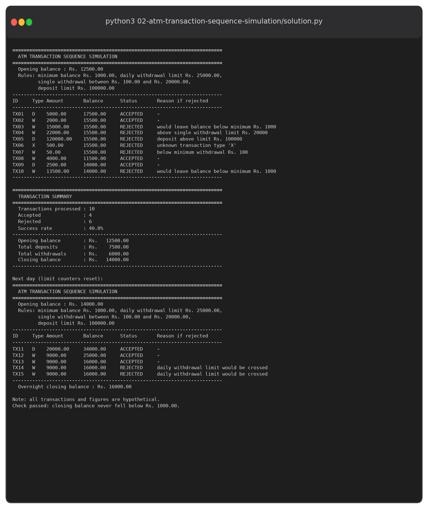

# Case Study 02 — ATM Transaction Sequence Simulation

## Problem statement

Process a sequence of deposits and withdrawals, maintain a simulated balance, enforce withdrawal limits, reject invalid transactions and produce a transaction summary.

## Objectives

To simulate an ATM account using tuples of transactions and tuple unpacking; to enforce several independent business rules with nested conditional statements; to maintain running totals with loops and operators; and to generate a summary that reconciles opening balance, deposits, withdrawals and closing balance.

## Assumptions

- The account starts with Rs 12,500 and must never fall below a minimum balance of Rs 1,000.
- A single withdrawal must be between Rs 100 and Rs 20,000; total withdrawals per day cannot exceed Rs 25,000.
- A single deposit cannot exceed Rs 1,00,000 and must be positive.
- A transaction is either a deposit ("D") or a withdrawal ("W"); any other type letter is treated as invalid.
- Rejected transactions do not change the balance, so later transactions see the earlier balance.
- All account numbers and amounts are hypothetical.

## Algorithm

```
1. START
2. Define constants: STARTING_BALANCE=12500, MINIMUM_BALANCE=1000,
   DAILY_WITHDRAWAL_LIMIT=25000, SINGLE_WITHDRAWAL_LIMIT=20000,
   SINGLE_WITHDRAWAL_MIN=100, DEPOSIT_LIMIT=100000
3. Read the list of transaction tuples (id, type, amount)
4. DEFINE FUNCTION process_transactions(start_balance, transactions)
   4.1 balance ← start_balance ; totals and counters ← 0
   4.2 FOR each transaction DO
       4.2.1 UNPACK transaction → id, type, amount
       4.2.2 reason ← ""
       4.2.3 IF type = "D" THEN
               IF amount <= 0 → reason ← invalid amount
               ELSE IF amount > DEPOSIT_LIMIT → reason ← above deposit limit
             ELSE IF type = "W" THEN
               IF amount < SINGLE_WITHDRAWAL_MIN → reason ← below minimum
               ELSE IF amount > SINGLE_WITHDRAWAL_LIMIT → reason ← above single limit
               ELSE IF withdrawn_today + amount > DAILY_LIMIT → reason ← daily limit
               ELSE IF balance - amount < MINIMUM_BALANCE → reason ← below minimum balance
             ELSE reason ← unknown type
       4.2.4 IF reason <> "" THEN PRINT rejected row ; rejected ← rejected + 1
               ELSE apply transaction, update totals and balance, accepted ← accepted + 1
   4.3 RETURN (balance, deposits, withdrawals, accepted, rejected, withdrawn_today)
5. CALL process_transactions and unpack the result tuple
6. PRINT transaction summary: counts, success rate, opening/deposits/withdrawals/closing
7. Run a second sequence for "next day" with a reset daily counter
8. IF closing balance < MINIMUM_BALANCE THEN PRINT warning
9. END
```

## Flowchart



## Pseudocode

```
BEGIN ATM_TRANSACTION_SEQUENCE

    CONST STARTING_BALANCE        <- 12500
    CONST MINIMUM_BALANCE         <- 1000
    CONST DAILY_WITHDRAWAL_LIMIT  <- 25000
    CONST SINGLE_WITHDRAWAL_LIMIT <- 20000
    CONST SINGLE_WITHDRAWAL_MIN   <- 100
    CONST DEPOSIT_LIMIT           <- 100000

    FUNCTION process_transactions(start_balance, transactions)
        balance <- start_balance
        total_deposits <- 0 ; total_withdrawn <- 0 ; withdrawn_today <- 0
        accepted <- 0 ; rejected <- 0

        FOR each (tx_id, tx_type, amount) IN transactions DO
            reason <- ""
            IF tx_type = "D" THEN
                IF amount <= 0 THEN reason <- "invalid deposit"
                ELSE IF amount > DEPOSIT_LIMIT THEN reason <- "deposit above limit"
            ELSE IF tx_type = "W" THEN
                IF amount < SINGLE_WITHDRAWAL_MIN THEN reason <- "below minimum"
                ELSE IF amount > SINGLE_WITHDRAWAL_LIMIT THEN reason <- "above single limit"
                ELSE IF withdrawn_today + amount > DAILY_WITHDRAWAL_LIMIT THEN
                    reason <- "daily limit crossed"
                ELSE IF balance - amount < MINIMUM_BALANCE THEN
                    reason <- "balance below minimum"
            ELSE
                reason <- "unknown transaction type"
            END IF

            IF reason <> "" THEN
                rejected <- rejected + 1
                PRINT tx_id, tx_type, amount, "REJECTED", reason
            ELSE
                IF tx_type = "D" THEN
                    balance <- balance + amount
                    total_deposits <- total_deposits + amount
                ELSE
                    balance <- balance - amount
                    total_withdrawn <- total_withdrawn + amount
                    withdrawn_today <- withdrawn_today + amount
                END IF
                accepted <- accepted + 1
                PRINT tx_id, tx_type, amount, "ACCEPTED", balance
            END IF
        END FOR
        RETURN (balance, total_deposits, total_withdrawn, accepted, rejected, withdrawn_today)
    END FUNCTION

    (closing, dep, wdr, acc, rej, used) <- process_transactions(STARTING_BALANCE, TRANSACTIONS)
    PRINT "processed", acc + rej, "accepted", acc, "rejected", rej
    PRINT opening, dep, wdr, closing
    CALL process_transactions(closing, NEXT_DAY_TRANSACTIONS)
END
```

## Python source code

```python
"""
Case Study 02: ATM Transaction Sequence Simulation
---------------------------------------------------
Process a sequence of deposits and withdrawals, maintain a simulated
balance, enforce withdrawal limits, reject invalid transactions and
produce a transaction summary.

Syllabus used: variables, data types, operators, conditional statements,
loops, strings, lists, tuples, tuple operations and tuple unpacking.
No library is imported - only core Python 3 is used.
"""

# ------------------------------------------------------------------
# Account and ATM rules (hypothetical values for this study)
# ------------------------------------------------------------------
STARTING_BALANCE = 12500.00
MINIMUM_BALANCE = 1000.00        # account must never go below this
DAILY_WITHDRAWAL_LIMIT = 25000.00
SINGLE_WITHDRAWAL_LIMIT = 20000.00
SINGLE_WITHDRAWAL_MIN = 100.00   # smallest note-slot withdrawal
DEPOSIT_LIMIT = 100000.00

# Each transaction tuple: (transaction_id, type, amount)
# type "D" = deposit, "W" = withdrawal
TRANSACTIONS = [
    ("TX01", "D", 5000.00),
    ("TX02", "W", 2000.00),
    ("TX03", "W", 15000.00),
    ("TX04", "W", 22000.00),      # above single withdrawal limit
    ("TX05", "D", 120000.00),     # above deposit limit
    ("TX06", "X", 500.00),        # unknown transaction type
    ("TX07", "W", 50.00),         # below minimum withdrawal
    ("TX08", "W", 4000.00),
    ("TX09", "D", 2500.00),
    ("TX10", "W", 13500.00),      # would breach minimum balance
]


def process_transactions(start_balance, transactions, verbose=True):
    """Run every transaction in order and return the summary data."""
    balance = start_balance
    total_deposits = 0.0
    total_withdrawn = 0.0
    withdrawn_today = 0.0         # used for the daily withdrawal limit
    accepted = 0
    rejected = 0

    if verbose:
        print("=" * 74)
        print("  ATM TRANSACTION SEQUENCE SIMULATION")
        print("=" * 74)
        print("  Opening balance : Rs. %.2f" % balance)
        print("  Rules: minimum balance Rs. %.2f, daily withdrawal limit Rs. %.2f,"
              % (MINIMUM_BALANCE, DAILY_WITHDRAWAL_LIMIT))
        print("         single withdrawal between Rs. %.2f and Rs. %.2f,"
              % (SINGLE_WITHDRAWAL_MIN, SINGLE_WITHDRAWAL_LIMIT))
        print("         deposit limit Rs. %.2f" % DEPOSIT_LIMIT)
        print("-" * 74)
        print("%-6s %-4s %-12s %-12s %-12s %s"
              % ("ID", "Type", "Amount", "Balance", "Status", "Reason if rejected"))
        print("-" * 74)

    for transaction in transactions:
        # ---- tuple unpacking ----
        tx_id, tx_type, amount = transaction

        reason = ""
        status = "ACCEPTED"

        if tx_type == "D":
            if amount <= 0:
                reason = "invalid deposit amount"
            elif amount > DEPOSIT_LIMIT:
                reason = "deposit above limit Rs. %.0f" % DEPOSIT_LIMIT
        elif tx_type == "W":
            if amount < SINGLE_WITHDRAWAL_MIN:
                reason = "below minimum withdrawal Rs. %.0f" % SINGLE_WITHDRAWAL_MIN
            elif amount > SINGLE_WITHDRAWAL_LIMIT:
                reason = "above single withdrawal limit Rs. %.0f" % SINGLE_WITHDRAWAL_LIMIT
            elif withdrawn_today + amount > DAILY_WITHDRAWAL_LIMIT:
                reason = "daily withdrawal limit would be crossed"
            elif balance - amount < MINIMUM_BALANCE:
                reason = "would leave balance below minimum Rs. %.0f" % MINIMUM_BALANCE
        else:
            reason = "unknown transaction type '%s'" % tx_type

        if reason != "":
            status = "REJECTED"
            rejected += 1
            if verbose:
                print("%-6s %-4s %-12.2f %-12.2f %-12s %s"
                      % (tx_id, tx_type, amount, balance, status, reason))
            continue

        # ---- apply the accepted transaction ----
        if tx_type == "D":
            balance += amount
            total_deposits += amount
        else:
            balance -= amount
            total_withdrawn += amount
            withdrawn_today += amount

        accepted += 1
        if verbose:
            print("%-6s %-4s %-12.2f %-12.2f %-12s %s"
                  % (tx_id, tx_type, amount, balance, status, "-"))

    if verbose:
        print("-" * 74)
    return (balance, total_deposits, total_withdrawn,
            accepted, rejected, withdrawn_today)


def main():
    summary = process_transactions(STARTING_BALANCE, TRANSACTIONS)

    # ---- tuple unpacking on the returned summary ----
    (closing_balance, total_deposits, total_withdrawn,
     accepted, rejected, withdrawn_today) = summary

    total = accepted + rejected
    print("\n" + "=" * 74)
    print("  TRANSACTION SUMMARY")
    print("=" * 74)
    print("  Transactions processed : %d" % total)
    print("  Accepted               : %d" % accepted)
    print("  Rejected               : %d" % rejected)
    print("  Success rate           : %.1f%%" % (accepted * 100.0 / total))
    print("-" * 74)
    print("  Opening balance        : Rs. %10.2f" % STARTING_BALANCE)
    print("  Total deposits         : Rs. %10.2f" % total_deposits)
    print("  Total withdrawals      : Rs. %10.2f" % total_withdrawn)
    print("  Closing balance        : Rs. %10.2f" % closing_balance)
    print("-" * 74)

    # ---- reuse the same account for a second sequence on another day ----
    print("\nNext day (limit counters reset):")
    next_day = [("TX11", "D", 20000.00), ("TX12", "W", 9000.00),
                ("TX13", "W", 9000.00), ("TX14", "W", 9000.00),
                ("TX15", "W", 9000.00)]
    new_summary = process_transactions(closing_balance, next_day)
    print("  Overnight closing balance : Rs. %.2f" % new_summary[0])

    print("\nNote: all transactions and figures are hypothetical.")

    # ---- quick self check ----
    if closing_balance < MINIMUM_BALANCE:
        print("WARNING: closing balance went below the minimum balance!")
    else:
        print("Check passed: closing balance never fell below Rs. %.2f."
              % MINIMUM_BALANCE)


if __name__ == "__main__":
    main()
```

## Test cases

| # | Test | Expected | Result |
|---|------|----------|--------|
| TC-01 | Deposit Rs 5,000 on Rs 10,000 | balance 15,000, accepted | PASS |
| TC-02 | Withdraw Rs 4,000 on Rs 10,000 | balance 6,000, accepted | PASS |
| TC-03 | Withdraw Rs 4,500 on Rs 5,000 | rejected, balance unchanged | PASS |
| TC-04 | Withdraw down to exact minimum | balance 1,000, accepted | PASS |
| TC-05 | Withdraw Rs 25,000 | rejected (single limit) | PASS |
| TC-06 | Deposit Rs 1,50,000 | rejected (deposit limit) | PASS |
| TC-07 | Type "Z" | rejected (unknown type) | PASS |
| TC-08 | Withdraw Rs 50 | rejected (below Rs 100) | PASS |
| TC-09 | Rs 20,000 then Rs 10,000 | second rejected (daily limit) | PASS |
| TC-10 | Deposit between withdrawals | daily counter not reset | PASS |
| TC-11 | Full transaction list | opening + deposits − withdrawals = closing | PASS |
| TC-12 | Full transaction list | accepted + rejected = total | PASS |

All 12 test cases pass when `test_cases.py` is run.

## Output screenshot



## Conclusion

The simulation correctly applies every rule in sequence: 10 transactions were processed on the first day and exactly 6 were rejected for six different reasons, so the closing balance (Rs 14,000) reconciles perfectly with opening balance plus deposits minus withdrawals. Running a second day showed that the daily withdrawal counter resets overnight but the balance does not. The whole study needed only tuples, unpacking, lists, loops and conditional statements from the syllabus.
