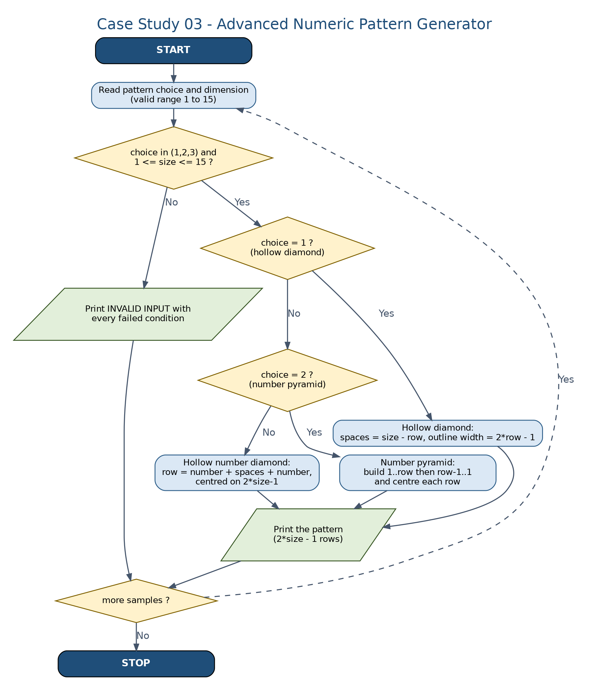
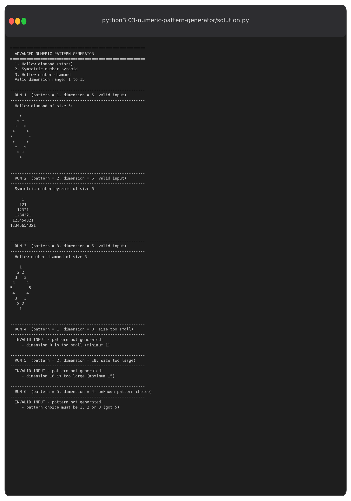

# Case Study 03 — Advanced Numeric Pattern Generator

## Problem statement

Produce a hollow diamond or a symmetric numerical pattern based on a user-specified dimension, with validation for invalid dimensions and carefully aligned output.

## Objectives

To build nested loops that control rows and columns; to compute leading spaces with operators so every row is aligned; to generate symmetric number sequences with counting loops; and to validate user input and explain each rejection.

## Assumptions

- Three patterns are supported: hollow diamond (choice 1), symmetric number pyramid (choice 2) and hollow number diamond (choice 3).
- The dimension must be a whole number between 1 and 15; anything outside that range is rejected before any pattern is printed.
- A pattern of dimension *n* has exactly *2n − 1* rows.
- Output is assumed to be viewed in a monospace font so spaces line up.
- The sample runs in `main()` are used as the demonstration input.

## Algorithm

```
1. START
2. Define MIN_DIMENSION=1, MAX_DIMENSION=15
3. DEFINE FUNCTION validate(choice, size)
   3.1 errors ← empty list
   3.2 IF choice not in (1,2,3) THEN append "invalid pattern choice"
   3.3 IF size < 1 THEN append "too small"
       ELSE IF size > 15 THEN append "too large"
   3.4 RETURN errors
4. DEFINE FUNCTION diamond_row(row, size)
   4.1 inside ← 2*row - 1
   4.2 IF inside = 1 THEN RETURN spaces(size-row) + "*"
   4.3 RETURN spaces(size-row) + "*" + spaces(inside-2) + "*"
5. DEFINE FUNCTION hollow_diamond(size)
   5.1 FOR row ← 1 to size DO PRINT diamond_row(row, size)
   5.2 FOR row ← size-1 down to 1 DO PRINT diamond_row(row, size)
6. DEFINE FUNCTION number_pyramid(size)
   6.1 width ← 2*size - 1
   6.2 FOR row ← 1 to size DO
       6.2.1 line ← "1..row" then "row-1..1"
       6.2.2 PRINT centre(line, width)
7. DEFINE FUNCTION hollow_number_diamond(size)
   7.1 FOR row ← 1 to size DO
       IF row = 1 THEN PRINT centre("1", 2*size-1)
       ELSE PRINT centre(str(row) + spaces(2*row-3) + str(row), 2*size-1)
   7.2 Repeat for row ← size-1 down to 1
8. DEFINE FUNCTION generate(choice, size)
   8.1 errors ← validate(choice, size)
   8.2 IF errors not empty THEN PRINT every error ; RETURN False
   8.3 Call the pattern function for the chosen choice
   8.4 RETURN True
9. FOR each sample (choice, size) DO PRINT heading ; CALL generate(...)
10. END
```

## Flowchart



## Pseudocode

```
BEGIN NUMERIC_PATTERN_GENERATOR

    CONST MIN_DIMENSION <- 1
    CONST MAX_DIMENSION <- 15

    FUNCTION validate(choice, size)
        errors <- []
        IF choice NOT IN (1, 2, 3) THEN
            APPEND "pattern choice must be 1, 2 or 3" TO errors
        END IF
        IF size < MIN_DIMENSION THEN
            APPEND "dimension too small" TO errors
        ELSE IF size > MAX_DIMENSION THEN
            APPEND "dimension too large" TO errors
        END IF
        RETURN errors
    END FUNCTION

    FUNCTION hollow_diamond(size)
        FOR row <- 1 TO size DO
            inside <- 2 * row - 1
            IF inside = 1 THEN
                PRINT SPACES(size - row) + "*"
            ELSE
                PRINT SPACES(size - row) + "*" + SPACES(inside - 2) + "*"
            END IF
        END FOR
        FOR row <- size - 1 DOWNTO 1 DO
            same as above
        END FOR
    END FUNCTION

    FUNCTION number_pyramid(size)
        width <- 2 * size - 1
        FOR row <- 1 TO size DO
            line <- ""
            FOR num <- 1 TO row DO line <- line + STRING(num) END FOR
            FOR num <- row - 1 DOWNTO 1 DO line <- line + STRING(num) END FOR
            PRINT CENTRE(line, width)
        END FOR
    END FUNCTION

    FUNCTION hollow_number_diamond(size)
        FOR row <- 1 TO size DO
            IF row = 1 THEN
                PRINT CENTRE("1", 2 * size - 1)
            ELSE
                PRINT CENTRE(STRING(row) + SPACES(2 * row - 3) + STRING(row),
                             2 * size - 1)
            END IF
        END FOR
        FOR row <- size - 1 DOWNTO 1 DO
            same as above
        END FOR
    END FUNCTION

    FUNCTION generate(choice, size)
        errors <- validate(choice, size)
        IF LENGTH(errors) > 0 THEN
            PRINT "INVALID INPUT"
            FOR each err IN errors DO PRINT err END FOR
            RETURN FALSE
        END IF
        IF choice = 1 THEN hollow_diamond(size)
        ELSE IF choice = 2 THEN number_pyramid(size)
        ELSE hollow_number_diamond(size)
        END IF
        RETURN TRUE
    END FUNCTION

    FOR each sample IN SAMPLES DO
        PRINT heading
        generate(sample.choice, sample.size)
    END FOR
END
```

## Python source code

```python
"""
Case Study 03: Advanced Numeric Pattern Generator
--------------------------------------------------
Produce a hollow diamond or a symmetric numerical pattern based on a
user-specified dimension, with validation for invalid dimensions and
carefully aligned output.

Syllabus used: variables, data types, operators, conditional statements,
loops, strings, pattern generation, lists.
No library is imported - only core Python 3 is used.

Pattern choice:
    1 = hollow diamond (stars)
    2 = symmetric number pyramid (1, 121, 12321, ...)
    3 = hollow number diamond
Anything else is reported as an invalid choice.
"""

# ---------------- validation limits ----------------
MIN_DIMENSION = 1
MAX_DIMENSION = 15         # kept moderate so the output stays aligned on screen


def validate(choice, size):
    """Check the user input and return a list of error messages."""
    errors = []

    if choice not in (1, 2, 3):
        errors.append("pattern choice must be 1, 2 or 3 (got %s)" % choice)

    if size < MIN_DIMENSION:
        errors.append("dimension %d is too small (minimum %d)"
                      % (size, MIN_DIMENSION))
    elif size > MAX_DIMENSION:
        errors.append("dimension %d is too large (maximum %d)"
                      % (size, MAX_DIMENSION))

    return errors


def diamond_row(row, size):
    """One row of a hollow diamond outline: leading spaces then outline."""
    inside = 2 * row - 1
    if inside == 1:
        return " " * (size - row) + "*"
    return " " * (size - row) + "*" + " " * (inside - 2) + "*"


def hollow_diamond(size):
    """Print a hollow diamond of stars with 2*size-1 rows."""
    for row in range(1, size + 1):
        print(diamond_row(row, size).rstrip())
    for row in range(size - 1, 0, -1):
        print(diamond_row(row, size).rstrip())


def number_pyramid(size):
    """Print rows 1, 121, 12321, ... up to size, perfectly centred.

    Each number occupies exactly one character, so centring on the
    widest row keeps every row aligned under a monospace font.
    """
    width = 2 * size - 1
    for row in range(1, size + 1):
        line = ""
        for num in range(1, row + 1):
            line += str(num % 10)          # keep one character per cell
        for num in range(row - 1, 0, -1):
            line += str(num % 10)
        print(line.center(width).rstrip())


def hollow_number_diamond(size):
    """Hollow diamond whose outline rows carry the row number.

    Every outline row has exactly 2*row-1 characters (row number,
    spaces, row number), so centring on 2*size-1 aligns all rows.
    """
    for row in range(1, size + 1):
        label = str(row % 10)
        if row == 1:
            line = label.center(2 * size - 1)
        else:
            line = label + " " * (2 * row - 3) + label
            line = line.center(2 * size - 1)
        print(line.rstrip())

    for row in range(size - 1, 0, -1):
        label = str(row % 10)
        if row == 1:
            line = label.center(2 * size - 1)
        else:
            line = label + " " * (2 * row - 3) + label
            line = line.center(2 * size - 1)
        print(line.rstrip())


def generate(choice, size):
    """Validate and then generate the requested pattern."""
    errors = validate(choice, size)
    if len(errors) > 0:
        print("  INVALID INPUT - pattern not generated:")
        for err in errors:
            print("     - %s" % err)
        return False

    if choice == 1:
        print("  Hollow diamond of size %d:" % size)
        print()
        hollow_diamond(size)
    elif choice == 2:
        print("  Symmetric number pyramid of size %d:" % size)
        print()
        number_pyramid(size)
    else:
        print("  Hollow number diamond of size %d:" % size)
        print()
        hollow_number_diamond(size)

    print()
    return True


def main():
    print("=" * 58)
    print("  ADVANCED NUMERIC PATTERN GENERATOR")
    print("=" * 58)
    print("  1. Hollow diamond (stars)")
    print("  2. Symmetric number pyramid")
    print("  3. Hollow number diamond")
    print("  Valid dimension range: %d to %d" % (MIN_DIMENSION, MAX_DIMENSION))

    # Three sample runs demonstrate the patterns; three more demonstrate
    # the validation messages for invalid dimensions and choices.
    samples = [
        (1, 5, "valid input"),
        (2, 6, "valid input"),
        (3, 5, "valid input"),
        (1, 0, "size too small"),
        (2, 18, "size too large"),
        (5, 4, "unknown pattern choice"),
    ]

    for i in range(len(samples)):
        choice, size, note = samples[i]
        print("\n" + "-" * 58)
        print("  RUN %d  (pattern = %d, dimension = %d, %s)"
              % (i + 1, choice, size, note))
        print("-" * 58)
        generate(choice, size)


if __name__ == "__main__":
    main()
```

## Test cases

| # | Test | Expected | Result |
|---|------|----------|--------|
| TC-01 | choice 1, size 5 | accepted | PASS |
| TC-02 | size 0 | rejected (too small) | PASS |
| TC-03 | size −3 | rejected (too small) | PASS |
| TC-04 | size 18 | rejected (too large) | PASS |
| TC-05 | choice 5 | rejected (unknown pattern) | PASS |
| TC-06 | choice 5, size 0 | two errors reported | PASS |
| TC-07 | diamond size 5 | exactly 9 rows | PASS |
| TC-08 | diamond rows | symmetric top-to-bottom | PASS |
| TC-09 | diamond size 5 | middle row widest | PASS |
| TC-10 | pyramid row 3 | reads 12321 | PASS |
| TC-11 | pyramid size 6 | 6 rows, last row longest | PASS |
| TC-12 | pyramid row 6 | reads 12345654321 | PASS |
| TC-13 | number diamond size 5 | exactly 9 rows | PASS |
| TC-14 | number diamond rows | symmetric top-to-bottom | PASS |
| TC-15 | generate(1, 0) | returns False | PASS |
| TC-16 | generate(1, 5) | returns True | PASS |

All 16 test cases pass when `test_cases.py` is run.

## Output screenshot



## Conclusion

The generator builds three different patterns from the same two-loop skeleton and validates every input before printing. All invalid cases (size 0, size 18, choice 5) were rejected with clear reasons and produced no partial pattern. Building the rows from a computed number of leading spaces and using `center()` kept every row aligned, even when the numbers reached 11 digits in the size-6 pyramid.
