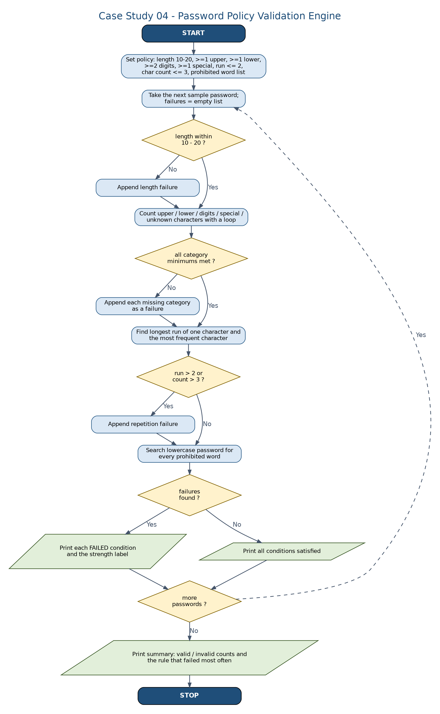
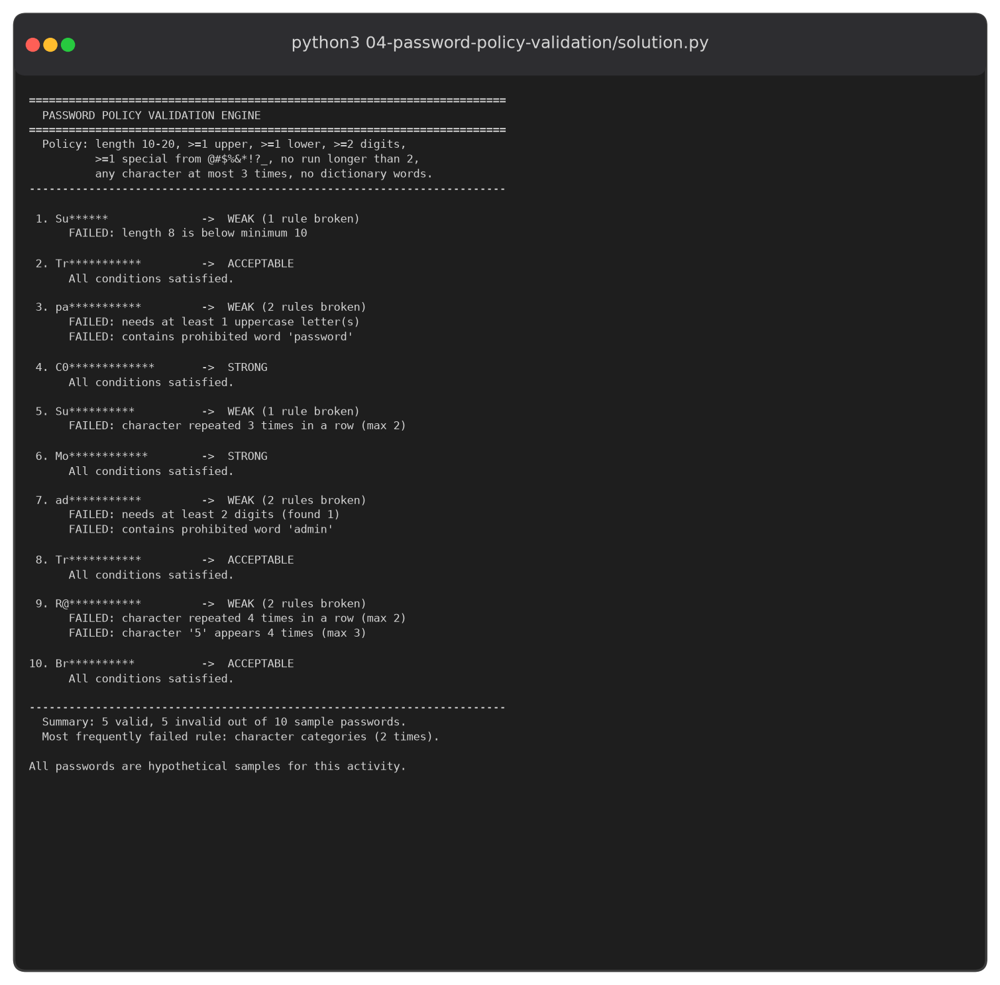

# Case Study 04 — Password Policy Validation Engine

## Problem statement

Evaluate sample password strings against minimum length, character-category, repetition and prohibited-substring rules, and explain each failed condition.

## Objectives

To apply string traversal and comparisons to classify every character; to implement four independent policy rules with conditional statements; to detect runs and frequency of repeated characters with loops; and to produce a human-readable explanation for each failure instead of a single "invalid" message.

## Assumptions

- Password length must be between 10 and 20 characters inclusive.
- At least one uppercase letter and one lowercase letter are required.
- At least two digits and at least one special character from `@#$%&*!?_` are required.
- No character may repeat more than twice consecutively, and no character may appear more than three times in the whole password.
- A short dictionary of prohibited words is checked case-insensitively: password, admin, welcome, 12345, qwerty, letmein.
- Only the characters listed above are considered allowed; anything else (space, hyphen, tilde) is reported as an unknown character.
- All passwords are hypothetical samples.

## Algorithm

```
1. START
2. Define policy constants and the PROHIBITED_WORDS list
3. DEFINE FUNCTION count_categories(password)
   3.1 upper, lower, digits, specials, others ← 0
   3.2 FOR each character ch in password DO
       IF ch is A-Z → upper ← upper + 1
       ELSE IF ch is a-z → lower ← lower + 1
       ELSE IF ch is 0-9 → digits ← digits + 1
       ELSE IF ch in SPECIAL_CHARS → specials ← specials + 1
       ELSE others ← others + 1
   3.3 RETURN (upper, lower, digits, specials, others)
4. DEFINE FUNCTION max_run_length(password)
   4.1 longest ← 1, current ← 1
   4.2 FOR i ← 1 to len(password)-1 DO
       IF password[i] = password[i-1] THEN current ← current + 1
            IF current > longest THEN longest ← current
       ELSE current ← 1
   4.3 RETURN longest
5. DEFINE FUNCTION most_repeated_character(password)
   5.1 FOR each distinct character DO count its occurrences
   5.2 RETURN the character with the highest count
6. DEFINE FUNCTION find_prohibited(password)
   6.1 Convert password to lowercase
   6.2 FOR each word in PROHIBITED_WORDS DO
       IF word is inside the lowercase password THEN add word to found
   6.3 RETURN found
7. DEFINE FUNCTION validate_password(password)
   7.1 failures ← empty list
   7.2 Check length lower/upper bounds → append reasons
   7.3 Check the four category minimums and the unknown-character count
   7.4 Check max run length and max frequency → append reasons
   7.5 Check prohibited words → append one reason per word
   7.6 RETURN failures
8. FOR each sample password DO
   8.1 PRINT masked password and strength label
   8.2 IF failures empty THEN PRINT "all conditions satisfied"
       ELSE PRINT every failure line
9. PRINT summary counts and the rule that failed most often
10. END
```

## Flowchart



## Pseudocode

```
BEGIN PASSWORD_POLICY_VALIDATION

    CONST MIN_LENGTH     <- 10
    CONST MAX_LENGTH     <- 20
    CONST MIN_UPPER      <- 1
    CONST MIN_LOWER      <- 1
    CONST MIN_DIGITS     <- 2
    CONST MIN_SPECIALS   <- 1
    SPECIAL_CHARS        <- "@#$%&*!?_"
    CONST MAX_REPEAT_RUN <- 2
    CONST MAX_REPEATED   <- 3
    PROHIBITED_WORDS     <- ["password","admin","welcome","12345","qwerty","letmein"]

    FUNCTION validate_password(password)
        failures <- []

        IF LENGTH(password) < MIN_LENGTH THEN
            APPEND "length below minimum" TO failures
        ELSE IF LENGTH(password) > MAX_LENGTH THEN
            APPEND "length above maximum" TO failures
        END IF

        (upper, lower, digits, specials, others) <- count_categories(password)
        IF upper   < MIN_UPPER    THEN APPEND "needs uppercase"  TO failures
        IF lower   < MIN_LOWER    THEN APPEND "needs lowercase"  TO failures
        IF digits  < MIN_DIGITS   THEN APPEND "needs 2 digits"   TO failures
        IF specials < MIN_SPECIALS THEN APPEND "needs special"   TO failures
        IF others > 0              THEN APPEND "unknown character" TO failures

        IF max_run_length(password) > MAX_REPEAT_RUN THEN
            APPEND "character repeated too many times in a row" TO failures
        END IF
        (ch, count) <- most_repeated_character(password)
        IF count > MAX_REPEATED THEN
            APPEND "character appears too many times" TO failures
        END IF

        FOR each word IN find_prohibited(password) DO
            APPEND "contains prohibited word" TO failures
        END FOR

        RETURN failures
    END FUNCTION

    valid <- 0 ; invalid <- 0
    FOR each password IN PASSWORDS DO
        failures <- validate_password(password)
        PRINT MASK(password), strength_label(failures, password)
        IF LENGTH(failures) = 0 THEN
            valid <- valid + 1
            PRINT "all conditions satisfied"
        ELSE
            invalid <- invalid + 1
            FOR each f IN failures DO PRINT "FAILED:", f END FOR
        END IF
    END FOR
    PRINT summary
END
```

## Python source code

```python
"""
Case Study 04: Password Policy Validation Engine
-------------------------------------------------
Evaluate sample password strings against minimum length, character
category, repetition and prohibited-substring rules, and explain each
failed condition.

Syllabus used: variables, data types, operators, conditional statements,
loops, strings and string methods, lists.
No library is imported - only core Python 3 is used.
"""

# ------------------------------------------------------------------
# Policy constants (hypothetical values chosen for this study)
# ------------------------------------------------------------------
MIN_LENGTH = 10
MAX_LENGTH = 20
MIN_UPPER = 1
MIN_LOWER = 1
MIN_DIGITS = 2
MIN_SPECIALS = 1
SPECIAL_CHARS = "@#$%&*!?_"
MAX_REPEAT_RUN = 2           # same character at most twice in a row
MAX_REPEATED_CODE = 3        # any character may appear at most 3 times
PROHIBITED_WORDS = ["password", "admin", "welcome", "12345", "qwerty", "letmein"]

# Sample passwords - a mix of good and deliberately bad ones
PASSWORDS = [
    "Sun@2024",              # too short (8) and only one digit
    "Tr@ilBlazer99",         # fully valid
    "password@1234",         # prohibited word, no uppercase
    "C0mpLex@Pass_88",       # valid and long
    "Super@Aaaa11",          # 'aaaa' run of four
    "Monsoon#Rain77",        # valid
    "admin#Secure1",         # prohibited word and only one digit
    "Tr@ilBlazer99",         # repeat of a valid password, still valid
    "R@inyDay_5555",         # run of four 5s, '5' appears four times
    "Breezy@Sky42",          # valid
]


def count_categories(password):
    """Count how many characters belong to each category."""
    upper = 0
    lower = 0
    digits = 0
    specials = 0
    others = 0

    for ch in password:
        if "A" <= ch <= "Z":
            upper += 1
        elif "a" <= ch <= "z":
            lower += 1
        elif "0" <= ch <= "9":
            digits += 1
        elif ch in SPECIAL_CHARS:
            specials += 1
        else:
            others += 1

    return upper, lower, digits, specials, others


def max_run_length(password):
    """Longest run of the same character repeated consecutively."""
    if len(password) == 0:
        return 0
    longest = 1
    current = 1
    for i in range(1, len(password)):
        if password[i] == password[i - 1]:
            current += 1
            if current > longest:
                longest = current
        else:
            current = 1
    return longest


def most_repeated_character(password):
    """Return (character, count) of the most frequent character."""
    best_char = ""
    best_count = 0
    checked = ""
    for i in range(len(password)):
        ch = password[i]
        if ch in checked:
            continue
        checked += ch
        count = 0
        for c in password:
            if c == ch:
                count += 1
        if count > best_count:
            best_count = count
            best_char = ch
    return best_char, best_count


def find_prohibited(password):
    """List any prohibited substrings present (case-insensitive)."""
    lowered = ""
    for ch in password:
        if "A" <= ch <= "Z":
            lowered += chr(ord(ch) + 32)
        else:
            lowered += ch

    found = []
    for word in PROHIBITED_WORDS:
        if word in lowered:
            found.append(word)
    return found


def validate_password(password):
    """Return the list of failed conditions (empty list = valid)."""
    failures = []

    # ---- rule 1: length ----
    if len(password) < MIN_LENGTH:
        failures.append("length %d is below minimum %d" % (len(password), MIN_LENGTH))
    elif len(password) > MAX_LENGTH:
        failures.append("length %d is above maximum %d" % (len(password), MAX_LENGTH))

    # ---- rule 2: character categories ----
    upper, lower, digits, specials, others = count_categories(password)

    if upper < MIN_UPPER:
        failures.append("needs at least %d uppercase letter(s)" % MIN_UPPER)
    if lower < MIN_LOWER:
        failures.append("needs at least %d lowercase letter(s)" % MIN_LOWER)
    if digits < MIN_DIGITS:
        failures.append("needs at least %d digits (found %d)" % (MIN_DIGITS, digits))
    if specials < MIN_SPECIALS:
        failures.append("needs at least %d special character(s) from %s"
                        % (MIN_SPECIALS, SPECIAL_CHARS))
    if others > 0:
        failures.append("contains %d character(s) outside the allowed set" % others)

    # ---- rule 3: repetition ----
    run = max_run_length(password)
    if run > MAX_REPEAT_RUN:
        failures.append("character repeated %d times in a row (max %d)"
                        % (run, MAX_REPEAT_RUN))

    rep_char, rep_count = most_repeated_character(password)
    if rep_count > MAX_REPEATED_CODE:
        failures.append("character '%s' appears %d times (max %d)"
                        % (rep_char, rep_count, MAX_REPEATED_CODE))

    # ---- rule 4: prohibited substrings ----
    found = find_prohibited(password)
    if len(found) > 0:
        for word in found:
            failures.append("contains prohibited word '%s'" % word)

    return failures


def strength_label(failures, password):
    """Simple descriptive label based on how many rules were broken."""
    if len(failures) == 0:
        if len(password) >= 14:
            return "STRONG"
        return "ACCEPTABLE"
    elif len(failures) == 1:
        return "WEAK (1 rule broken)"
    elif len(failures) <= 3:
        return "WEAK (%d rules broken)" % len(failures)
    return "VERY WEAK (%d rules broken)" % len(failures)


def mask(password):
    """Show the first two characters and hide the remainder."""
    if len(password) <= 2:
        return password
    return password[0:2] + "*" * (len(password) - 2)


def main():
    print("=" * 72)
    print("  PASSWORD POLICY VALIDATION ENGINE")
    print("=" * 72)
    print("  Policy: length %d-%d, >=%d upper, >=%d lower, >=%d digits,"
          % (MIN_LENGTH, MAX_LENGTH, MIN_UPPER, MIN_LOWER, MIN_DIGITS))
    print("          >=%d special from %s, no run longer than %d,"
          % (MIN_SPECIALS, SPECIAL_CHARS, MAX_REPEAT_RUN))
    print("          any character at most %d times, no dictionary words."
          % MAX_REPEATED_CODE)
    print("-" * 72)

    valid_count = 0
    invalid_count = 0

    for i in range(len(PASSWORDS)):
        password = PASSWORDS[i]
        failures = validate_password(password)
        label = strength_label(failures, password)

        print("\n%2d. %-20s  ->  %s" % (i + 1, mask(password), label))

        if len(failures) == 0:
            valid_count += 1
            print("      All conditions satisfied.")
        else:
            invalid_count += 1
            for f in failures:
                print("      FAILED: %s" % f)

    print("\n" + "-" * 72)
    print("  Summary: %d valid, %d invalid out of %d sample passwords."
          % (valid_count, invalid_count, len(PASSWORDS)))

    # ---- report which rule fails most often ----
    rule_tally = [0, 0, 0, 0]
    for password in PASSWORDS:
        upper, lower, digits, specials, others = count_categories(password)
        if len(password) < MIN_LENGTH or len(password) > MAX_LENGTH:
            rule_tally[0] += 1
        if (upper < MIN_UPPER or lower < MIN_LOWER or digits < MIN_DIGITS
                or specials < MIN_SPECIALS or others > 0):
            rule_tally[1] += 1
        if max_run_length(password) > MAX_REPEAT_RUN:
            rule_tally[2] += 1
        if len(find_prohibited(password)) > 0:
            rule_tally[3] += 1

    rule_names = ["length", "character categories", "repetition", "prohibited words"]
    worst = 0
    for i in range(1, 4):
        if rule_tally[i] > rule_tally[worst]:
            worst = i
    print("  Most frequently failed rule: %s (%d times)."
          % (rule_names[worst], rule_tally[worst]))
    print("\nAll passwords are hypothetical samples for this activity.")


if __name__ == "__main__":
    main()
```

## Test cases

| # | Test | Expected | Result |
|---|------|----------|--------|
| TC-01 | `Tr@ilBlazer99` | valid | PASS |
| TC-02 | `Sun@2024` | length failure | PASS |
| TC-03 | 22-character password | length failure | PASS |
| TC-04 | `password@1234` | uppercase + prohibited word | PASS |
| TC-05 | `Monsoon#Rain1` | two-digit rule failure | PASS |
| TC-06 | `MonsoonRain77` | special character failure | PASS |
| TC-07 | `Super@Aaaa11` | 3-in-a-row failure | PASS |
| TC-08 | `R@inyDay_5555` | max-frequency failure | PASS |
| TC-09 | `PASSWORD@2024` | prohibited word (case-insensitive) | PASS |
| TC-10 | all six prohibited words | every one caught | PASS |
| TC-11 | `max_run_length('aabbbbcc')` | 4 | PASS |
| TC-12 | `max_run_length('')` | 0 | PASS |
| TC-13 | `most_repeated_character('aabbbbcc')` | ('b', 4) | PASS |
| TC-14 | `count_categories('Ab1@x')` | (1, 2, 1, 1, 0) | PASS |
| TC-15 | `Ab1@x~` | unknown character reported | PASS |
| TC-16 | sample list | exactly 5 of 10 valid | PASS |

All 16 test cases pass when `test_cases.py` is run.

## Output screenshot



## Conclusion

The engine evaluates every sample password against all four rule groups and lists each broken condition separately, which makes the result easy to act on. Of the ten samples, five were valid; the most frequent problem was a missing character category. The repetition checks (consecutive run and overall frequency) correctly separated `Super@Aaaa11` from `R@inyDay_5555`, which break different repetition rules. Only string methods, loops, conditionals and lists were needed.
