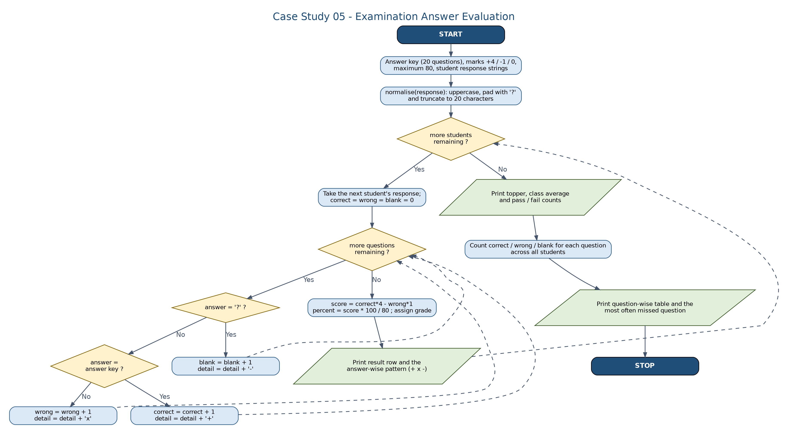
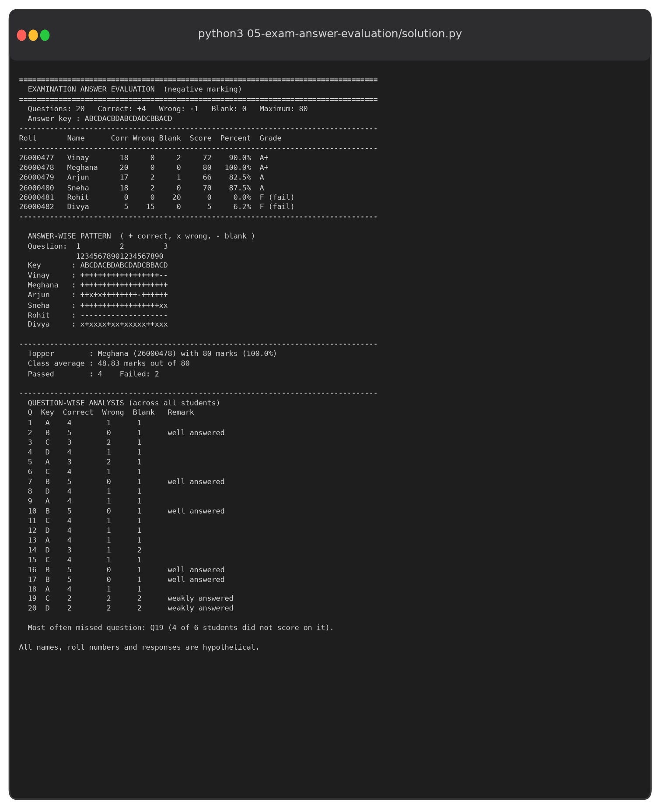

# Case Study 05 — String-Based Examination Answer Evaluation

## Problem statement

Compare answer strings against an answer key, calculate correct, incorrect and unanswered responses, apply negative marking and produce student-wise results.

## Objectives

To index and compare characters of two strings with loops; to classify each response as correct, wrong or blank using conditional statements; to apply a marking scheme with negative marks; and to summarise results per student, per question and for the class as a whole.

## Assumptions

- The paper has 20 multiple-choice questions with options A, B, C and D.
- Marking scheme: correct +4, wrong −1, blank 0, so the maximum is 80 marks.
- An unanswered question is written as `?`; a blank position in a short string is also treated as unanswered.
- Lowercase answers are accepted after conversion to uppercase.
- A response shorter than 20 characters is padded with `?` and a longer one is truncated to the first 20.
- Pass mark is 40% of the maximum. All students, roll numbers and responses are hypothetical.

## Algorithm

```
1. START
2. Define ANSWER_KEY (20 characters), marks constants and STUDENTS list
3. DEFINE FUNCTION normalise(response)
   3.1 Convert every lowercase letter to uppercase
   3.2 Pad with '?' until length is 20 ; truncate if longer
   3.3 RETURN the fixed string
4. DEFINE FUNCTION evaluate(response)
   4.1 ans ← normalise(response)
   4.2 correct, wrong, blank ← 0
   4.3 FOR i ← 0 to 19 DO
       given ← ans[i] ; expected ← ANSWER_KEY[i]
       IF given = '?' THEN blank ← blank + 1 ; mark '-'
       ELSE IF given = expected THEN correct ← correct + 1 ; mark '+'
       ELSE wrong ← wrong + 1 ; mark 'x'
   4.4 score ← correct*4 + wrong*(-1) + blank*0
   4.5 RETURN (correct, wrong, blank, score, detail string)
5. FOR each student DO
   5.1 UNPACK (roll, name, response)
   5.2 (correct, wrong, blank, score, detail) ← evaluate(response)
   5.3 percent ← score * 100 / 80
   5.4 grade ← grade(percent)
   5.5 PRINT one result row
6. PRINT the answer-wise pattern (+, x, -) for every student
7. FIND topper ; COMPUTE class average and pass/fail counts
8. FOR each question DO count correct / wrong / blank across students
   and mark well answered / weakly answered questions
9. PRINT the most often missed question
10. END
```

## Flowchart



## Pseudocode

```
BEGIN EXAM_ANSWER_EVALUATION

    CONST CORRECT_MARKS <- 4
    CONST WRONG_MARKS   <- -1
    CONST BLANK_MARKS   <- 0
    CONST NUM_QUESTIONS <- 20
    CONST PASS_PERCENT  <- 40
    ANSWER_KEY <- "ABCDACBDABCDADCBBACD"
    MAXIMUM    <- NUM_QUESTIONS * CORRECT_MARKS

    FUNCTION normalise(response)
        fixed <- UPPERCASE(response)
        WHILE LENGTH(fixed) < NUM_QUESTIONS DO fixed <- fixed + "?" END WHILE
        IF LENGTH(fixed) > NUM_QUESTIONS THEN
            fixed <- first NUM_QUESTIONS characters of fixed
        END IF
        RETURN fixed
    END FUNCTION

    FUNCTION evaluate(response)
        ans <- normalise(response)
        correct <- 0 ; wrong <- 0 ; blank <- 0 ; detail <- ""
        FOR i <- 0 TO NUM_QUESTIONS - 1 DO
            IF ans[i] = "?" THEN
                blank <- blank + 1 ; detail <- detail + "-"
            ELSE IF ans[i] = ANSWER_KEY[i] THEN
                correct <- correct + 1 ; detail <- detail + "+"
            ELSE
                wrong <- wrong + 1 ; detail <- detail + "x"
            END IF
        END FOR
        score <- correct * CORRECT_MARKS + wrong * WRONG_MARKS + blank * BLANK_MARKS
        RETURN (correct, wrong, blank, score, detail)
    END FUNCTION

    FUNCTION grade(percent)
        IF percent >= 90 THEN RETURN "A+"
        ELSE IF percent >= 80 THEN RETURN "A"
        ELSE IF percent >= 70 THEN RETURN "B"
        ELSE IF percent >= 60 THEN RETURN "C"
        ELSE IF percent >= PASS_PERCENT THEN RETURN "D (pass)"
        ELSE RETURN "F (fail)"
        END IF
    END FUNCTION

    FOR each (roll, name, response) IN STUDENTS DO
        (c, w, b, score, detail) <- evaluate(response)
        percent <- score * 100 / MAXIMUM
        PRINT roll, name, c, w, b, score, percent, grade(percent)
    END FOR

    topper <- student with maximum score
    average <- TOTAL(scores) / COUNT(students)
    FOR q <- 0 TO NUM_QUESTIONS - 1 DO
        count correct, wrong and blank answers for question q
        PRINT row
    END FOR
    PRINT question with highest (wrong + blank) count
END
```

## Python source code

```python
"""
Case Study 05: String-Based Examination Answer Evaluation
----------------------------------------------------------
Compare answer strings against an answer key, calculate correct,
incorrect and unanswered responses, apply negative marking and
produce student-wise results.

Syllabus used: variables, data types, operators, conditional statements,
loops, strings, lists, tuples and tuple unpacking.
No library is imported - only core Python 3 is used.
"""

# ------------------------------------------------------------------
# Marking scheme (hypothetical values for this study)
# ------------------------------------------------------------------
CORRECT_MARKS = 4
WRONG_MARKS = -1
BLANK_MARKS = 0
NUM_QUESTIONS = 20
PASS_PERCENT = 40.0          # pass mark as a percentage of maximum

# '?' marks an unanswered question
ANSWER_KEY = "ABCDACBDABCDADCBBACD"

# (roll, name, response string of length 20)
STUDENTS = [
    ("26000477", "Vinay",  "ABCDACBDABCDADCBBA"),   # short response, padded with blanks
    ("26000478", "Meghana", "ABCDACBDABCDADCBBACD"),  # identical to key
    ("26000479", "Arjun",  "ABBDCCBDABCDA?CBBACD"),  # a few wrong, one blank
    ("26000480", "Sneha",  "ABCDACBDABCDADCBBADC"),  # one swapped at the end
    ("26000481", "Rohit",  "????????????????????"),  # all blank
    ("26000482", "Divya",  "BBBBBBBBBBBBBBBBBBBB"),  # all wrong
]


def normalise(response):
    """Pad short responses with '?' and upper-case every letter."""
    fixed = ""
    for ch in response:
        if "a" <= ch <= "z":
            fixed += chr(ord(ch) - 32)      # convert lower to upper
        else:
            fixed += ch
    while len(fixed) < NUM_QUESTIONS:
        fixed += "?"
    if len(fixed) > NUM_QUESTIONS:
        fixed = fixed[0:NUM_QUESTIONS]
    return fixed


def evaluate(response):
    """Return (correct, wrong, blank, score, detail_string)."""
    ans = normalise(response)

    correct = 0
    wrong = 0
    blank = 0
    detail = ""

    for i in range(NUM_QUESTIONS):
        given = ans[i]
        expected = ANSWER_KEY[i]

        if given == "?":
            blank += 1
            detail += "-"
        elif given == expected:
            correct += 1
            detail += "+"
        else:
            wrong += 1
            detail += "x"

    score = correct * CORRECT_MARKS + wrong * WRONG_MARKS + blank * BLANK_MARKS
    return correct, wrong, blank, score, detail


def grade(percentage):
    """Convert percentage to a letter grade."""
    if percentage >= 90:
        return "A+"
    elif percentage >= 80:
        return "A"
    elif percentage >= 70:
        return "B"
    elif percentage >= 60:
        return "C"
    elif percentage >= PASS_PERCENT:
        return "D (pass)"
    else:
        return "F (fail)"


def main():
    maximum = NUM_QUESTIONS * CORRECT_MARKS

    print("=" * 82)
    print("  EXAMINATION ANSWER EVALUATION  (negative marking)")
    print("=" * 82)
    print("  Questions: %d   Correct: +%d   Wrong: %d   Blank: %d   Maximum: %d"
          % (NUM_QUESTIONS, CORRECT_MARKS, WRONG_MARKS, BLANK_MARKS, maximum))
    print("  Answer key : %s" % ANSWER_KEY)
    print("-" * 82)
    print("%-10s %-9s %4s %5s %5s %6s %8s  %s"
          % ("Roll", "Name", "Corr", "Wrong", "Blank", "Score", "Percent", "Grade"))
    print("-" * 82)

    results = []       # (roll, name, correct, wrong, blank, score, percent, grade)

    for student in STUDENTS:
        # ---- tuple unpacking ----
        roll, name, response = student

        correct, wrong, blank, score, detail = evaluate(response)
        percent = score * 100.0 / maximum
        g = grade(percent)

        results.append((roll, name, correct, wrong, blank, score, percent, g))

        print("%-10s %-9s %4d %5d %5d %6d %7.1f%%  %s"
              % (roll, name, correct, wrong, blank, score, percent, g))

    print("-" * 82)

    # ---- answer-wise pattern for each student ----
    print("\n  ANSWER-WISE PATTERN  ( + correct, x wrong, - blank )")
    print("  Question:  1         2         3")
    print("             12345678901234567890")
    print("  Key       : %s" % ANSWER_KEY)

    for student in STUDENTS:
        roll, name, response = student
        _, _, _, _, detail = evaluate(response)
        print("  %-9s : %s" % (name, detail))

    # ---- topper and statistics ----
    print("\n" + "-" * 82)
    topper_index = 0
    for i in range(1, len(results)):
        if results[i][5] > results[topper_index][5]:
            topper_index = i

    top = results[topper_index]
    print("  Topper        : %s (%s) with %d marks (%.1f%%)"
          % (top[1], top[0], top[5], top[6]))

    total_score = 0
    passed_count = 0
    failed_count = 0
    for r in results:
        total_score += r[5]
        if r[6] >= PASS_PERCENT:
            passed_count += 1
        else:
            failed_count += 1

    avg = total_score * 1.0 / len(results)
    print("  Class average : %.2f marks out of %d" % (avg, maximum))
    print("  Passed        : %d    Failed: %d" % (passed_count, failed_count))

    # ---- question-wise analysis: which questions were missed most? ----
    print("\n" + "-" * 82)
    print("  QUESTION-WISE ANALYSIS (across all students)")
    print("  Q  Key  Correct  Wrong  Blank   Remark")
    hardest_q = 1
    hardest_missed = -1
    for q in range(NUM_QUESTIONS):
        c = 0
        w = 0
        b = 0
        for student in STUDENTS:
            roll, name, response = student
            ans = normalise(response)
            if ans[q] == "?":
                b += 1
            elif ans[q] == ANSWER_KEY[q]:
                c += 1
            else:
                w += 1
        remark = ""
        if c >= len(STUDENTS) - 1:
            remark = "well answered"
        elif w + b >= len(STUDENTS) * 0.6:
            remark = "weakly answered"
        print("  %-3d %-4s %-8d %-6d %-6d %s" % (q + 1, ANSWER_KEY[q], c, w, b, remark))
        if w + b > hardest_missed:
            hardest_missed = w + b
            hardest_q = q + 1

    print("\n  Most often missed question: Q%d (%d of %d students did not score on it)."
          % (hardest_q, hardest_missed, len(STUDENTS)))
    print("\nAll names, roll numbers and responses are hypothetical.")


if __name__ == "__main__":
    main()
```

## Test cases

| # | Test | Expected | Result |
|---|------|----------|--------|
| TC-01 | Response identical to key | 20 correct, 80 marks | PASS |
| TC-02 | All blanks | 20 blank, 0 marks | PASS |
| TC-03 | All wrong | 20 wrong, −20 marks | PASS |
| TC-04 | One wrong, rest correct | 75 marks | PASS |
| TC-05 | One blank, rest correct | 76 marks | PASS |
| TC-06 | 10-character response | padded to 20, 10 blank | PASS |
| TC-07 | 25-character response | truncated to 20 | PASS |
| TC-08 | Key in lowercase | scores 80 | PASS |
| TC-09 | Mixed-case response | 20 correct | PASS |
| TC-10 | Detail string | length 20 | PASS |
| TC-11 | First answer wrong | detail starts with 'x' | PASS |
| TC-12 | Grade boundaries | A+/A/B/C/D/F correct | PASS |
| TC-13 | Sample data | topper scores 80 | PASS |
| TC-14 | All-blank student | scores 0 | PASS |

All 20 checks pass when `test_cases.py` is run.

## Output screenshot



## Conclusion

The evaluator handles unequal strings gracefully because every response is normalised before comparison, and the `+ x -` pattern shows exactly where each student lost marks. Negative marking correctly pulled the all-wrong student to −20 while the all-blank student stayed at 0, which demonstrates the difference between wrong and unanswered answers. Question-wise counts showed Q19 and Q20 were the weakest, and the topper could be identified directly from the scores list. Only strings, loops, conditionals and lists from the syllabus were used.
