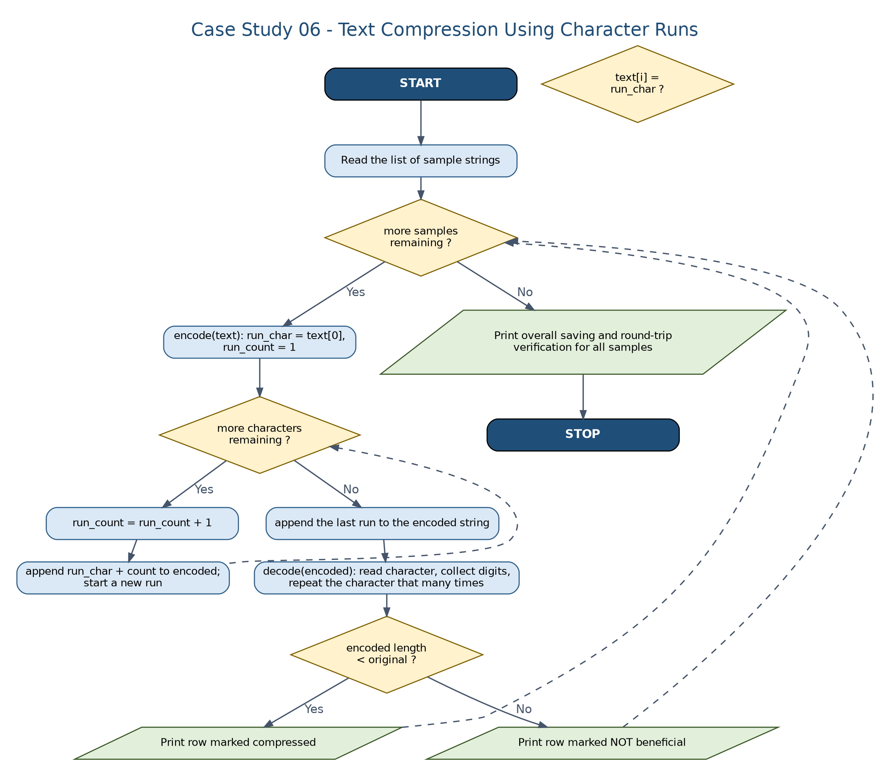
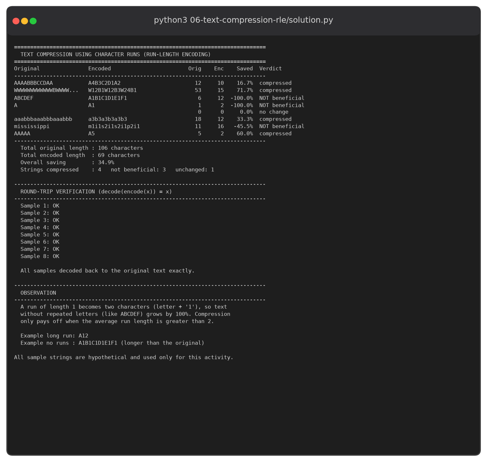

# Case Study 06 — Text Compression Using Character Runs

## Problem statement

Encode a string by grouping consecutive repeated characters and compare original and encoded lengths, including cases where encoding is not beneficial.

## Objectives

To traverse a string character by character with a loop and remember the current run; to build an encoded string using concatenation and the `str()` conversion of integers; to decode the result back to verify correctness; and to compare lengths to decide when run-length encoding actually saves space.

## Assumptions

- Encoding format: every run of a character becomes `character + count`, e.g. `AAAABBBCC` → `A4B3C2`.
- Runs of length 1 are written with a count of 1 so decoding is never ambiguous.
- The count is written in decimal and may be more than one digit (e.g. `A12`).
- A malformed encoded string (character without a count) is detected and returns `None`.
- Comparison is by number of characters only (each character = 1 byte).
- All sample strings are hypothetical.

## Algorithm

```
1. START
2. Define the SAMPLE list of strings
3. DEFINE FUNCTION encode(text)
   3.1 IF text is empty THEN RETURN ""
   3.2 run_char ← text[0] ; run_count ← 1 ; encoded ← ""
   3.3 FOR i ← 1 to len(text)-1 DO
       IF text[i] = run_char THEN run_count ← run_count + 1
       ELSE encoded ← encoded + run_char + str(run_count)
            run_char ← text[i] ; run_count ← 1
   3.4 encoded ← encoded + run_char + str(run_count)
   3.5 RETURN encoded
4. DEFINE FUNCTION decode(encoded)
   4.1 decoded ← "" ; i ← 0
   4.2 WHILE i < len(encoded) DO
       ch ← encoded[i] ; i ← i + 1
       number ← collect consecutive digits
       IF number is empty THEN RETURN None
       decoded ← decoded + ch * int(number)
   4.3 RETURN decoded
5. DEFINE FUNCTION savings(original_length, encoded_length)
   5.1 IF original_length = 0 THEN RETURN 0
   5.2 RETURN (original - encoded) * 100 / original
6. FOR each sample DO
   6.1 encoded ← encode(sample)
   6.2 Compare lengths, print row with verdict compressed / NOT beneficial / no change
   6.3 Accumulate totals and counters
7. PRINT overall saving and counts
8. FOR each sample PRINT OK / MISMATCH for decode(encode(x)) = x
9. PRINT observation about runs of length 1
10. END
```

## Flowchart



## Pseudocode

```
BEGIN TEXT_COMPRESSION_RLE

    FUNCTION encode(text)
        IF LENGTH(text) = 0 THEN RETURN "" END IF
        run_char  <- text[0]
        run_count <- 1
        encoded   <- ""
        FOR i <- 1 TO LENGTH(text) - 1 DO
            IF text[i] = run_char THEN
                run_count <- run_count + 1
            ELSE
                encoded <- encoded + run_char + STRING(run_count)
                run_char <- text[i]
                run_count <- 1
            END IF
        END FOR
        encoded <- encoded + run_char + STRING(run_count)
        RETURN encoded
    END FUNCTION

    FUNCTION decode(encoded)
        decoded <- "" ; i <- 0
        WHILE i < LENGTH(encoded) DO
            ch <- encoded[i] ; i <- i + 1
            number <- ""
            WHILE i < LENGTH(encoded) AND encoded[i] IS DIGIT DO
                number <- number + encoded[i] ; i <- i + 1
            END WHILE
            IF number = "" THEN RETURN NULL END IF
            decoded <- decoded + REPEAT(ch, TO_INTEGER(number))
        END WHILE
        RETURN decoded
    END FUNCTION

    total_original <- 0 ; total_encoded <- 0
    FOR each text IN SAMPLES DO
        encoded <- encode(text)
        saved <- (LENGTH(text) - LENGTH(encoded)) * 100 / LENGTH(text)
        IF LENGTH(encoded) < LENGTH(text) THEN
            verdict <- "compressed"
        ELSE IF LENGTH(encoded) > LENGTH(text) THEN
            verdict <- "NOT beneficial"
        ELSE
            verdict <- "no change"
        END IF
        PRINT text, encoded, lengths, saved, verdict
        total_original <- total_original + LENGTH(text)
        total_encoded  <- total_encoded + LENGTH(encoded)
    END FOR

    PRINT overall saving
    FOR each text IN SAMPLES DO
        IF decode(encode(text)) = text THEN PRINT "OK" ELSE PRINT "MISMATCH"
    END FOR
END
```

## Python source code

```python
"""
Case Study 06: Text Compression Using Character Runs
-----------------------------------------------------
Encode a string by grouping consecutive repeated characters and compare
original and encoded lengths, including cases where encoding is not
beneficial.

Syllabus used: variables, data types, operators, conditional statements,
loops, strings, lists.
No library is imported - only core Python 3 is used.

Encoding format (run-length encoding):
    each run of a character becomes  character + count
    e.g.  "AAAABBBCC"  ->  "A4B3C2"
Runs of a single character are written with count 1 so decoding stays
unambiguous.
"""

# Sample strings covering strongly repetitive, mixed and non-repetitive text
SAMPLES = [
    "AAAABBBCCDAA",
    "WWWWWWWWWWWWBWWWWWWWWWWWWBBBWWWWWWWWWWWWWWWWWWWWWWWWB",
    "ABCDEF",
    "A",
    "",
    "aaabbbaaabbbaaabbb",
    "mississippi",
    "AAAAA",
]


def encode(text):
    """Run-length encode text. Returns '' for an empty string."""
    if len(text) == 0:
        return ""

    encoded = ""
    run_char = text[0]
    run_count = 1

    for i in range(1, len(text)):
        if text[i] == run_char:
            run_count += 1
        else:
            encoded += run_char + str(run_count)
            run_char = text[i]
            run_count = 1

    encoded += run_char + str(run_count)
    return encoded


def decode(encoded):
    """Decode a run-length encoded string back to the original text."""
    decoded = ""
    i = 0
    while i < len(encoded):
        ch = encoded[i]
        i += 1

        # collect the full number that follows the character
        number = ""
        while i < len(encoded) and "0" <= encoded[i] <= "9":
            number += encoded[i]
            i += 1

        if number == "":
            # malformed record: character without a count
            return None

        count = int(number)
        decoded += ch * count

    return decoded


def savings(original_length, encoded_length):
    """Percentage saving of the encoded length over the original."""
    if original_length == 0:
        return 0.0
    return (original_length - encoded_length) * 100.0 / original_length


def main():
    print("=" * 78)
    print("  TEXT COMPRESSION USING CHARACTER RUNS (RUN-LENGTH ENCODING)")
    print("=" * 78)
    print("%-22s %-28s %6s %6s %8s  %s"
          % ("Original", "Encoded", "Orig", "Enc", "Saved", "Verdict"))
    print("-" * 78)

    total_original = 0
    total_encoded = 0
    beneficial = 0
    harmful = 0
    neutral = 0

    for i in range(len(SAMPLES)):
        text = SAMPLES[i]
        encoded = encode(text)

        orig_len = len(text)
        enc_len = len(encoded)
        total_original += orig_len
        total_encoded += enc_len

        saved = savings(orig_len, enc_len)

        if enc_len < orig_len:
            verdict = "compressed"
            beneficial += 1
        elif enc_len > orig_len:
            verdict = "NOT beneficial"
            harmful += 1
        else:
            verdict = "no change"
            neutral += 1

        # shorten long strings so the table stays readable
        shown_original = text
        if len(shown_original) > 20:
            shown_original = shown_original[0:17] + "..."
        shown_encoded = encoded
        if len(shown_encoded) > 26:
            shown_encoded = shown_encoded[0:23] + "..."

        print("%-22s %-28s %6d %6d %7.1f%%  %s"
              % (shown_original, shown_encoded, orig_len, enc_len, saved, verdict))

    print("-" * 78)
    print("  Total original length : %d characters" % total_original)
    print("  Total encoded length  : %d characters" % total_encoded)
    print("  Overall saving        : %.1f%%"
          % savings(total_original, total_encoded))
    print("  Strings compressed    : %d   not beneficial: %d   unchanged: %d"
          % (beneficial, harmful, neutral))

    # ---------------- round-trip check ----------------
    print("\n" + "-" * 78)
    print("  ROUND-TRIP VERIFICATION (decode(encode(x)) = x)")
    print("-" * 78)
    all_ok = True
    for i in range(len(SAMPLES)):
        text = SAMPLES[i]
        encoded = encode(text)
        decoded = decode(encoded)
        if decoded == text:
            print("  Sample %d: OK" % (i + 1))
        else:
            all_ok = False
            print("  Sample %d: MISMATCH" % (i + 1))

    if all_ok:
        print("\n  All samples decoded back to the original text exactly.")

    # ---------------- why some strings do not compress ----------------
    print("\n" + "-" * 78)
    print("  OBSERVATION")
    print("-" * 78)
    print("  A run of length 1 becomes two characters (letter + '1'), so text")
    print("  without repeated letters (like ABCDEF) grows by 100%. Compression")
    print("  only pays off when the average run length is greater than 2.")
    print("\n  Example long run: %s" % encode("A" * 12))
    print("  Example no runs : %s (longer than the original)" % encode("ABCDEF"))
    print("\nAll sample strings are hypothetical and used only for this activity.")


if __name__ == "__main__":
    main()
```

## Test cases

| # | Test | Expected | Result |
|---|------|----------|--------|
| TC-01 | `AAAABBBCCDAA` | `A4B3C2D1A2` | PASS |
| TC-02 | `ABCDEF` | `A1B1C1D1E1F1` | PASS |
| TC-03 | `A` | `A1` | PASS |
| TC-04 | empty string | empty string | PASS |
| TC-05 | `A` × 12 | `A12` (two-digit count) | PASS |
| TC-06 | `abab` | `a1b1a1b1` | PASS |
| TC-07 | decode `A4B3C2D1A2` | `AAAABBBCCDAA` | PASS |
| TC-08 | decode `A12B2` | 12 A's + 2 B's | PASS |
| TC-09 | round trip on all samples | identical | PASS |
| TC-10 | round trip on a run-rich string | identical | PASS |
| TC-11 | decode `A` | `None` (malformed) | PASS |
| TC-12 | savings(12, 10) | 16.67% | PASS |
| TC-13 | savings(6, 12) | −100% | PASS |
| TC-14 | savings(0, 0) | 0 | PASS |
| TC-15 | `ABCDEF` encoding | longer than original | PASS |
| TC-16 | `AAAAA` encoding | shorter than original | PASS |

All 16 test cases pass when `test_cases.py` is run.

## Output screenshot



## Conclusion

The encoder correctly groups every run and handles multi-digit counts, and decoding every sample reproduced the original text exactly. The comparison made the limitation of run-length encoding clear: the very repetitive W/B string compressed by 71.7% while `ABCDEF` doubled in size because each run of one character needs two characters in the encoded form. Overall, 4 of 8 sample strings compressed and the total saving was about 35%. Only loops, strings, lists and conditionals were needed.
