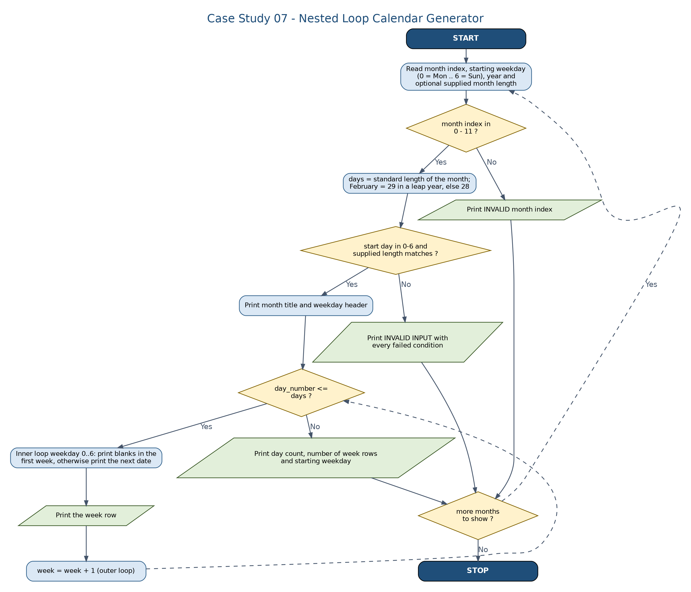
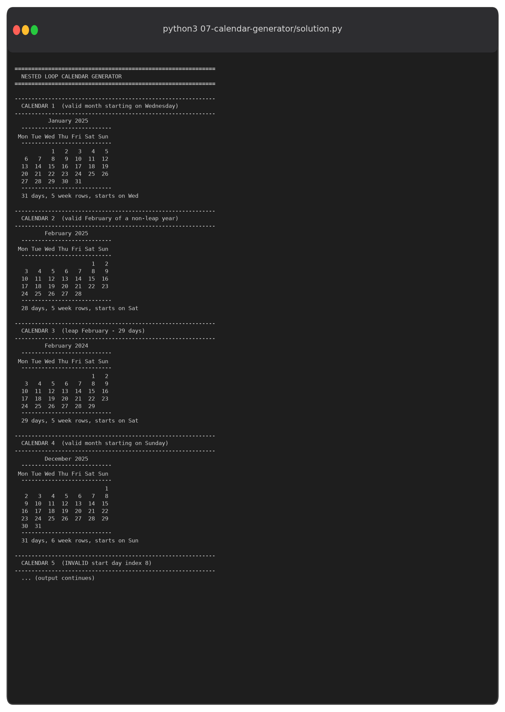

# Case Study 07 — Nested Loop Calendar Generator

## Problem statement

Generate a formatted monthly calendar using the supplied starting weekday and number of days, correctly aligning weeks and handling valid month lengths.

## Objectives

To use nested loops — an outer loop over weeks and an inner loop over the seven weekdays — to lay out a two-dimensional grid; to pad the first week with blanks using arithmetic on the starting weekday; to validate the month index, starting weekday and day count before printing anything; and to handle the leap-year rule for February.

## Assumptions

- Weekdays are numbered 0 = Monday to 6 = Sunday.
- Month indices follow 0 = January to 11 = December.
- Month lengths follow the Gregorian calendar: 31/30 days as usual, February has 28 days except in leap years (divisible by 4, except centuries not divisible by 400) where it has 29.
- The starting weekday is supplied by the user; no date library is used.
- If a month length is also supplied, it must match the standard length, otherwise the input is rejected.
- Each date occupies a 4-character column so the grid stays aligned in a monospace font.

## Algorithm

```
1. START
2. Define DAY_NAMES, MONTH_NAMES, MONTH_LENGTHS and the list of months to print
3. DEFINE FUNCTION month_length(month_index, year)
   3.1 IF month_index outside 0-11 THEN RETURN -1
   3.2 IF month_index = 1 (February) THEN
       IF year divisible by 400 → RETURN 29
       ELSE IF year divisible by 4 and not by 100 → RETURN 29
       ELSE → RETURN 28
   3.3 RETURN MONTH_LENGTHS[month_index]
4. DEFINE FUNCTION validate(month_index, start_day, year, supplied_length)
   4.1 errors ← empty list
   4.2 IF month_index outside 0-11 THEN append error ; RETURN errors
   4.3 IF start_day outside 0-6 THEN append error
   4.4 expected ← month_length(month_index, year)
       IF supplied_length <> -1 AND supplied_length <> expected
           THEN append "month length mismatch"
   4.5 RETURN errors
5. DEFINE FUNCTION print_calendar(month_index, start_day, year, supplied_length)
   5.1 errors ← validate(...)
       IF errors not empty THEN PRINT every error ; RETURN False
   5.2 days ← month_length(month_index, year)
   5.3 PRINT month title and weekday header
   5.4 day_number ← 1 ; week ← 0
   5.5 WHILE day_number <= days DO          (outer loop: rows)
       5.5.1 row ← ""
       5.5.2 FOR weekday ← 0 to 6 DO        (inner loop: columns)
             IF week = 0 AND weekday < start_day THEN row ← row + 4 spaces
             ELSE IF day_number <= days THEN row ← row + formatted day ; day_number++
             ELSE row ← row + 4 spaces
       5.5.3 PRINT row without trailing spaces
       5.5.4 week ← week + 1
   5.6 PRINT summary line (days, rows, starting weekday)
   5.7 RETURN True
6. FOR each month in the list DO print heading ; CALL print_calendar(...)
7. PRINT the month-length reference table for 2025 and the leap February
8. END
```

## Flowchart



## Pseudocode

```
BEGIN CALENDAR_GENERATOR

    DAY_NAMES    <- ["Mon","Tue","Wed","Thu","Fri","Sat","Sun"]
    MONTH_NAMES  <- ["January",...,"December"]
    MONTH_LENGTHS <- [31,28,31,30,31,30,31,31,30,31,30,31]

    FUNCTION month_length(month_index, year)
        IF month_index < 0 OR month_index > 11 THEN RETURN -1 END IF
        IF month_index = 1 THEN
            IF year MOD 400 = 0 THEN RETURN 29
            ELSE IF year MOD 4 = 0 AND year MOD 100 <> 0 THEN RETURN 29
            ELSE RETURN 28
            END IF
        END IF
        RETURN MONTH_LENGTHS[month_index]
    END FUNCTION

    FUNCTION validate(month_index, start_day, year, supplied_length)
        errors <- []
        IF month_index < 0 OR month_index > 11 THEN
            APPEND "month index outside 0-11" TO errors
            RETURN errors
        END IF
        IF start_day < 0 OR start_day > 6 THEN
            APPEND "starting weekday outside 0-6" TO errors
        END IF
        expected <- month_length(month_index, year)
        IF supplied_length <> -1 AND supplied_length <> expected THEN
            APPEND "month length mismatch" TO errors
        END IF
        RETURN errors
    END FUNCTION

    FUNCTION print_calendar(month_index, start_day, year, supplied_length)
        errors <- validate(month_index, start_day, year, supplied_length)
        IF LENGTH(errors) > 0 THEN
            PRINT "INVALID INPUT"
            FOR each e IN errors DO PRINT e END FOR
            RETURN FALSE
        END IF

        days <- month_length(month_index, year)
        PRINT title ; PRINT weekday header
        day_number <- 1 ; week <- 0
        WHILE day_number <= days DO
            row <- ""
            FOR weekday <- 0 TO 6 DO
                IF week = 0 AND weekday < start_day THEN
                    row <- row + "    "
                ELSE IF day_number <= days THEN
                    row <- row + PAD(day_number, 4)
                    day_number <- day_number + 1
                ELSE
                    row <- row + "    "
                END IF
            END FOR
            PRINT TRIM_RIGHT(row)
            week <- week + 1
        END WHILE
        PRINT days, "days,", week, "week rows"
        RETURN TRUE
    END FUNCTION

    FOR each month IN MONTHS_TO_SHOW DO
        PRINT heading
        print_calendar(month.index, month.start, month.year, month.supplied)
    END FOR
END
```

## Python source code

```python
"""
Case Study 07: Nested Loop Calendar Generator
----------------------------------------------
Generate a formatted monthly calendar using the supplied starting
weekday and number of days, correctly aligning weeks and handling
valid month lengths.

Syllabus used: variables, data types, operators, conditional statements,
loops (including nested loops), strings, lists.
No library is imported - only core Python 3 is used.
"""

DAY_NAMES = ["Mon", "Tue", "Wed", "Thu", "Fri", "Sat", "Sun"]
MONTH_NAMES = ["January", "February", "March", "April", "May", "June",
               "July", "August", "September", "October", "November", "December"]

# Standard number of days in each month (non-leap year).
# February is handled separately so a leap year can reuse the same list.
MONTH_LENGTHS = [31, 28, 31, 30, 31, 30, 31, 31, 30, 31, 30, 31]

# (month_index, starting_day_index (0=Mon .. 6=Sun), year,
#  supplied_length (-1 = use the standard length), note)
MONTHS_TO_SHOW = [
    (0, 2, 2025, -1, "valid month starting on Wednesday"),
    (1, 5, 2025, -1, "valid February of a non-leap year"),
    (1, 5, 2024, -1, "leap February - 29 days"),
    (11, 6, 2025, -1, "valid month starting on Sunday"),
    (5, 8, 2025, -1, "INVALID start day index 8"),
    (3, 0, 2025, 31, "INVALID month length - 31 days supplied for April"),
    (12, 1, 2025, -1, "INVALID month index 12"),
]


def month_length(month_index, year):
    """Days in a month, with the Gregorian leap-year rule for February."""
    if month_index < 0 or month_index > 11:
        return -1
    if month_index == 1:
        if (year % 400 == 0) or (year % 4 == 0 and year % 100 != 0):
            return 29
        return 28
    return MONTH_LENGTHS[month_index]


def validate(month_index, start_day, year, override_length):
    """Return a list of validation errors (empty means the input is valid)."""
    errors = []

    if month_index < 0 or month_index > 11:
        errors.append("month index %d is outside 0-11" % month_index)
        return errors          # nothing else can be checked meaningfully

    if start_day < 0 or start_day > 6:
        errors.append("starting weekday must be 0 (Mon) to 6 (Sun), got %d"
                      % start_day)

    expected = month_length(month_index, year)
    if override_length != -1 and override_length != expected:
        errors.append("%s %d has %d days, but %d were supplied"
                      % (MONTH_NAMES[month_index], year, expected, override_length))

    return errors


def print_calendar(month_index, start_day, year, override_length=-1):
    """Print the formatted calendar. Returns False if input was invalid."""
    errors = validate(month_index, start_day, year, override_length)
    if len(errors) > 0:
        print("  INVALID INPUT - calendar not generated:")
        for err in errors:
            print("     - %s" % err)
        return False

    days = month_length(month_index, year)

    title = "%s %d" % (MONTH_NAMES[month_index], year)
    print("  " + title.center(27))
    print("  " + ("-" * 27))

    # weekday header
    header = ""
    for name in DAY_NAMES:
        header += " " + name
    print(header)
    print("  " + ("-" * 27))

    # ---- nested loops: week rows x day columns ----
    day_number = 1
    week = 0
    while day_number <= days:
        row = ""
        for weekday in range(7):                       # inner loop: columns
            if week == 0 and weekday < start_day:
                row += "    "                          # leading blanks
            elif day_number <= days:
                row += "%4d" % day_number
                day_number += 1
            else:
                row += "    "                          # trailing blanks
        print(row.rstrip())
        week += 1                                      # outer loop: rows

    print("  " + ("-" * 27))
    print("  %d days, %d week rows, starts on %s"
          % (days, week, DAY_NAMES[start_day]))
    return True


def main():
    print("=" * 60)
    print("  NESTED LOOP CALENDAR GENERATOR")
    print("=" * 60)

    for i in range(len(MONTHS_TO_SHOW)):
        month_index, start_day, year, supplied, note = MONTHS_TO_SHOW[i]
        print("\n" + "-" * 60)
        print("  CALENDAR %d  (%s)" % (i + 1, note))
        print("-" * 60)
        print_calendar(month_index, start_day, year, supplied)

    # ---------------- summary of month lengths ----------------
    print("\n" + "=" * 60)
    print("  MONTH LENGTH REFERENCE FOR 2025 (non-leap year)")
    print("=" * 60)
    for i in range(12):
        print("  %-10s : %2d days" % (MONTH_NAMES[i], month_length(i, 2025)))
    print("  %-10s : %2d days  (leap year)" % (MONTH_NAMES[1],
                                               month_length(1, 2024)))
    print("\n  Note: calendars are generated from a supplied starting weekday;")
    print("  the program does not use any date library.")


if __name__ == "__main__":
    main()
```

## Test cases

| # | Test | Expected | Result |
|---|------|----------|--------|
| TC-01 | January 2025 | 31 days | PASS |
| TC-02 | April 2025 | 30 days | PASS |
| TC-03 | February 2025 | 28 days | PASS |
| TC-04 | February 2024 | 29 days (leap) | PASS |
| TC-05 | February 1900 | 28 days (century rule) | PASS |
| TC-06 | February 2000 | 29 days (400 rule) | PASS |
| TC-07 | month index 12 | returns −1 | PASS |
| TC-08 | January, start 2 | accepted | PASS |
| TC-09 | start day 8 | rejected | PASS |
| TC-10 | start day −1 | rejected | PASS |
| TC-11 | April with 31 days supplied | rejected | PASS |
| TC-12 | April with 30 days supplied | accepted | PASS |
| TC-13 | month index 12 | rejected | PASS |
| TC-14 | January 2025 calendar | generated | PASS |
| TC-15 | January starting Wednesday | 5 day rows | PASS |
| TC-16 | first week row | begins with 2 blank days | PASS |
| TC-17 | January grid | 1–31 each exactly once | PASS |
| TC-18 | December starting Sunday | 6 day rows | PASS |
| TC-19 | leap February 2024 | prints 29, not 30 | PASS |
| TC-20 | invalid start day | error printed, returns False | PASS |

All 20 test cases pass when `test_cases.py` is run.

## Output screenshot



## Conclusion

The nested loop lays out each month as a week-by-week grid and the leading blank columns correctly align the first date under its weekday. All valid months rendered completely — every date from 1 to the month length appeared exactly once — while the three invalid inputs (start weekday 8, April given 31 days, month index 12) were rejected before anything was printed. The leap-year rule correctly gave February 2024 twenty-nine days and February 2025 twenty-eight. No date library was used, which keeps the program fully within the loops and conditionals syllabus.
