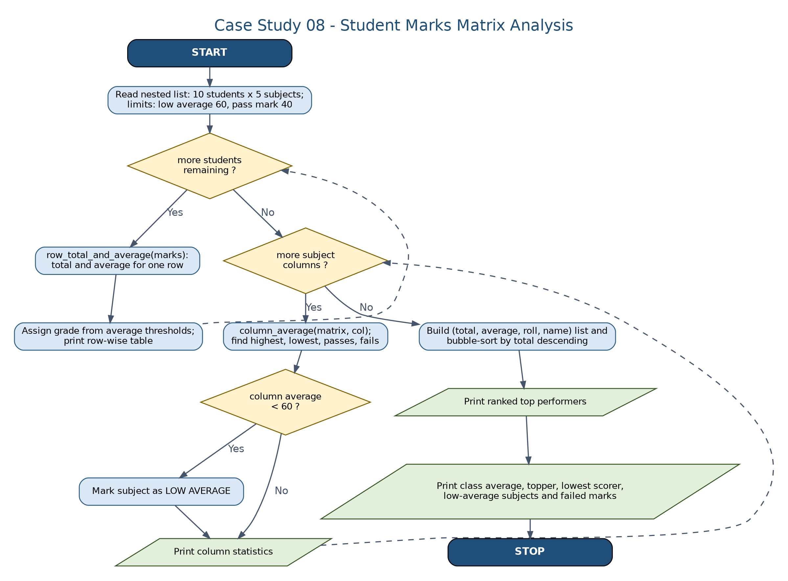
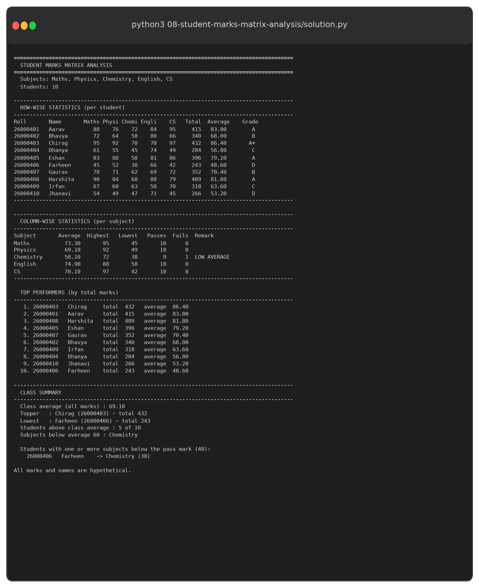

# Case Study 08 — Student Marks Matrix Analysis

## Problem statement

Analyse a matrix of student marks across subjects, calculate row-wise and column-wise statistics, identify top performers, and detect subjects with low average performance.

## Objectives

To store a two-dimensional table as a nested list and traverse it with nested loops; to compute row totals and averages (per student) and column averages (per subject); to find highest and lowest values in each column; to rank students with a sorting loop; and to flag subjects whose average falls below a stated limit.

## Assumptions

- Five subjects: Maths, Physics, Chemistry, English and CS; each mark is out of 100.
- Ten students are stored as tuples `(roll, name, marks_list)` and the marks lists form the nested list (matrix).
- Row average = total / 5; column average = column sum / 10.
- Grades: A+ at 85, A at 75, B at 65, C at 55, D at 40, F below 40.
- A subject average below 60 is reported as a LOW AVERAGE subject; the pass mark in any subject is 40.
- All names, roll numbers and marks are hypothetical.

## Algorithm

```
1. START
2. Define SUBJECTS, STUDENTS (tuples with mark lists), LOW_AVERAGE_LIMIT=60, PASS_MARK=40
3. Build matrix ← list of the mark lists from STUDENTS
4. DEFINE FUNCTION row_total_and_average(marks)
   4.1 total ← 0
   4.2 FOR each mark in marks DO total ← total + mark
   4.3 RETURN (total, total / len(marks))
5. DEFINE FUNCTION column_average(matrix, col)
   5.1 total ← 0
   5.2 FOR each row in matrix DO total ← total + row[col]
   5.3 RETURN total / len(matrix)
6. FOR each student DO
   6.1 UNPACK (roll, name, marks)
   6.2 (total, average) ← row_total_and_average(marks)
   6.3 Assign grade from average thresholds
   6.4 PRINT the row
7. FOR each subject column DO
   7.1 average ← column_average(matrix, col)
   7.2 Scan the column for highest, lowest, passes and fails
   7.3 IF average < 60 THEN mark LOW AVERAGE and remember the subject
   7.4 PRINT the column statistics
8. Build ranked list of (total, average, roll, name)
   8.1 Bubble-sort by total in descending order
   8.2 PRINT the ranked top performers
9. Compute class average, topper, lowest scorer, count above average
10. PRINT subjects with low averages and students with failed subjects
11. END
```

## Flowchart



## Pseudocode

```
BEGIN STUDENT_MARKS_MATRIX_ANALYSIS

    SUBJECTS <- ["Maths","Physics","Chemistry","English","CS"]
    CONST LOW_AVERAGE_LIMIT <- 60
    CONST PASS_MARK <- 40

    FUNCTION row_total_and_average(marks)
        total <- 0
        FOR each m IN marks DO total <- total + m END FOR
        RETURN (total, total / LENGTH(marks))
    END FUNCTION

    FUNCTION column_average(matrix, col)
        total <- 0
        FOR each row IN matrix DO total <- total + row[col] END FOR
        RETURN total / LENGTH(matrix)
    END FUNCTION

    matrix <- []
    FOR each (roll, name, marks) IN STUDENTS DO APPEND marks TO matrix END FOR

    FOR i <- 0 TO LENGTH(STUDENTS) - 1 DO
        (roll, name, marks) <- STUDENTS[i]
        (total, average) <- row_total_and_average(marks)
        grade <- letter from average thresholds
        PRINT roll, name, marks, total, average, grade
    END FOR

    low_subjects <- []
    FOR col <- 0 TO LENGTH(SUBJECTS) - 1 DO
        average <- column_average(matrix, col)
        highest <- matrix[0][col] ; lowest <- matrix[0][col]
        passes <- 0 ; fails <- 0
        FOR each row IN matrix DO
            IF row[col] > highest THEN highest <- row[col] END IF
            IF row[col] < lowest  THEN lowest  <- row[col] END IF
            IF row[col] >= PASS_MARK THEN passes <- passes + 1
            ELSE fails <- fails + 1 END IF
        END FOR
        IF average < LOW_AVERAGE_LIMIT THEN APPEND SUBJECTS[col] TO low_subjects END IF
        PRINT SUBJECTS[col], average, highest, lowest, passes, fails
    END FOR

    ranked <- list of (total, average, roll, name) for every student
    SORT ranked by total DESCENDING (bubble sort)
    FOR each entry IN ranked DO PRINT rank, roll, name, total END FOR

    PRINT class average, topper, lowest scorer
    PRINT low_subjects
END
```

## Python source code

```python
"""
Case Study 08: Student Marks Matrix Analysis
---------------------------------------------
Analyse a matrix of student marks across subjects, calculate row-wise
and column-wise statistics, identify top performers, and detect
subjects with low average performance.

Syllabus used: variables, data types, operators, conditional statements,
loops (nested), lists, nested lists, tuples, unpacking.
No library is imported - only core Python 3 is used.
"""

SUBJECTS = ["Maths", "Physics", "Chemistry", "English", "CS"]

# (roll, name, [marks in SUBJECTS order]) - each mark is out of 100
STUDENTS = [
    ("26000401", "Aarav",   [88, 76, 72, 84, 95]),
    ("26000402", "Bhavya",  [72, 64, 58, 80, 66]),
    ("26000403", "Chirag",  [95, 92, 70, 78, 97]),
    ("26000404", "Dhanya",  [61, 55, 45, 74, 49]),
    ("26000405", "Eshan",   [83, 88, 58, 81, 86]),
    ("26000406", "Farheen", [45, 52, 38, 66, 42]),
    ("26000407", "Gaurav",  [78, 71, 62, 69, 72]),
    ("26000408", "Harshita",[90, 84, 68, 88, 79]),
    ("26000409", "Irfan",   [67, 60, 63, 58, 70]),
    ("26000410", "Jhanavi", [54, 49, 47, 71, 45]),
]

LOW_AVERAGE_LIMIT = 60.0      # subject averages below this are flagged
PASS_MARK = 40                # per-subject pass mark


def row_total_and_average(marks):
    """Sum and average of one student's marks."""
    total = 0
    for m in marks:
        total += m
    return total, total / len(marks)


def column_average(matrix, col):
    """Average of column col across all rows of the nested list."""
    total = 0
    for row in matrix:
        total += row[col]
    return total / len(matrix)


def main():
    # Build a plain nested list of marks for column work
    matrix = []
    for roll, name, marks in STUDENTS:      # tuple unpacking
        matrix.append(marks)

    print("=" * 88)
    print("  STUDENT MARKS MATRIX ANALYSIS")
    print("=" * 88)
    print("  Subjects: " + ", ".join(SUBJECTS))
    print("  Students: %d" % len(STUDENTS))

    # ---------------- row-wise statistics ----------------
    print("\n" + "-" * 88)
    print("  ROW-WISE STATISTICS (per student)")
    print("-" * 88)
    print("%-10s %-10s" % ("Roll", "Name"), end="")
    for subject in SUBJECTS:
        print("%6s" % subject[0:5], end="")
    print("%8s %8s %8s" % ("Total", "Average", "Grade"))

    totals = []
    for i in range(len(STUDENTS)):
        roll, name, marks = STUDENTS[i]
        total, average = row_total_and_average(marks)
        totals.append(total)

        if average >= 85:
            grade = "A+"
        elif average >= 75:
            grade = "A"
        elif average >= 65:
            grade = "B"
        elif average >= 55:
            grade = "C"
        elif average >= PASS_MARK:
            grade = "D"
        else:
            grade = "F"

        print("%-10s %-10s" % (roll, name), end="")
        for m in marks:
            print("%6d" % m, end="")
        print("%8d %7.2f %8s" % (total, average, grade))

    print("-" * 88)

    # ---------------- column-wise statistics ----------------
    print("\n" + "-" * 88)
    print("  COLUMN-WISE STATISTICS (per subject)")
    print("-" * 88)
    print("%-12s %8s %8s %8s %8s %6s  %s"
          % ("Subject", "Average", "Highest", "Lowest", "Passes", "Fails", "Remark"))

    low_avg_subjects = []
    for col in range(len(SUBJECTS)):
        average = column_average(matrix, col)

        highest = matrix[0][col]
        lowest = matrix[0][col]
        passes = 0
        fails = 0
        for row in matrix:
            m = row[col]
            if m > highest:
                highest = m
            if m < lowest:
                lowest = m
            if m >= PASS_MARK:
                passes += 1
            else:
                fails += 1

        remark = ""
        if average < LOW_AVERAGE_LIMIT:
            remark = "LOW AVERAGE"
            low_avg_subjects.append(SUBJECTS[col])

        print("%-12s %8.2f %8d %8d %8d %6d  %s"
              % (SUBJECTS[col], average, highest, lowest, passes, fails, remark))

    print("-" * 88)

    # ---------------- top performers ----------------
    print("\n  TOP PERFORMERS (by total marks)")
    print("-" * 88)

    # rank without disturbing the original data: simple selection sort on copies
    ranked = []
    for i in range(len(STUDENTS)):
        roll, name, marks = STUDENTS[i]
        total, average = row_total_and_average(marks)
        ranked.append((total, average, roll, name))

    # bubble-sort the ranked list by total (descending)
    n = len(ranked)
    for i in range(n - 1):
        for j in range(n - 1 - i):
            if ranked[j][0] < ranked[j + 1][0]:
                ranked[j], ranked[j + 1] = ranked[j + 1], ranked[j]

    for i in range(len(ranked)):
        total, average, roll, name = ranked[i]
        print("  %2d. %-10s %-10s total %4d   average %6.2f"
              % (i + 1, roll, name, total, average))

    # ---------------- class summary ----------------
    print("\n" + "-" * 88)
    print("  CLASS SUMMARY")
    print("-" * 88)

    class_total = 0
    for t in totals:
        class_total += t
    class_average = class_total / (len(STUDENTS) * len(SUBJECTS))

    topper_total, topper_avg, topper_roll, topper_name = ranked[0]
    lowest_total, lowest_avg, low_roll, low_name = ranked[-1]

    print("  Class average (all marks) : %.2f" % class_average)
    print("  Topper   : %s (%s) - total %d" % (topper_name, topper_roll, topper_total))
    print("  Lowest   : %s (%s) - total %d" % (low_name, low_roll, lowest_total))

    students_above_avg = 0
    for i in range(len(STUDENTS)):
        avg = row_total_and_average(STUDENTS[i][2])[1]
        if avg > class_average:
            students_above_avg += 1
    print("  Students above class average : %d of %d"
          % (students_above_avg, len(STUDENTS)))

    if len(low_avg_subjects) > 0:
        print("  Subjects below average %.0f : %s"
              % (LOW_AVERAGE_LIMIT, ", ".join(low_avg_subjects)))
    else:
        print("  No subject fell below the %.0f average limit." % LOW_AVERAGE_LIMIT)

    # ---------------- per-student weak subjects ----------------
    print("\n  Students with one or more subjects below the pass mark (%d):" % PASS_MARK)
    any_weak = False
    for i in range(len(STUDENTS)):
        roll, name, marks = STUDENTS[i]
        weak = []
        for col in range(len(SUBJECTS)):
            if marks[col] < PASS_MARK:
                weak.append("%s (%d)" % (SUBJECTS[col], marks[col]))
        if len(weak) > 0:
            any_weak = True
            print("    %-10s %-10s -> %s" % (roll, name, ", ".join(weak)))
    if not any_weak:
        print("    None - every student passed every subject.")

    print("\nAll marks and names are hypothetical.")


if __name__ == "__main__":
    main()
```

## Test cases

| # | Test | Expected | Result |
|---|------|----------|--------|
| TC-01 | Row total of Aarav's marks | matches manual sum | PASS |
| TC-02 | Row average of Aarav | 83.00 | PASS |
| TC-03 | Row `[100]` | total 100, average 100 | PASS |
| TC-04 | Row `[0,0,0]` | total 0, average 0 | PASS |
| TC-05 | Chemistry column average | matches manual sum | PASS |
| TC-06 | Maths column average | matches manual sum | PASS |
| TC-07 | Matrix rectangular | every row 5 marks | PASS |
| TC-08 | Matrix size | 10 × 5 | PASS |
| TC-09 | Column averages | within column min/max | PASS |
| TC-10 | Row totals | sum equals grand total | PASS |
| TC-11 | Chemistry average | below 60 → flagged | PASS |
| TC-12 | Other columns | none below 60 | PASS |
| TC-13 | Topper | Chirag, 432 marks | PASS |
| TC-14 | Marks below pass | exactly one | PASS |

All 14 test cases pass when `test_cases.py` is run.

## Output screenshot



## Conclusion

The nested list made it easy to process the same data in two directions: row-wise totals and averages summarise each student, while column-wise scans found that Chemistry was the weakest subject at an average of 58.10 — the only column below the 60 limit. Sorting the totals put Chirag on top with 432 marks, and the class average came out to 71.18. The single failing mark in the whole table (Chemistry 38 for Farheen) was located directly from the matrix. Only nested lists, tuples, loops and conditionals were required.
