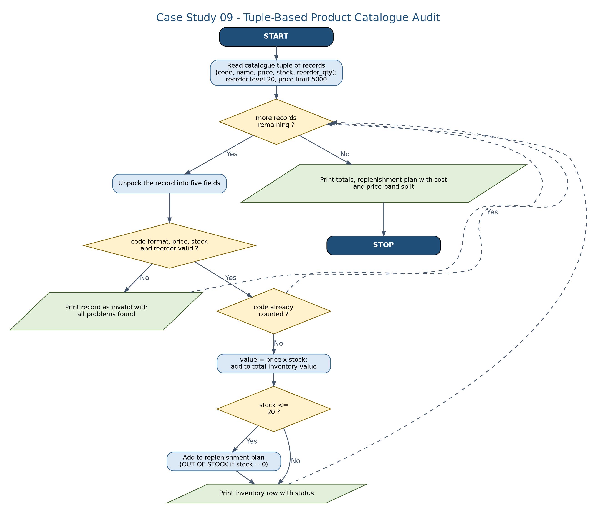
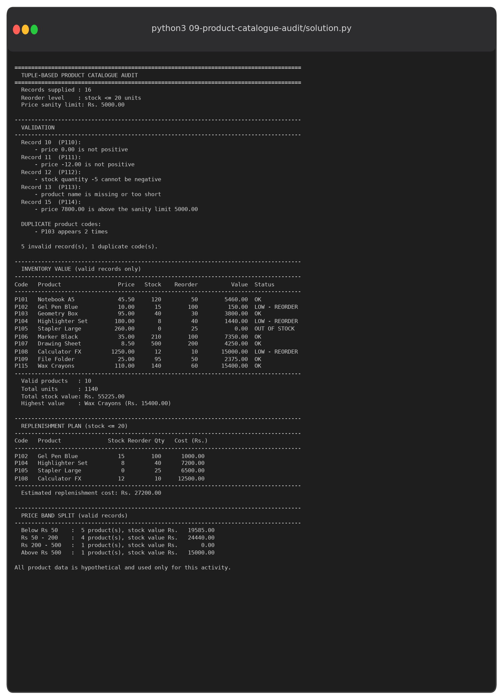

# Case Study 09 — Tuple-Based Product Catalogue Audit

## Problem statement

Store product identifiers, prices and stock quantities in tuples; detect invalid records, calculate inventory values and identify items requiring replenishment.

## Objectives

To model an immutable product catalogue as a tuple of five-field tuples and unpack each record; to validate product code format, prices, stock and reorder quantities with conditional statements; to detect duplicate codes by scanning with a list of seen codes; and to compute inventory values and a replenishment plan with loops and operators.

## Assumptions

- Every record is a tuple `(product_code, product_name, price, stock, reorder_qty)`.
- A valid product code is `P` followed by exactly three digits.
- Price must be positive and no more than Rs 5,000 (larger values are treated as data-entry errors for a stationery catalogue).
- Stock cannot be negative; reorder quantity must be a positive integer.
- Stock at or below 20 units is LOW and needs replenishment; stock of exactly 0 is OUT OF STOCK.
- A duplicated product code is counted only once in the inventory value.
- All product data is hypothetical.

## Algorithm

```
1. START
2. Define REORDER_LEVEL=20, MAX_PRICE=5000 and the CATALOGUE tuple of records
3. DEFINE FUNCTION validate_record(record)
   3.1 UNPACK record → code, name, price, stock, reorder_qty
   3.2 problems ← empty list
   3.3 IF code is not 'P' + 3 digits THEN append problem
   3.4 IF len(name) < 3 THEN append problem
   3.5 IF price <= 0 THEN append problem
       ELSE IF price > 5000 THEN append problem
   3.6 IF stock < 0 THEN append problem
   3.7 IF reorder_qty <= 0 THEN append problem
   3.8 RETURN problems
4. DEFINE FUNCTION find_duplicates(catalogue)
   4.1 seen ← empty list ; duplicates ← empty list
   4.2 FOR each record DO
       IF record[0] in seen THEN add to duplicates (once)
       ELSE add to seen
   4.3 RETURN duplicates
5. VALIDATION PASS: for each record call validate_record and print every problem
6. PRINT the duplicate codes found by find_duplicates
7. INVENTORY PASS: FOR each record DO
   7.1 IF invalid THEN skip
   7.2 IF code already counted THEN skip
   7.3 value ← price * stock ; add to totals
   7.4 status ← OUT OF STOCK / LOW - REORDER / OK from stock and REORDER_LEVEL
   7.5 PRINT the row
8. PRINT totals: valid products, units, stock value, highest value product
9. REPLENISHMENT PASS: FOR each valid low-stock product DO
   9.1 Find its price in the catalogue
   9.2 cost ← price * reorder_qty ; accumulate
   9.3 PRINT code, name, stock, reorder qty, cost
10. PRINT estimated replenishment cost
11. PRICE BAND SPLIT: for each (band, low, high) tuple count products and value
12. END
```

## Flowchart



## Pseudocode

```
BEGIN PRODUCT_CATALOGUE_AUDIT

    CONST REORDER_LEVEL <- 20
    CONST MAX_PRICE     <- 5000
    CATALOGUE           <- tuple of (code, name, price, stock, reorder_qty)

    FUNCTION validate_record(record)
        (code, name, price, stock, reorder_qty) <- record
        problems <- []
        IF LENGTH(code) <> 4 OR code[0] <> "P" THEN
            APPEND "code must be P + 3 digits" TO problems
        ELSE
            FOR i <- 1 TO 3 DO
                IF code[i] NOT A DIGIT THEN
                    APPEND "non-digit in code" TO problems
                    EXIT FOR
                END IF
            END FOR
        END IF
        IF LENGTH(name) < 3 THEN APPEND "name missing" TO problems END IF
        IF price <= 0 THEN APPEND "price not positive" TO problems
        ELSE IF price > MAX_PRICE THEN APPEND "price above limit" TO problems END IF
        IF stock < 0 THEN APPEND "negative stock" TO problems END IF
        IF reorder_qty <= 0 THEN APPEND "invalid reorder qty" TO problems END IF
        RETURN problems
    END FUNCTION

    FUNCTION find_duplicates(catalogue)
        seen <- [] ; duplicates <- []
        FOR each record IN catalogue DO
            IF record[0] IN seen THEN
                IF record[0] NOT IN duplicates THEN APPEND record[0] TO duplicates END IF
            ELSE
                APPEND record[0] TO seen
            END IF
        END FOR
        RETURN duplicates
    END FUNCTION

    FOR i <- 0 TO LENGTH(CATALOGUE) - 1 DO
        problems <- validate_record(CATALOGUE[i])
        IF LENGTH(problems) > 0 THEN
            PRINT CATALOGUE[i][0]
            FOR each p IN problems DO PRINT p END FOR
        END IF
    END FOR
    PRINT find_duplicates(CATALOGUE)

    total_value <- 0 ; counted <- []
    FOR each record IN CATALOGUE DO
        problems <- validate_record(record)
        IF LENGTH(problems) = 0 AND record[0] NOT IN counted THEN
            APPEND record[0] TO counted
            value <- record[2] * record[3]
            total_value <- total_value + value
            IF record[3] = 0 THEN status <- "OUT OF STOCK"
            ELSE IF record[3] <= REORDER_LEVEL THEN status <- "LOW - REORDER"
            ELSE status <- "OK"
            END IF
            PRINT record, value, status
        END IF
    END FOR
    PRINT total_value

    FOR each record IN CATALOGUE DO
        IF valid(record) AND record[3] <= REORDER_LEVEL THEN
            PRINT record[0], record[1], record[3], record[4], record[2] * record[4]
        END IF
    END FOR
END
```

## Python source code

```python
"""
Case Study 09: Tuple-Based Product Catalogue Audit
---------------------------------------------------
Store product identifiers, prices and stock quantities in tuples;
detect invalid records, calculate inventory values and identify items
requiring replenishment.

Syllabus used: variables, data types, operators, conditional statements,
loops, strings, lists, tuples, tuple operations and unpacking.
No library is imported - only core Python 3 is used.
"""

# ------------------------------------------------------------------
# Audit rules (hypothetical values for this study)
# ------------------------------------------------------------------
REORDER_LEVEL = 20        # stock at or below this needs replenishment
MAX_PRICE = 5000.00       # any price above this is treated as a typo
MAX_UNIT_PRICE = 100000   # sanity check on price

# Catalogue tuples: (product_code, product_name, price, stock, reorder_qty)
CATALOGUE = (
    ("P101", "Notebook A5",       45.50,  120,  50),
    ("P102", "Gel Pen Blue",      10.00,   15, 100),      # below reorder level
    ("P103", "Geometry Box",      95.00,   40,  30),
    ("P104", "Highlighter Set",  180.00,    8,  40),      # low stock
    ("P105", "Stapler Large",    260.00,    0,  25),      # out of stock
    ("P106", "Marker Black",      35.00,  210, 100),
    ("P107", "Drawing Sheet",      8.50,  500, 200),
    ("P108", "Calculator FX",   1250.00,   12,  10),      # low stock, high value
    ("P109", "File Folder",       25.00,   95,  50),
    ("P110", "Ruler 30cm",         0.00,   60,  20),      # INVALID price
    ("P111", "Glue Stick",        -12.00,  30,  20),      # INVALID price
    ("P112", "Sketch Pens 12",   320.00,  -5,  30),       # INVALID stock
    ("P113", "",                 55.00,   45,  20),       # INVALID (no name)
    ("P103", "Geometry Box",      95.00,   40,  30),      # DUPLICATE code
    ("P114", "Desk Organiser",  7800.00,    6,  10),      # price above limit
    ("P115", "Wax Crayons",      110.00,  140,  60),
)


def validate_record(record):
    """Return a list of problems with one catalogue tuple."""
    problems = []

    code, name, price, stock, reorder_qty = record        # tuple unpacking

    if len(code) != 4 or code[0] != "P":
        problems.append("product code '%s' must be 'P' + 3 digits" % code)
    else:
        for i in range(1, 4):
            if code[i] < "0" or code[i] > "9":
                problems.append("product code '%s' has a non-digit character" % code)
                break

    if len(name) < 3:
        problems.append("product name is missing or too short")

    if price <= 0:
        problems.append("price %.2f is not positive" % price)
    elif price > MAX_PRICE:
        problems.append("price %.2f is above the sanity limit %.2f"
                        % (price, MAX_PRICE))

    if stock < 0:
        problems.append("stock quantity %d cannot be negative" % stock)

    if reorder_qty <= 0:
        problems.append("reorder quantity %d must be positive" % reorder_qty)

    return problems


def find_duplicates(catalogue):
    """Return a list of product codes that appear more than once."""
    duplicates = []
    seen = []

    for record in catalogue:
        code = record[0]
        if code in seen:
            if code not in duplicates:
                duplicates.append(code)
        else:
            seen.append(code)

    return duplicates


def main():
    print("=" * 86)
    print("  TUPLE-BASED PRODUCT CATALOGUE AUDIT")
    print("=" * 86)
    print("  Records supplied : %d" % len(CATALOGUE))
    print("  Reorder level    : stock <= %d units" % REORDER_LEVEL)
    print("  Price sanity limit: Rs. %.2f" % MAX_PRICE)

    # ---------------- validation pass ----------------
    print("\n" + "-" * 86)
    print("  VALIDATION")
    print("-" * 86)

    invalid_codes = []
    for i in range(len(CATALOGUE)):
        record = CATALOGUE[i]
        problems = validate_record(record)
        if len(problems) > 0:
            code, name, price, stock, reorder_qty = record
            print("  Record %2d  (%s):" % (i + 1, code))
            for p in problems:
                print("      - %s" % p)
            if code not in invalid_codes:
                invalid_codes.append(code)

    duplicates = find_duplicates(CATALOGUE)
    if len(duplicates) > 0:
        print("\n  DUPLICATE product codes:")
        for code in duplicates:
            occurrences = 0
            for record in CATALOGUE:
                if record[0] == code:
                    occurrences += 1
            print("      - %s appears %d times" % (code, occurrences))

    if len(invalid_codes) == 0 and len(duplicates) == 0:
        print("  No invalid or duplicate records found.")
    else:
        print("\n  %d invalid record(s), %d duplicate code(s)."
              % (len(invalid_codes), len(duplicates)))

    # ---------------- valid records table ----------------
    print("\n" + "-" * 86)
    print("  INVENTORY VALUE (valid records only)")
    print("-" * 86)
    print("%-6s %-18s %10s %7s %10s %14s  %s"
          % ("Code", "Product", "Price", "Stock", "Reorder", "Value", "Status"))
    print("-" * 86)

    counted_codes = []
    total_value = 0.0
    total_units = 0
    replenish_list = []
    highest_value = 0.0
    highest_name = ""

    for record in CATALOGUE:
        code, name, price, stock, reorder_qty = record       # unpack

        problems = validate_record(record)
        if len(problems) > 0:
            continue                                          # skip bad rows

        if code in counted_codes:
            continue                                          # skip duplicates
        counted_codes.append(code)

        value = price * stock
        total_value += value
        total_units += stock

        if value > highest_value:
            highest_value = value
            highest_name = name

        status = "OK"
        if stock == 0:
            status = "OUT OF STOCK"
            replenish_list.append((code, name, stock, reorder_qty))
        elif stock <= REORDER_LEVEL:
            status = "LOW - REORDER"
            replenish_list.append((code, name, stock, reorder_qty))

        print("%-6s %-18s %10.2f %7d %10d %14.2f  %s"
              % (code, name, price, stock, reorder_qty, value, status))

    print("-" * 86)
    print("  Valid products   : %d" % len(counted_codes))
    print("  Total units      : %d" % total_units)
    print("  Total stock value: Rs. %.2f" % total_value)
    print("  Highest value    : %s (Rs. %.2f)" % (highest_name, highest_value))

    # ---------------- replenishment plan ----------------
    print("\n" + "-" * 86)
    print("  REPLENISHMENT PLAN (stock <= %d)" % REORDER_LEVEL)
    print("-" * 86)

    if len(replenish_list) == 0:
        print("  No product needs replenishment.")
    else:
        print("%-6s %-18s %7s %10s %12s"
              % ("Code", "Product", "Stock", "Reorder Qty", "Cost (Rs.)"))
        print("-" * 86)

        replenish_cost = 0.0
        for item in replenish_list:
            code, name, stock, reorder_qty = item              # unpack again
            # find the price of this product from the catalogue
            price = 0.0
            for record in CATALOGUE:
                if record[0] == code:
                    price = record[2]
                    break
            cost = price * reorder_qty
            replenish_cost += cost
            print("%-6s %-18s %7d %10d %12.2f"
                  % (code, name, stock, reorder_qty, cost))

        print("-" * 86)
        print("  Estimated replenishment cost: Rs. %.2f" % replenish_cost)

    # ---------------- category split by price band ----------------
    print("\n" + "-" * 86)
    print("  PRICE BAND SPLIT (valid records)")
    print("-" * 86)

    bands = [("Below Rs 50", 0, 50), ("Rs 50 - 200", 50, 200),
             ("Rs 200 - 500", 200, 500), ("Above Rs 500", 500, 100000)]
    for band_name, low, high in bands:          # unpacking the band tuples
        count = 0
        band_value = 0.0
        for record in CATALOGUE:
            code, name, price, stock, reorder_qty = record
            if len(validate_record(record)) > 0 or code not in counted_codes:
                continue
            if price >= low and price < high:
                count += 1
                band_value += price * stock
        print("  %-14s : %2d product(s), stock value Rs. %10.2f"
              % (band_name, count, band_value))

    print("\nAll product data is hypothetical and used only for this activity.")


if __name__ == "__main__":
    main()
```

## Test cases

| # | Test | Expected | Result |
|---|------|----------|--------|
| TC-01 | Well-formed record | no problems | PASS |
| TC-02 | Zero price | rejected | PASS |
| TC-03 | Negative price | rejected | PASS |
| TC-04 | Price 7800 | rejected (above limit) | PASS |
| TC-05 | Negative stock | rejected | PASS |
| TC-06 | Zero stock | valid (out of stock) | PASS |
| TC-07 | Empty name | rejected | PASS |
| TC-08 | Code `P10` | rejected | PASS |
| TC-09 | Code `X101` | rejected | PASS |
| TC-10 | Code `P1A1` | rejected | PASS |
| TC-11 | Reorder quantity 0 | rejected | PASS |
| TC-12 | Sample catalogue | P103 is the only duplicate | PASS |
| TC-13 | Catalogue without repeats | no duplicates | PASS |
| TC-14 | Code appearing 3 times | reported once | PASS |
| TC-15 | Tuple shape | every record has 5 fields | PASS |
| TC-16 | Unpacking first record | correct values | PASS |
| TC-17 | Sample catalogue | exactly 5 invalid records | PASS |
| TC-18 | Sample catalogue | 4 valid products at/below reorder level | PASS |

All 18 test cases pass when `test_cases.py` is run.

## Output screenshot



## Conclusion

The audit separated a 16-record catalogue into 10 valid products and 6 problem records: five invalid rows (zero price, negative price, negative stock, missing name, price above the sanity limit) and one duplicated code. Once the bad rows were excluded, the stock value came to Rs 55,225.00 and four products needed replenishment at an estimated cost of Rs 27,200.00. Because each catalogue entry is a tuple, unpacking the five fields made the validation and reporting passes very short, and only lists, loops, strings and conditionals were needed.
