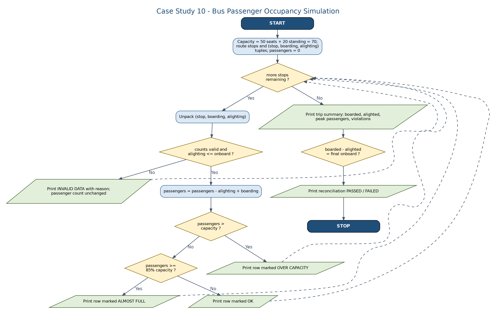
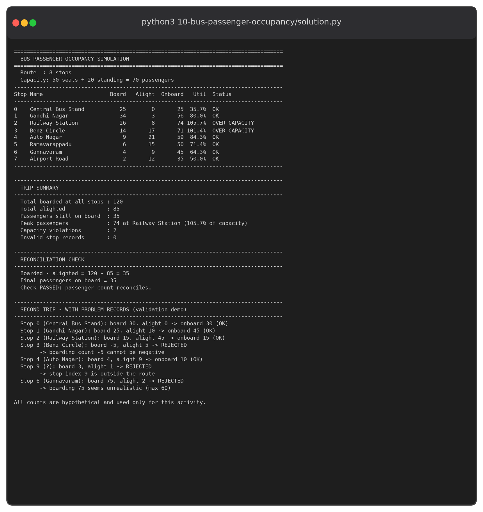

# Case Study 10 — Bus Passenger Occupancy Simulation

## Problem statement

Process boarding and alighting counts across multiple stops, calculate passenger counts at each stop, and flag any capacity violations.

## Solution approach

Each stop is stored as a tuple `(stop_index, boarding, alighting)`. A loop walks the route in order, applies `onboard = onboard − alighting + boarding` after validating the record, and classifies every stop as OK, ALMOST FULL, FULL or OVER CAPACITY. A second trip with deliberately bad data demonstrates the validation rules.

## Objectives

To store a stop-wise route as a tuple of tuples and unpack it in a loop; to maintain a running passenger count with operators; to validate boarding and alighting counts and reject impossible records; and to reconcile total boardings and alightings against the final count.

## Assumptions

- The bus has 50 seats + 20 standing places, so the maximum is 70 passengers.
- A single stop never has more than 60 boarding or alighting passengers (larger values are treated as data errors).
- Alighting cannot exceed the number of passengers currently on board.
- A stop with more than 85% of capacity occupied is ALMOST FULL; exactly 70 is FULL.
- Rejected records do not change the passenger count.
- All route names and counts are hypothetical.

## Algorithm

```
1. START
2. Define SEATING_CAPACITY=50, STANDING_CAPACITY=20, TOTAL=70, MAX_AT_ONE_STOP=60
3. Define ROUTE_STOPS (list) and BOARDING_ALIGHTING (tuple of stop tuples)
4. DEFINE FUNCTION validate_stop_record(record, num_stops)
   4.1 UNPACK record → stop, boarding, alighting
   4.2 problems ← empty list
   4.3 IF stop outside route THEN append problem
   4.4 IF boarding < 0 THEN append problem
   4.5 IF alighting < 0 THEN append problem
   4.6 IF boarding > 60 or alighting > 60 THEN append problem
   4.7 RETURN problems
5. DEFINE FUNCTION simulate_trip(stop_names, records, capacity)
   5.1 passengers ← 0 ; results ← empty list
   5.2 FOR each record DO
       5.2.1 UNPACK stop, boarding, alighting
       5.2.2 problems ← validate_stop_record(...)
       IF problems not empty THEN append INVALID result ; CONTINUE
       5.2.3 IF alighting > passengers THEN append INVALID result ; CONTINUE
       5.2.4 passengers ← passengers - alighting + boarding
       5.2.5 status ← OVER CAPACITY if passengers > capacity
                        FULL if passengers = capacity
                        ALMOST FULL if passengers >= 85% capacity
                        OK otherwise
       5.2.6 append (stop, boarding, alighting, passengers, status, [])
   5.3 RETURN results
6. CALL simulate_trip on the main route, PRINT the table with utilisation %
7. ACCUMULATE totals, peak passengers and capacity violations
8. PRINT trip summary and reconciliation check (boarded - alighted = final)
9. CALL simulate_trip on the problem trip and PRINT the rejection reasons
10. END
```

## Flowchart



## Pseudocode

```
BEGIN BUS_PASSENGER_OCCUPANCY

    CONST SEATING_CAPACITY  <- 50
    CONST STANDING_CAPACITY <- 20
    TOTAL_CAPACITY          <- SEATING_CAPACITY + STANDING_CAPACITY
    CONST MAX_AT_ONE_STOP   <- 60
    ROUTE_STOPS             <- ["Central Bus Stand", ..., "Airport Road"]
    BOARDING_ALIGHTING      <- ((0,25,0), (1,34,3), ..., (7,2,12))

    FUNCTION validate_stop_record((stop, boarding, alighting), num_stops)
        problems <- []
        IF stop < 0 OR stop >= num_stops THEN APPEND "stop outside route" TO problems END IF
        IF boarding < 0 THEN APPEND "negative boarding" TO problems END IF
        IF alighting < 0 THEN APPEND "negative alighting" TO problems END IF
        IF boarding  > MAX_AT_ONE_STOP THEN APPEND "unrealistic boarding" TO problems END IF
        IF alighting > MAX_AT_ONE_STOP THEN APPEND "unrealistic alighting" TO problems END IF
        RETURN problems
    END FUNCTION

    FUNCTION simulate_trip(stop_names, records, capacity)
        passengers <- 0 ; results <- []
        FOR each (stop, boarding, alighting) IN records DO
            problems <- validate_stop_record((stop, boarding, alighting),
                                             LENGTH(stop_names))
            IF LENGTH(problems) > 0 THEN
                APPEND (stop, boarding, alighting, passengers, "INVALID", problems) TO results
                CONTINUE
            END IF
            IF alighting > passengers THEN
                APPEND (stop, boarding, alighting, passengers, "INVALID",
                        ["alighting exceeds onboard"]) TO results
                CONTINUE
            END IF

            passengers <- passengers - alighting + boarding
            IF passengers > capacity THEN status <- "OVER CAPACITY"
            ELSE IF passengers = capacity THEN status <- "FULL"
            ELSE IF passengers >= capacity * 0.85 THEN status <- "ALMOST FULL"
            ELSE status <- "OK"
            END IF
            APPEND (stop, boarding, alighting, passengers, status, []) TO results
        END FOR
        RETURN results
    END FUNCTION

    results <- simulate_trip(ROUTE_STOPS, BOARDING_ALIGHTING, TOTAL_CAPACITY)
    total_boarded <- 0 ; total_alighted <- 0 ; violations <- 0 ; peak <- 0
    FOR each (stop, boarding, alighting, onboard, status, problems) IN results DO
        IF status = "INVALID" THEN PRINT rejection ; CONTINUE END IF
        total_boarded  <- total_boarded + boarding
        total_alighted <- total_alighted + alighting
        IF status = "OVER CAPACITY" THEN violations <- violations + 1 END IF
        IF onboard > peak THEN peak <- onboard END IF
        PRINT stop name, boarding, alighting, onboard, utilisation %, status
    END FOR
    PRINT totals, peak, violations
    IF total_boarded - total_alighted = results[LAST].onboard THEN
        PRINT "reconciliation PASSED"
    END IF
    CALL simulate_trip on PROBLEM_TRIP and print rejection reasons
END
```

## Python source code

```python
"""
Case Study 10: Bus Passenger Occupancy Simulation
--------------------------------------------------
Process boarding and alighting counts across multiple stops, calculate
passenger counts at each stop, and flag any capacity violations.

Syllabus used: variables, data types, operators, conditional statements,
loops, strings, lists, tuples, tuple operations and unpacking.
No library is imported - only core Python 3 is used.
"""

# ------------------------------------------------------------------
# Bus and route constants (hypothetical values for this study)
# ------------------------------------------------------------------
SEATING_CAPACITY = 50
STANDING_CAPACITY = 20
TOTAL_CAPACITY = SEATING_CAPACITY + STANDING_CAPACITY   # 70 passengers max
MAX_AT_ONE_STOP = 60          # safety check on the input data

# Route stops and (boarding, alighting) tuples for one trip
ROUTE_STOPS = [
    "Central Bus Stand",
    "Gandhi Nagar",
    "Railway Station",
    "Benz Circle",
    "Auto Nagar",
    "Ramavarappadu",
    "Gannavaram",
    "Airport Road",
]

# (stop index, boarding, alighting)  - stop 0 is the start
BOARDING_ALIGHTING = (
    (0, 25, 0),      # board at the bus stand
    (1, 34, 3),
    (2, 26, 8),      # rush hour - bus goes over capacity here
    (3, 14, 17),
    (4, 9, 21),
    (5, 6, 15),
    (6, 4, 9),
    (7, 2, 12),
)


def validate_stop_record(record, num_stops):
    """Return a list of problems with one (stop, boarding, alighting) tuple."""
    problems = []

    stop, boarding, alighting = record       # tuple unpacking

    if stop < 0 or stop >= num_stops:
        problems.append("stop index %d is outside the route" % stop)
    if boarding < 0:
        problems.append("boarding count %d cannot be negative" % boarding)
    if alighting < 0:
        problems.append("alighting count %d cannot be negative" % alighting)
    if boarding > MAX_AT_ONE_STOP:
        problems.append("boarding %d seems unrealistic (max %d)"
                        % (boarding, MAX_AT_ONE_STOP))
    if alighting > MAX_AT_ONE_STOP:
        problems.append("alighting %d seems unrealistic (max %d)"
                        % (alighting, MAX_AT_ONE_STOP))

    return problems


def simulate_trip(stop_names, records, capacity):
    """Run the trip and return a list of per-stop result tuples."""
    passengers = 0
    results = []

    for record in records:
        stop, boarding, alighting = record         # unpack

        problems = validate_stop_record(record, len(stop_names))
        if len(problems) > 0:
            # record the problem and skip the stop
            results.append((stop, boarding, alighting, passengers, "INVALID", problems))
            continue

        if alighting > passengers:
            # more people get off than are on the bus
            results.append((stop, boarding, alighting, passengers,
                            "INVALID", ["alighting %d exceeds onboard %d"
                                        % (alighting, passengers)]))
            continue

        passengers = passengers - alighting + boarding

        status = "OK"
        if passengers > capacity:
            status = "OVER CAPACITY"
        elif passengers == capacity:
            status = "FULL"
        elif passengers >= capacity * 0.85:
            status = "ALMOST FULL"

        results.append((stop, boarding, alighting, passengers, status, []))

    return results


def main():
    print("=" * 84)
    print("  BUS PASSENGER OCCUPANCY SIMULATION")
    print("=" * 84)
    print("  Route  : %d stops" % len(ROUTE_STOPS))
    print("  Capacity: %d seats + %d standing = %d passengers"
          % (SEATING_CAPACITY, STANDING_CAPACITY, TOTAL_CAPACITY))
    print("-" * 84)

    results = simulate_trip(ROUTE_STOPS, BOARDING_ALIGHTING, TOTAL_CAPACITY)

    print("%-4s %-22s %7s %8s %8s %6s  %s"
          % ("Stop", "Name", "Board", "Alight", "Onboard", "Util", "Status"))
    print("-" * 84)

    total_boarded = 0
    total_alighted = 0
    violations = 0
    peak_passengers = 0
    peak_stop = ""
    invalid_stops = 0

    for result in results:
        stop, boarding, alighting, onboard, status, problems = result     # unpack

        if status == "INVALID":
            invalid_stops += 1
            name = ROUTE_STOPS[stop] if 0 <= stop < len(ROUTE_STOPS) else "?"
            print("%-4d %-22s %7d %8s %8s %6s  %s"
                  % (stop, name, boarding, "-", onboard, "-", "INVALID DATA"))
            for p in problems:
                print("        -> %s" % p)
            continue

        total_boarded += boarding
        total_alighted += alighting

        util = onboard * 100.0 / TOTAL_CAPACITY

        if status == "OVER CAPACITY":
            violations += 1

        if onboard > peak_passengers:
            peak_passengers = onboard
            peak_stop = ROUTE_STOPS[stop]

        print("%-4d %-22s %7d %8d %8d %5.1f%%  %s"
              % (stop, ROUTE_STOPS[stop], boarding, alighting, onboard, util, status))

    print("-" * 84)

    # ---------------- trip summary ----------------
    print("\n" + "-" * 84)
    print("  TRIP SUMMARY")
    print("-" * 84)
    print("  Total boarded at all stops : %d" % total_boarded)
    print("  Total alighted             : %d" % total_alighted)
    print("  Passengers still on board  : %d" % results[-1][3])
    print("  Peak passengers            : %d at %s (%.1f%% of capacity)"
          % (peak_passengers, peak_stop, peak_passengers * 100.0 / TOTAL_CAPACITY))
    print("  Capacity violations        : %d" % violations)
    print("  Invalid stop records       : %d" % invalid_stops)

    # ---------------- reconciliation check ----------------
    print("\n" + "-" * 84)
    print("  RECONCILIATION CHECK")
    print("-" * 84)
    final_onboard = results[-1][3]
    expected = total_boarded - total_alighted
    print("  Boarded - alighted = %d - %d = %d" % (total_boarded, total_alighted, expected))
    print("  Final passengers on board = %d" % final_onboard)
    if expected == final_onboard:
        print("  Check PASSED: passenger count reconciles.")
    else:
        print("  Check FAILED: counts do not reconcile.")

    # ---------------- second trip with problem data ----------------
    print("\n" + "-" * 84)
    print("  SECOND TRIP - WITH PROBLEM RECORDS (validation demo)")
    print("-" * 84)

    problem_trip = (
        (0, 30, 0),
        (1, 25, 10),
        (2, 15, 45),      # more alighting than onboard
        (3, -5, 5),       # negative boarding
        (4, 4, 9),
        (9, 3, 1),        # stop outside the route
        (6, 75, 2),       # unrealistic boarding count
    )

    problem_results = simulate_trip(ROUTE_STOPS, problem_trip, TOTAL_CAPACITY)
    for result in problem_results:
        stop, boarding, alighting, onboard, status, problems = result
        name = ROUTE_STOPS[stop] if 0 <= stop < len(ROUTE_STOPS) else "?"
        if status == "INVALID":
            print("  Stop %d (%s): board %d, alight %d -> REJECTED"
                  % (stop, name, boarding, alighting))
            for p in problems:
                print("        -> %s" % p)
        else:
            print("  Stop %d (%s): board %d, alight %d -> onboard %d (%s)"
                  % (stop, name, boarding, alighting, onboard, status))

    print("\nAll counts are hypothetical and used only for this activity.")


if __name__ == "__main__":
    main()
```

## Test cases

| # | Test | Expected | Result |
|---|------|----------|--------|
| TC-01 | Total capacity | 70 | PASS |
| TC-02 | Valid stop record | accepted | PASS |
| TC-03 | Negative boarding | rejected | PASS |
| TC-04 | Negative alighting | rejected | PASS |
| TC-05 | Stop index 9 | rejected | PASS |
| TC-06 | Boarding 75 | rejected | PASS |
| TC-07 | Zero boarding, everyone alights | valid | PASS |
| TC-08 | Simple trip 20 → 17 → 12 | counts correct | PASS |
| TC-09 | Over-capacity trip | flagged | PASS |
| TC-10 | Exactly 70 on board | FULL | PASS |
| TC-11 | 60 of 70 (85%+) | ALMOST FULL | PASS |
| TC-12 | Alighting 15 with 10 on board | rejected | PASS |
| TC-13 | Negative boarding in trip | rejected | PASS |
| TC-14 | After a rejected stop | count unchanged | PASS |
| TC-15 | Sample trip | peak 74 passengers | PASS |
| TC-16 | Sample trip | 2 capacity violations | PASS |
| TC-17 | Sample trip | counts reconcile | PASS |
| TC-18 | Sample trip | 8 results for 8 stops | PASS |

All 18 test cases pass when `test_cases.py` is run.

## Output screenshot



## Conclusion

The simulation tracked the bus through all eight stops: boardings exceeded alightings during the morning rush, so the bus carried 74 passengers at Railway Station (105.7% of the 70-passenger capacity) and was still over capacity at the next stop — exactly the two violations reported in the summary. The reconciliation check (120 boarded − 85 alighted = 35 still on board) confirms the running counter is consistent. The second trip showed that impossible records (negative boarding, alighting more than on board, an off-route stop index and an unrealistic boarding count) are all rejected without disturbing the passenger count. Only tuples, unpacking, loops, conditionals and operators were used.
