# Python Activity-Based Learning

**Name:** DANTINADA VINAY NAGA DATTA  
**Roll No:** 26000477  
**Subject:** Python Programming  
**Activity:** Python Activity 1 — 10 Case Studies

> This file contains the complete submission: all ten case studies with the problem statement, objectives, assumptions, algorithm, flowchart, pseudocode, Python source code, test cases, output and conclusion for each one.
>
> A compiled version of the same document is also in the repository as [Python-Activity-Based-Learning-Complete.pdf](Python-Activity-Based-Learning-Complete.pdf) (120 pages).

---

## Contents

| # | Case study | Question no. | Syllabus focus |
|---|------------|--------------|----------------|
| 1 | [Progressive Electricity Billing](#case-01--progressive-electricity-billing) | Q2 | variables, operators, conditionals, loops, lists |
| 2 | [ATM Transaction Sequence Simulation](#case-02--atm-transaction-sequence-simulation) | Q13 | tuples, unpacking, conditionals, loops |
| 3 | [Advanced Numeric Pattern Generator](#case-03--advanced-numeric-pattern-generator) | Q27 | nested loops, pattern generation, strings |
| 4 | [Password Policy Validation Engine](#case-04--password-policy-validation-engine) | Q29 | strings, string methods, conditionals, loops |
| 5 | [String-Based Examination Answer Evaluation](#case-05--string-based-examination-answer-evaluation) | Q31 | strings, loops, lists, negative marking |
| 6 | [Text Compression Using Character Runs](#case-06--text-compression-using-character-runs) | Q35 | strings, loops, encoding and decoding |
| 7 | [Nested Loop Calendar Generator](#case-07--nested-loop-calendar-generator) | Q37 | nested loops, pattern generation, arithmetic |
| 8 | [Student Marks Matrix Analysis](#case-08--student-marks-matrix-analysis) | Q42 | nested lists, tuples, row and column statistics |
| 9 | [Tuple-Based Product Catalogue Audit](#case-09--tuple-based-product-catalogue-audit) | Q49 | tuples, unpacking, validation, lists |
| 10 | [Bus Passenger Occupancy Simulation](#case-10--bus-passenger-occupancy-simulation) | Q51 | tuples, unpacking, running totals, conditionals |

Every folder also contains its own `README.md`, `flowchart.png`, `solution.py`, `test_cases.py`, `output.txt` and `output_screenshot.png`.

---

## Case 01 — Progressive Electricity Billing

**Case study question Q2** &nbsp;•&nbsp; Folder: [`01-progressive-electricity-billing/`](01-progressive-electricity-billing/)

---

### 1. Problem statement

Calculate household electricity bills using multiple consumption slabs, fixed charges, surcharges and rebates, then compare bills across several months and identify unusual increases.

### 2. Objectives

To apply progressive (slab-wise) charging with conditional statements and loops; to compute duty, surcharge and rebate components using operators; to store monthly readings in lists and slab rules in tuples and unpack them cleanly; and to flag month-on-month bill rises beyond a given percentage.

### 3. Assumptions

- One unit = one kWh and all readings are in whole units.
- Tariff slabs (monthly): first 100 units at Rs 2.50, next 100 at Rs 4.20, next 200 at Rs 6.10, above 400 at Rs 7.80.
- Fixed charge Rs 50 per month; electricity duty 5% of energy charge.
- A surcharge of 3% of the energy charge is applied when consumption exceeds 500 units.
- A prompt-payment rebate of 2% is allowed on the gross bill (fixed + energy + duty + surcharge).
- A month-on-month bill rise greater than 25% is treated as an *unusual increase*.
- All readings and names are hypothetical.

### 4. Algorithm

```text
1. START
2. Define constants: FIXED_CHARGE=50, SLAB_LIMITS=(100,200,400),
   SLAB_RATES=(2.50,4.20,6.10,7.80), DUTY=5%, SURCHARGE=3% above 500 units,
   REBATE=2%, UNUSUAL_RISE=25%
3. DEFINE FUNCTION slab_charge(units)
   3.1 charge ← 0, remaining ← units, lower ← 0
   3.2 FOR i ← 0 to len(SLAB_LIMITS)-1 DO
       (upper, rate) ← (SLAB_LIMITS[i], SLAB_RATES[i])
       IF remaining <= 0 THEN BREAK
       slab_units ← min(upper - lower, remaining)
       charge ← charge + slab_units * rate
       remaining ← remaining - slab_units
       lower ← upper
   END FOR
   3.3 IF remaining > 0 THEN charge ← charge + remaining * SLAB_RATES[last]
   3.4 RETURN charge
4. DEFINE FUNCTION compute_bill(units)
   4.1 energy ← slab_charge(units)
   4.2 duty ← energy * 5 / 100
   4.3 IF units > 500 THEN surcharge ← energy * 3 / 100 ELSE surcharge ← 0
   4.4 gross ← FIXED_CHARGE + energy + duty + surcharge
   4.5 rebate ← gross * 2 / 100 ; total ← gross - rebate
   4.6 RETURN (total, breakdown lines)
5. FOR each household DO
   5.1 bills ← empty list ; rises ← empty list
   5.2 FOR each month index i DO
       bill ← compute_bill(CONSUMPTION[i])
       IF i = 0 THEN rise ← 0 ELSE rise ← (bill - bills[i-1]) * 100 / bills[i-1]
       IF rise > 25 THEN remark ← "UNUSUAL INCREASE"
       PRINT month, units, bill, rise, remark
   5.3 PRINT average bill and highest bill
6. Scan every month pair of every household:
   IF rise > 25% THEN PRINT the jump and remember the sharpest one
7. PRINT recommendation for the sharpest rise
8. END
```

### 5. Flowchart

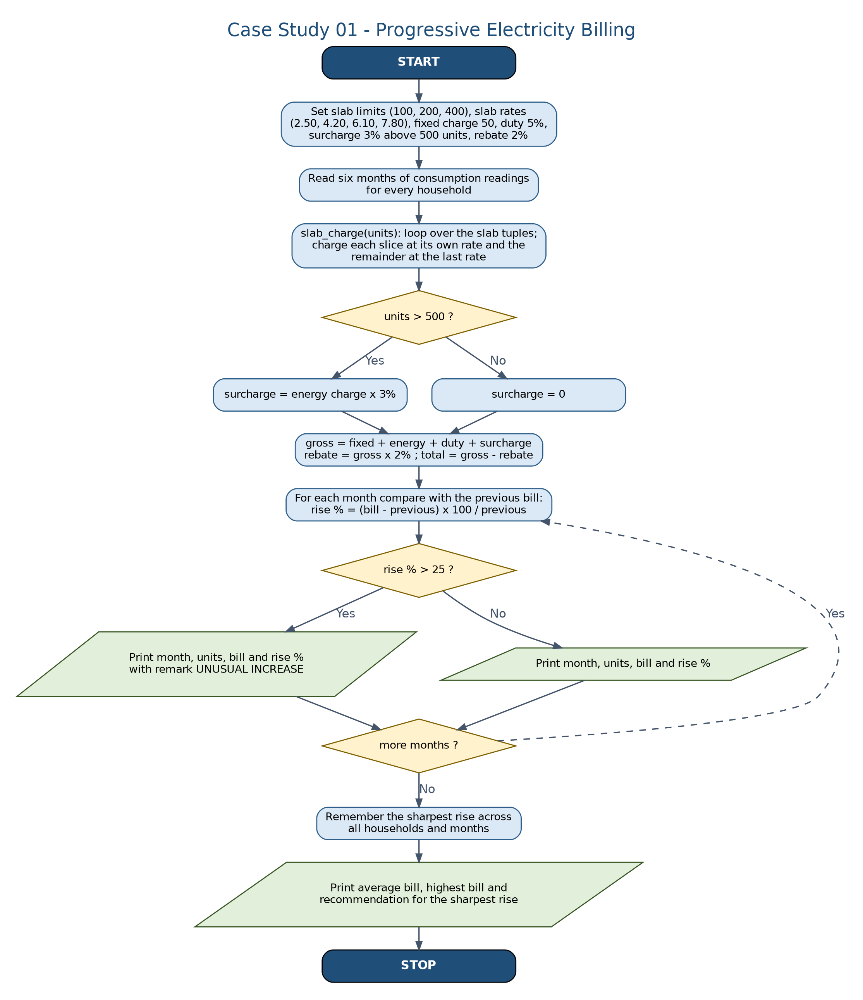

### 6. Pseudocode

```text
BEGIN PROGRESSIVE_ELECTRICITY_BILLING

    CONST FIXED_CHARGE    ← 50
    SLAB_LIMITS           ← (100, 200, 400)
    SLAB_RATES            ← (2.50, 4.20, 6.10, 7.80)
    CONST DUTY_PERCENT    ← 5
    CONST SURCHARGE_PCT   ← 3
    CONST SURCHARGE_LIMIT ← 500
    CONST REBATE_PERCENT  ← 2
    CONST UNUSUAL_RISE    ← 25

    FUNCTION slab_charge(units)
        remaining ← units ; charge ← 0 ; lower ← 0
        FOR i ← 0 TO LENGTH(SLAB_LIMITS) - 1 DO
            IF remaining <= 0 THEN EXIT FOR
            upper ← SLAB_LIMITS[i]
            use ← MINIMUM(upper - lower, remaining)
            charge ← charge + use * SLAB_RATES[i]
            remaining ← remaining - use
            lower ← upper
        END FOR
        IF remaining > 0 THEN charge ← charge + remaining * SLAB_RATES[LAST]
        RETURN charge
    END FUNCTION

    FUNCTION compute_bill(units)
        energy ← slab_charge(units)
        duty   ← energy * DUTY_PERCENT / 100
        IF units > SURCHARGE_LIMIT THEN
            surcharge ← energy * SURCHARGE_PCT / 100
        ELSE
            surcharge ← 0
        END IF
        gross  ← FIXED_CHARGE + energy + duty + surcharge
        rebate ← gross * REBATE_PERCENT / 100
        RETURN (gross - rebate)
    END FUNCTION

    FOR each household IN HOUSEHOLDS DO
        bills ← [] ; previous ← 0
        FOR i ← 0 TO LENGTH(MONTHS) - 1 DO
            bill ← compute_bill(CONSUMPTION[household][i])
            IF i = 0 THEN
                rise ← 0
            ELSE
                rise ← (bill - previous) * 100 / previous
            END IF
            IF rise > UNUSUAL_RISE THEN
                PRINT "UNUSUAL INCREASE"
            END IF
            PRINT MONTHS[i], consumption, bill, rise
            APPEND bill TO bills
            previous ← bill
        END FOR
        PRINT AVERAGE(bills), MAXIMUM(bills)
    END FOR

    Find the highest rise across all households and months
    PRINT that household, month and percentage with a recommendation
END
```

### 7. Python source code

Complete file — [`01-progressive-electricity-billing/solution.py`](01-progressive-electricity-billing/solution.py)

```python
"""
Case Study 01: Progressive Electricity Billing
------------------------------------------------
Calculate household bills using multiple consumption slabs, fixed charges,
surcharges and rebates, then compare bills across several months and
identify unusual increases.

Syllabus used: variables, data types, operators, conditional statements,
loops, strings, lists, tuples, tuple operations and tuple unpacking.
No library is imported - only core Python 3 is used.
"""

# ------------------------------------------------------------------
# Tariff and policy constants (hypothetical values for this study)
# ------------------------------------------------------------------
FIXED_CHARGE = 50.0            # Rs. meter / fixed charge per month
SLAB_LIMITS = (100, 200, 400)  # slabs: 0-100, 101-200, 201-400, above 400
SLAB_RATES = (2.50, 4.20, 6.10, 7.80)   # Rs. per unit in each slab
DUTY_PERCENT = 5.0             # electricity duty applied on slab charge
SURCHARGE_PERCENT = 3.0        # extra surcharge when usage > 500 units
SURCHARGE_LIMIT = 500
REBATE_PERCENT = 2.0           # prompt-payment rebate on the total
UNUSUAL_RISE_PERCENT = 25.0    # month-on-month rise treated as unusual

HOUSEHOLDS = ["H-101", "H-102", "H-103"]

# Consumption in units for six successive months (index 0 = month 1)
MONTHS = ["Jan", "Feb", "Mar", "Apr", "May", "Jun"]
CONSUMPTION = [
    (112, 118, 145, 160, 158, 170),   # H-101 - gently rising
    (240, 255, 310, 330, 420, 455),   # H-102 - sudden summer jump
    (88, 95, 250, 105, 98, 101),      # H-103 - one abnormal month
]


def slab_charge(units):
    """Progressive slab calculation using a loop over the slab tuples."""
    remaining = units
    charge = 0.0
    lower = 0
    for i in range(len(SLAB_LIMITS)):
        upper = SLAB_LIMITS[i]
        rate = SLAB_RATES[i]
        if remaining <= 0:
            break
        slab_units = upper - lower
        if remaining < slab_units:
            slab_units = remaining
        charge += slab_units * rate
        remaining -= slab_units
        lower = upper

    if remaining > 0:                      # last open-ended slab
        charge += remaining * SLAB_RATES[-1]

    return charge


def compute_bill(units):
    """Return (bill_amount, breakdown_lines) for one month's consumption."""
    lines = []

    energy = slab_charge(units)
    duty = energy * DUTY_PERCENT / 100.0

    surcharge = 0.0
    if units > SURCHARGE_LIMIT:
        surcharge = energy * SURCHARGE_PERCENT / 100.0

    gross = FIXED_CHARGE + energy + duty + surcharge
    rebate = gross * REBATE_PERCENT / 100.0
    total = gross - rebate

    lines.append("Energy charge (slabs) : Rs. %8.2f" % energy)
    lines.append("Fixed charge          : Rs. %8.2f" % FIXED_CHARGE)
    lines.append("Electricity duty %4.1f%% : Rs. %8.2f" % (DUTY_PERCENT, duty))
    if surcharge > 0:
        lines.append("Surcharge %4.1f%%        : Rs. %8.2f" % (SURCHARGE_PERCENT, surcharge))
    lines.append("Rebate %4.1f%%           : Rs. %8.2f" % (REBATE_PERCENT, -rebate))
    lines.append("TOTAL PAYABLE         : Rs. %8.2f" % total)

    return round(total, 2), lines


def compare_months(household, readings):
    """Print the month-wise comparison and flag unusual increases."""
    print("\n" + "=" * 62)
    print("  MONTH-WISE BILL COMPARISON  -  Household %s" % household)
    print("=" * 62)
    print("%-7s %-8s %-12s %-10s %s" % ("Month", "Units", "Bill (Rs.)", "Rise %", "Remark"))
    print("-" * 62)

    bills = []
    rises = []
    for i in range(len(readings)):
        units = readings[i]
        bill, _ = compute_bill(units)
        bills.append(bill)

        if i == 0:
            rise = 0.0
        else:
            prev = bills[i - 1]
            rise = (bill - prev) * 100.0 / prev
        rises.append(rise)

        remark = ""
        if i > 0 and rise > UNUSUAL_RISE_PERCENT:
            remark = "UNUSUAL INCREASE"
        elif i > 0 and rise < 0:
            remark = "lower than previous"

        print("%-7s %-8d %-12.2f %-10.1f %s" % (MONTHS[i], units, bill, rise, remark))

    print("-" * 62)
    avg = sum(bills) / len(bills)
    print("Average bill over %d months : Rs. %.2f" % (len(bills), avg))

    highest_index = 0
    for i in range(1, len(bills)):
        if bills[i] > bills[highest_index]:
            highest_index = i
    print("Highest bill : %s  (Rs. %.2f)" % (MONTHS[highest_index], bills[highest_index]))

    return bills, rises


def main():
    print("=" * 62)
    print("  PROGRESSIVE ELECTRICITY BILLING SYSTEM")
    print("=" * 62)

    # sample month-wise detail for the first household, full breakdown
    print("\nDETAILED BILL BREAKDOWN - H-101, month Mar (145 units):")
    _, lines = compute_bill(145)
    for line in lines:
        print("   " + line)

    all_bills = []
    for i in range(len(HOUSEHOLDS)):
        bills, rises = compare_months(HOUSEHOLDS[i], CONSUMPTION[i])
        all_bills.append(bills)

    # ------- which household had the sharpest single jump? -------
    print("\n" + "=" * 62)
    print("  UNUSUAL INCREASE SUMMARY")
    print("=" * 62)
    worst_household = ""
    worst_rise = 0.0
    worst_month = ""
    for i in range(len(HOUSEHOLDS)):
        for j in range(1, len(MONTHS)):
            rise = (all_bills[i][j] - all_bills[i][j - 1]) * 100.0 / all_bills[i][j - 1]
            if rise > UNUSUAL_RISE_PERCENT:
                print("  %s : %s -> %s : %+.1f%%  (Rs. %.2f -> Rs. %.2f)"
                      % (HOUSEHOLDS[i], MONTHS[j - 1], MONTHS[j], rise,
                         all_bills[i][j - 1], all_bills[i][j]))
                if rise > worst_rise:
                    worst_rise = rise
                    worst_household = HOUSEHOLDS[i]
                    worst_month = MONTHS[j]

    if worst_rise > 0:
        print("\n  Sharpest rise: %s in %s (%+.1f%%)."
              % (worst_household, worst_month, worst_rise))
        print("  Recommendation: verify meter reading and check for faulty appliances.")
    else:
        print("  No month showed an unusual increase.")

    print("\nAll values are hypothetical and used only for this activity.")


if __name__ == "__main__":
    main()
```

### 8. Test cases

| # | Test | Expected | Result |
|---|------|----------|--------|
| T1 | 50 units, first slab only | Rs 125.00 | PASS |
| T2 | 100 units, exact slab boundary | Rs 250.00 | PASS |
| T3 | 250 units across three slabs | Rs 975.00 | PASS |
| T4 | 500 units including last slab | Rs 2670.00 | PASS |
| T5 | No surcharge at exactly 500 units | duty + fixed − rebate only | PASS |
| T6 | Surcharge applied at 501 units | 3% of energy charge added | PASS |
| T7 | Zero consumption | fixed − rebate = Rs 49.00 | PASS |
| T8 | 181 units costs more than 180 units | strictly increasing | PASS |
| T9 | H-103 March jump | rise > 25% flagged | PASS |
| T10 | H-103 April | bill falls back below March | PASS |

All 10 tests pass when `test_cases.py` is run.

Complete test file — [`01-progressive-electricity-billing/test_cases.py`](01-progressive-electricity-billing/test_cases.py)

```python
"""Automated test cases for Case Study 01 - Progressive Electricity Billing."""
import importlib.util
import os

spec = importlib.util.spec_from_file_location(
    "sol", os.path.join(os.path.dirname(os.path.abspath(__file__)), "solution.py"))
sol = importlib.util.module_from_spec(spec)
spec.loader.exec_module(sol)

passed = 0


def check(label, condition):
    global passed
    assert condition, "FAILED: " + label
    passed += 1
    print("  PASS:", label)


# TC-01: usage fully inside the first slab
check("50 units charged at Rs 2.50 = 125.00",
      abs(sol.slab_charge(50) - 125.00) < 0.01)

# TC-02: exactly on the first slab boundary
check("100 units = 250.00 (boundary)",
      abs(sol.slab_charge(100) - 250.00) < 0.01)

# TC-03: usage spread over three slabs
# 100*2.50 + 100*4.20 + 50*6.10 = 250 + 420 + 305
check("250 units = 975.00 across three slabs",
      abs(sol.slab_charge(250) - 975.00) < 0.01)

# TC-04: usage that enters the open-ended last slab
# 250 + 420 + 200*6.10 + 100*7.80 = 2670
check("500 units = 2670.00 including last slab",
      abs(sol.slab_charge(500) - 2670.00) < 0.01)

# TC-05: no surcharge when usage is exactly at the 500 unit limit
expected = 50 + 2670 + 2670 * 0.05
expected = expected - expected * 0.02
check("500 units -> no surcharge, bill = %.2f" % expected,
      abs(sol.compute_bill(500)[0] - round(expected, 2)) < 0.01)

# TC-06: one unit above the limit brings in the 3% surcharge
energy = 2670 + 7.80
expected = 50 + energy + energy * 0.05 + energy * 0.03
expected = expected - expected * 0.02
check("501 units -> surcharge applied, bill = %.2f" % expected,
      abs(sol.compute_bill(501)[0] - round(expected, 2)) < 0.01)

# TC-07: zero consumption only pays fixed charge minus rebate
check("0 units -> 50.00 - 2% rebate = 49.00",
      abs(sol.compute_bill(0)[0] - 49.00) < 0.01)

# TC-08: bill must grow with consumption
check("bill strictly increases from 180 to 181 units",
      sol.compute_bill(181)[0] > sol.compute_bill(180)[0])

# TC-09: the abnormal month of H-103 is flagged
bills, rises = sol.compare_months("H-103", sol.CONSUMPTION[2])
check("H-103 March rise flagged as unusual (%.1f%% > 25%%)" % rises[2],
      rises[2] > sol.UNUSUAL_RISE_PERCENT)

# TC-10: the next month falls back and shows a negative rise
check("H-103 April bill below March bill (negative rise)",
      bills[3] < bills[2] and rises[3] < 0)

print("\n%d test cases passed" % passed)
```

### 9. Output

Console output produced by running `01-progressive-electricity-billing/solution.py` — [`output.txt`](01-progressive-electricity-billing/output.txt)

```text
==============================================================
  PROGRESSIVE ELECTRICITY BILLING SYSTEM
==============================================================

DETAILED BILL BREAKDOWN - H-101, month Mar (145 units):
   Energy charge (slabs) : Rs.   439.00
   Fixed charge          : Rs.    50.00
   Electricity duty  5.0% : Rs.    21.95
   Rebate  2.0%           : Rs.   -10.22
   TOTAL PAYABLE         : Rs.   500.73

==============================================================
  MONTH-WISE BILL COMPARISON  -  Household H-101
==============================================================
Month   Units    Bill (Rs.)   Rise %     Remark
--------------------------------------------------------------
Jan     112      358.11       0.0        
Feb     118      384.04       7.2        
Mar     145      500.73       30.4       UNUSUAL INCREASE
Apr     160      565.56       12.9       
May     158      556.91       -1.5       lower than previous
Jun     170      608.78       9.3        
--------------------------------------------------------------
Average bill over 6 months : Rs. 495.69
Highest bill : Jun  (Rs. 608.78)

==============================================================
  MONTH-WISE BILL COMPARISON  -  Household H-102
==============================================================
Month   Units    Bill (Rs.)   Rise %     Remark
--------------------------------------------------------------
Jan     240      989.51       0.0        
Feb     255      1083.66      9.5        
Mar     310      1428.89      31.9       UNUSUAL INCREASE
Apr     330      1554.43      8.8        
May     420      2154.33      38.6       UNUSUAL INCREASE
Jun     455      2435.25      13.0       
--------------------------------------------------------------
Average bill over 6 months : Rs. 1607.68
Highest bill : Jun  (Rs. 2435.25)

==============================================================
  MONTH-WISE BILL COMPARISON  -  Household H-103
==============================================================
Month   Units    Bill (Rs.)   Rise %     Remark
--------------------------------------------------------------
Jan     88       275.38       0.0        
Feb     95       293.39       6.5        
Mar     250      1052.28      258.7      UNUSUAL INCREASE
Apr     105      327.86       -68.8      lower than previous
May     98       301.11       -8.2       lower than previous
Jun     101      310.57       3.1        
--------------------------------------------------------------
Average bill over 6 months : Rs. 426.77
Highest bill : Mar  (Rs. 1052.28)

==============================================================
  UNUSUAL INCREASE SUMMARY
==============================================================
  H-101 : Feb -> Mar : +30.4%  (Rs. 384.04 -> Rs. 500.73)
  H-102 : Feb -> Mar : +31.9%  (Rs. 1083.66 -> Rs. 1428.89)
  H-102 : Apr -> May : +38.6%  (Rs. 1554.43 -> Rs. 2154.33)
  H-103 : Feb -> Mar : +258.7%  (Rs. 293.39 -> Rs. 1052.28)

  Sharpest rise: H-103 in Mar (+258.7%).
  Recommendation: verify meter reading and check for faulty appliances.

All values are hypothetical and used only for this activity.
```

### 10. Output screenshot

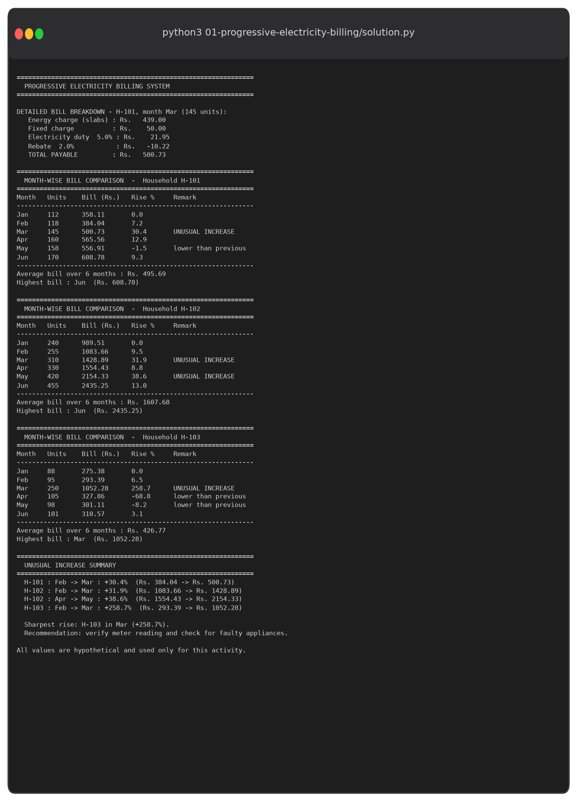

### 11. Conclusion

The program computes progressive slab-wise bills correctly and the breakdown shows how each component (energy, fixed, duty, surcharge, rebate) contributes to the total. Comparing six months of readings highlighted the abnormal spikes — H-103's March bill was 258.7% higher than February and settled back to normal in April, while H-102 showed a genuine summer trend. The whole study needed only tuples, lists, loops, conditionals and arithmetic operators from the syllabus.

---

## Case 02 — ATM Transaction Sequence Simulation

**Case study question Q13** &nbsp;•&nbsp; Folder: [`02-atm-transaction-sequence-simulation/`](02-atm-transaction-sequence-simulation/)

---

### 1. Problem statement

Process a sequence of deposits and withdrawals, maintain a simulated balance, enforce withdrawal limits, reject invalid transactions and produce a transaction summary.

### 2. Objectives

To simulate an ATM account using tuples of transactions and tuple unpacking; to enforce several independent business rules with nested conditional statements; to maintain running totals with loops and operators; and to generate a summary that reconciles opening balance, deposits, withdrawals and closing balance.

### 3. Assumptions

- The account starts with Rs 12,500 and must never fall below a minimum balance of Rs 1,000.
- A single withdrawal must be between Rs 100 and Rs 20,000; total withdrawals per day cannot exceed Rs 25,000.
- A single deposit cannot exceed Rs 1,00,000 and must be positive.
- A transaction is either a deposit ("D") or a withdrawal ("W"); any other type letter is treated as invalid.
- Rejected transactions do not change the balance, so later transactions see the earlier balance.
- All account numbers and amounts are hypothetical.

### 4. Algorithm

```text
1. START
2. Define constants: STARTING_BALANCE=12500, MINIMUM_BALANCE=1000,
   DAILY_WITHDRAWAL_LIMIT=25000, SINGLE_WITHDRAWAL_LIMIT=20000,
   SINGLE_WITHDRAWAL_MIN=100, DEPOSIT_LIMIT=100000
3. Read the list of transaction tuples (id, type, amount)
4. DEFINE FUNCTION process_transactions(start_balance, transactions)
   4.1 balance ← start_balance ; totals and counters ← 0
   4.2 FOR each transaction DO
       4.2.1 UNPACK transaction → id, type, amount
       4.2.2 reason ← ""
       4.2.3 IF type = "D" THEN
               IF amount <= 0 → reason ← invalid amount
               ELSE IF amount > DEPOSIT_LIMIT → reason ← above deposit limit
             ELSE IF type = "W" THEN
               IF amount < SINGLE_WITHDRAWAL_MIN → reason ← below minimum
               ELSE IF amount > SINGLE_WITHDRAWAL_LIMIT → reason ← above single limit
               ELSE IF withdrawn_today + amount > DAILY_LIMIT → reason ← daily limit
               ELSE IF balance - amount < MINIMUM_BALANCE → reason ← below minimum balance
             ELSE reason ← unknown type
       4.2.4 IF reason <> "" THEN PRINT rejected row ; rejected ← rejected + 1
               ELSE apply transaction, update totals and balance, accepted ← accepted + 1
   4.3 RETURN (balance, deposits, withdrawals, accepted, rejected, withdrawn_today)
5. CALL process_transactions and unpack the result tuple
6. PRINT transaction summary: counts, success rate, opening/deposits/withdrawals/closing
7. Run a second sequence for "next day" with a reset daily counter
8. IF closing balance < MINIMUM_BALANCE THEN PRINT warning
9. END
```

### 5. Flowchart

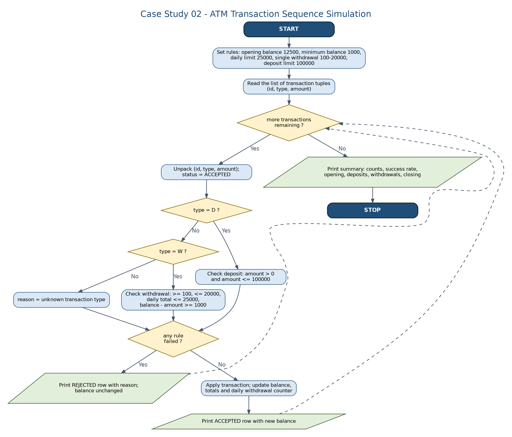

### 6. Pseudocode

```text
BEGIN ATM_TRANSACTION_SEQUENCE

    CONST STARTING_BALANCE        <- 12500
    CONST MINIMUM_BALANCE         <- 1000
    CONST DAILY_WITHDRAWAL_LIMIT  <- 25000
    CONST SINGLE_WITHDRAWAL_LIMIT <- 20000
    CONST SINGLE_WITHDRAWAL_MIN   <- 100
    CONST DEPOSIT_LIMIT           <- 100000

    FUNCTION process_transactions(start_balance, transactions)
        balance <- start_balance
        total_deposits <- 0 ; total_withdrawn <- 0 ; withdrawn_today <- 0
        accepted <- 0 ; rejected <- 0

        FOR each (tx_id, tx_type, amount) IN transactions DO
            reason <- ""
            IF tx_type = "D" THEN
                IF amount <= 0 THEN reason <- "invalid deposit"
                ELSE IF amount > DEPOSIT_LIMIT THEN reason <- "deposit above limit"
            ELSE IF tx_type = "W" THEN
                IF amount < SINGLE_WITHDRAWAL_MIN THEN reason <- "below minimum"
                ELSE IF amount > SINGLE_WITHDRAWAL_LIMIT THEN reason <- "above single limit"
                ELSE IF withdrawn_today + amount > DAILY_WITHDRAWAL_LIMIT THEN
                    reason <- "daily limit crossed"
                ELSE IF balance - amount < MINIMUM_BALANCE THEN
                    reason <- "balance below minimum"
            ELSE
                reason <- "unknown transaction type"
            END IF

            IF reason <> "" THEN
                rejected <- rejected + 1
                PRINT tx_id, tx_type, amount, "REJECTED", reason
            ELSE
                IF tx_type = "D" THEN
                    balance <- balance + amount
                    total_deposits <- total_deposits + amount
                ELSE
                    balance <- balance - amount
                    total_withdrawn <- total_withdrawn + amount
                    withdrawn_today <- withdrawn_today + amount
                END IF
                accepted <- accepted + 1
                PRINT tx_id, tx_type, amount, "ACCEPTED", balance
            END IF
        END FOR
        RETURN (balance, total_deposits, total_withdrawn, accepted, rejected, withdrawn_today)
    END FUNCTION

    (closing, dep, wdr, acc, rej, used) <- process_transactions(STARTING_BALANCE, TRANSACTIONS)
    PRINT "processed", acc + rej, "accepted", acc, "rejected", rej
    PRINT opening, dep, wdr, closing
    CALL process_transactions(closing, NEXT_DAY_TRANSACTIONS)
END
```

### 7. Python source code

Complete file — [`02-atm-transaction-sequence-simulation/solution.py`](02-atm-transaction-sequence-simulation/solution.py)

```python
"""
Case Study 02: ATM Transaction Sequence Simulation
---------------------------------------------------
Process a sequence of deposits and withdrawals, maintain a simulated
balance, enforce withdrawal limits, reject invalid transactions and
produce a transaction summary.

Syllabus used: variables, data types, operators, conditional statements,
loops, strings, lists, tuples, tuple operations and tuple unpacking.
No library is imported - only core Python 3 is used.
"""

# ------------------------------------------------------------------
# Account and ATM rules (hypothetical values for this study)
# ------------------------------------------------------------------
STARTING_BALANCE = 12500.00
MINIMUM_BALANCE = 1000.00        # account must never go below this
DAILY_WITHDRAWAL_LIMIT = 25000.00
SINGLE_WITHDRAWAL_LIMIT = 20000.00
SINGLE_WITHDRAWAL_MIN = 100.00   # smallest note-slot withdrawal
DEPOSIT_LIMIT = 100000.00

# Each transaction tuple: (transaction_id, type, amount)
# type "D" = deposit, "W" = withdrawal
TRANSACTIONS = [
    ("TX01", "D", 5000.00),
    ("TX02", "W", 2000.00),
    ("TX03", "W", 15000.00),
    ("TX04", "W", 22000.00),      # above single withdrawal limit
    ("TX05", "D", 120000.00),     # above deposit limit
    ("TX06", "X", 500.00),        # unknown transaction type
    ("TX07", "W", 50.00),         # below minimum withdrawal
    ("TX08", "W", 4000.00),
    ("TX09", "D", 2500.00),
    ("TX10", "W", 13500.00),      # would breach minimum balance
]


def process_transactions(start_balance, transactions, verbose=True):
    """Run every transaction in order and return the summary data."""
    balance = start_balance
    total_deposits = 0.0
    total_withdrawn = 0.0
    withdrawn_today = 0.0         # used for the daily withdrawal limit
    accepted = 0
    rejected = 0

    if verbose:
        print("=" * 74)
        print("  ATM TRANSACTION SEQUENCE SIMULATION")
        print("=" * 74)
        print("  Opening balance : Rs. %.2f" % balance)
        print("  Rules: minimum balance Rs. %.2f, daily withdrawal limit Rs. %.2f,"
              % (MINIMUM_BALANCE, DAILY_WITHDRAWAL_LIMIT))
        print("         single withdrawal between Rs. %.2f and Rs. %.2f,"
              % (SINGLE_WITHDRAWAL_MIN, SINGLE_WITHDRAWAL_LIMIT))
        print("         deposit limit Rs. %.2f" % DEPOSIT_LIMIT)
        print("-" * 74)
        print("%-6s %-4s %-12s %-12s %-12s %s"
              % ("ID", "Type", "Amount", "Balance", "Status", "Reason if rejected"))
        print("-" * 74)

    for transaction in transactions:
        # ---- tuple unpacking ----
        tx_id, tx_type, amount = transaction

        reason = ""
        status = "ACCEPTED"

        if tx_type == "D":
            if amount <= 0:
                reason = "invalid deposit amount"
            elif amount > DEPOSIT_LIMIT:
                reason = "deposit above limit Rs. %.0f" % DEPOSIT_LIMIT
        elif tx_type == "W":
            if amount < SINGLE_WITHDRAWAL_MIN:
                reason = "below minimum withdrawal Rs. %.0f" % SINGLE_WITHDRAWAL_MIN
            elif amount > SINGLE_WITHDRAWAL_LIMIT:
                reason = "above single withdrawal limit Rs. %.0f" % SINGLE_WITHDRAWAL_LIMIT
            elif withdrawn_today + amount > DAILY_WITHDRAWAL_LIMIT:
                reason = "daily withdrawal limit would be crossed"
            elif balance - amount < MINIMUM_BALANCE:
                reason = "would leave balance below minimum Rs. %.0f" % MINIMUM_BALANCE
        else:
            reason = "unknown transaction type '%s'" % tx_type

        if reason != "":
            status = "REJECTED"
            rejected += 1
            if verbose:
                print("%-6s %-4s %-12.2f %-12.2f %-12s %s"
                      % (tx_id, tx_type, amount, balance, status, reason))
            continue

        # ---- apply the accepted transaction ----
        if tx_type == "D":
            balance += amount
            total_deposits += amount
        else:
            balance -= amount
            total_withdrawn += amount
            withdrawn_today += amount

        accepted += 1
        if verbose:
            print("%-6s %-4s %-12.2f %-12.2f %-12s %s"
                  % (tx_id, tx_type, amount, balance, status, "-"))

    if verbose:
        print("-" * 74)
    return (balance, total_deposits, total_withdrawn,
            accepted, rejected, withdrawn_today)


def main():
    summary = process_transactions(STARTING_BALANCE, TRANSACTIONS)

    # ---- tuple unpacking on the returned summary ----
    (closing_balance, total_deposits, total_withdrawn,
     accepted, rejected, withdrawn_today) = summary

    total = accepted + rejected
    print("\n" + "=" * 74)
    print("  TRANSACTION SUMMARY")
    print("=" * 74)
    print("  Transactions processed : %d" % total)
    print("  Accepted               : %d" % accepted)
    print("  Rejected               : %d" % rejected)
    print("  Success rate           : %.1f%%" % (accepted * 100.0 / total))
    print("-" * 74)
    print("  Opening balance        : Rs. %10.2f" % STARTING_BALANCE)
    print("  Total deposits         : Rs. %10.2f" % total_deposits)
    print("  Total withdrawals      : Rs. %10.2f" % total_withdrawn)
    print("  Closing balance        : Rs. %10.2f" % closing_balance)
    print("-" * 74)

    # ---- reuse the same account for a second sequence on another day ----
    print("\nNext day (limit counters reset):")
    next_day = [("TX11", "D", 20000.00), ("TX12", "W", 9000.00),
                ("TX13", "W", 9000.00), ("TX14", "W", 9000.00),
                ("TX15", "W", 9000.00)]
    new_summary = process_transactions(closing_balance, next_day)
    print("  Overnight closing balance : Rs. %.2f" % new_summary[0])

    print("\nNote: all transactions and figures are hypothetical.")

    # ---- quick self check ----
    if closing_balance < MINIMUM_BALANCE:
        print("WARNING: closing balance went below the minimum balance!")
    else:
        print("Check passed: closing balance never fell below Rs. %.2f."
              % MINIMUM_BALANCE)


if __name__ == "__main__":
    main()
```

### 8. Test cases

| # | Test | Expected | Result |
|---|------|----------|--------|
| TC-01 | Deposit Rs 5,000 on Rs 10,000 | balance 15,000, accepted | PASS |
| TC-02 | Withdraw Rs 4,000 on Rs 10,000 | balance 6,000, accepted | PASS |
| TC-03 | Withdraw Rs 4,500 on Rs 5,000 | rejected, balance unchanged | PASS |
| TC-04 | Withdraw down to exact minimum | balance 1,000, accepted | PASS |
| TC-05 | Withdraw Rs 25,000 | rejected (single limit) | PASS |
| TC-06 | Deposit Rs 1,50,000 | rejected (deposit limit) | PASS |
| TC-07 | Type "Z" | rejected (unknown type) | PASS |
| TC-08 | Withdraw Rs 50 | rejected (below Rs 100) | PASS |
| TC-09 | Rs 20,000 then Rs 10,000 | second rejected (daily limit) | PASS |
| TC-10 | Deposit between withdrawals | daily counter not reset | PASS |
| TC-11 | Full transaction list | opening + deposits − withdrawals = closing | PASS |
| TC-12 | Full transaction list | accepted + rejected = total | PASS |

All 12 test cases pass when `test_cases.py` is run.

Complete test file — [`02-atm-transaction-sequence-simulation/test_cases.py`](02-atm-transaction-sequence-simulation/test_cases.py)

```python
"""Automated test cases for Case Study 02 - ATM Transaction Sequence Simulation."""
import importlib.util
import os

spec = importlib.util.spec_from_file_location(
    "sol", os.path.join(os.path.dirname(os.path.abspath(__file__)), "solution.py"))
sol = importlib.util.module_from_spec(spec)
spec.loader.exec_module(sol)

passed = 0


def check(label, condition):
    global passed
    assert condition, "FAILED: " + label
    passed += 1
    print("  PASS:", label)


def run(start, txs):
    return sol.process_transactions(start, txs, verbose=False)


# TC-01: a valid deposit is accepted and raises the balance
res = run(10000, [("T1", "D", 5000)])
check("valid deposit accepted, balance 10000 -> 15000",
      res[0] == 15000 and res[3] == 1 and res[4] == 0)

# TC-02: a valid withdrawal is accepted and lowers the balance
res = run(10000, [("T1", "W", 4000)])
check("valid withdrawal accepted, balance 10000 -> 6000",
      res[0] == 6000 and res[3] == 1)

# TC-03: withdrawal leading to balance below minimum is rejected
res = run(5000, [("T1", "W", 4500)])
check("withdrawal below minimum balance rejected, balance unchanged",
      res[0] == 5000 and res[4] == 1)

# TC-04: withdrawal exactly down to the minimum balance is allowed
res = run(5000, [("T1", "W", 4000)])
check("withdrawal down to exact minimum balance accepted", res[0] == 1000)

# TC-05: single withdrawal above Rs 20000 rejected
res = run(50000, [("T1", "W", 25000)])
check("withdrawal above single limit Rs 20000 rejected",
      res[4] == 1 and res[0] == 50000)

# TC-06: deposit above Rs 100000 rejected
res = run(10000, [("T1", "D", 150000)])
check("deposit above limit Rs 100000 rejected",
      res[4] == 1 and res[0] == 10000)

# TC-07: unknown transaction type rejected
res = run(10000, [("T1", "Z", 500)])
check("unknown transaction type rejected", res[4] == 1)

# TC-08: withdrawal below Rs 100 rejected
res = run(10000, [("T1", "W", 50)])
check("withdrawal below Rs 100 rejected", res[4] == 1)

# TC-09: daily withdrawal limit enforced
res = run(60000, [("T1", "W", 20000), ("T2", "W", 10000)])
check("daily limit Rs 25000: second withdrawal rejected",
      res[4] == 1 and res[5] == 20000 and res[0] == 40000)

# TC-10: a deposit does not reset the daily withdrawal counter
res = run(60000, [("T1", "W", 20000), ("T2", "D", 50000), ("T3", "W", 6000)])
check("deposit does not free up the daily withdrawal limit",
      res[4] == 1 and res[5] == 20000)

# TC-11: summary totals are consistent
res = run(12500, sol.TRANSACTIONS)
check("opening + deposits - withdrawals = closing",
      abs(12500 + res[1] - res[2] - res[0]) < 0.01)

# TC-12: accepted + rejected counts cover every transaction
res = run(12500, sol.TRANSACTIONS)
check("accepted + rejected = total transactions",
      res[3] + res[4] == len(sol.TRANSACTIONS))

print("\n%d test cases passed" % passed)
```

### 9. Output

Console output produced by running `02-atm-transaction-sequence-simulation/solution.py` — [`output.txt`](02-atm-transaction-sequence-simulation/output.txt)

```text
==========================================================================
  ATM TRANSACTION SEQUENCE SIMULATION
==========================================================================
  Opening balance : Rs. 12500.00
  Rules: minimum balance Rs. 1000.00, daily withdrawal limit Rs. 25000.00,
         single withdrawal between Rs. 100.00 and Rs. 20000.00,
         deposit limit Rs. 100000.00
--------------------------------------------------------------------------
ID     Type Amount       Balance      Status       Reason if rejected
--------------------------------------------------------------------------
TX01   D    5000.00      17500.00     ACCEPTED     -
TX02   W    2000.00      15500.00     ACCEPTED     -
TX03   W    15000.00     15500.00     REJECTED     would leave balance below minimum Rs. 1000
TX04   W    22000.00     15500.00     REJECTED     above single withdrawal limit Rs. 20000
TX05   D    120000.00    15500.00     REJECTED     deposit above limit Rs. 100000
TX06   X    500.00       15500.00     REJECTED     unknown transaction type 'X'
TX07   W    50.00        15500.00     REJECTED     below minimum withdrawal Rs. 100
TX08   W    4000.00      11500.00     ACCEPTED     -
TX09   D    2500.00      14000.00     ACCEPTED     -
TX10   W    13500.00     14000.00     REJECTED     would leave balance below minimum Rs. 1000
--------------------------------------------------------------------------

==========================================================================
  TRANSACTION SUMMARY
==========================================================================
  Transactions processed : 10
  Accepted               : 4
  Rejected               : 6
  Success rate           : 40.0%
--------------------------------------------------------------------------
  Opening balance        : Rs.   12500.00
  Total deposits         : Rs.    7500.00
  Total withdrawals      : Rs.    6000.00
  Closing balance        : Rs.   14000.00
--------------------------------------------------------------------------

Next day (limit counters reset):
==========================================================================
  ATM TRANSACTION SEQUENCE SIMULATION
==========================================================================
  Opening balance : Rs. 14000.00
  Rules: minimum balance Rs. 1000.00, daily withdrawal limit Rs. 25000.00,
         single withdrawal between Rs. 100.00 and Rs. 20000.00,
         deposit limit Rs. 100000.00
--------------------------------------------------------------------------
ID     Type Amount       Balance      Status       Reason if rejected
--------------------------------------------------------------------------
TX11   D    20000.00     34000.00     ACCEPTED     -
TX12   W    9000.00      25000.00     ACCEPTED     -
TX13   W    9000.00      16000.00     ACCEPTED     -
TX14   W    9000.00      16000.00     REJECTED     daily withdrawal limit would be crossed
TX15   W    9000.00      16000.00     REJECTED     daily withdrawal limit would be crossed
--------------------------------------------------------------------------
  Overnight closing balance : Rs. 16000.00

Note: all transactions and figures are hypothetical.
Check passed: closing balance never fell below Rs. 1000.00.
```

### 10. Output screenshot

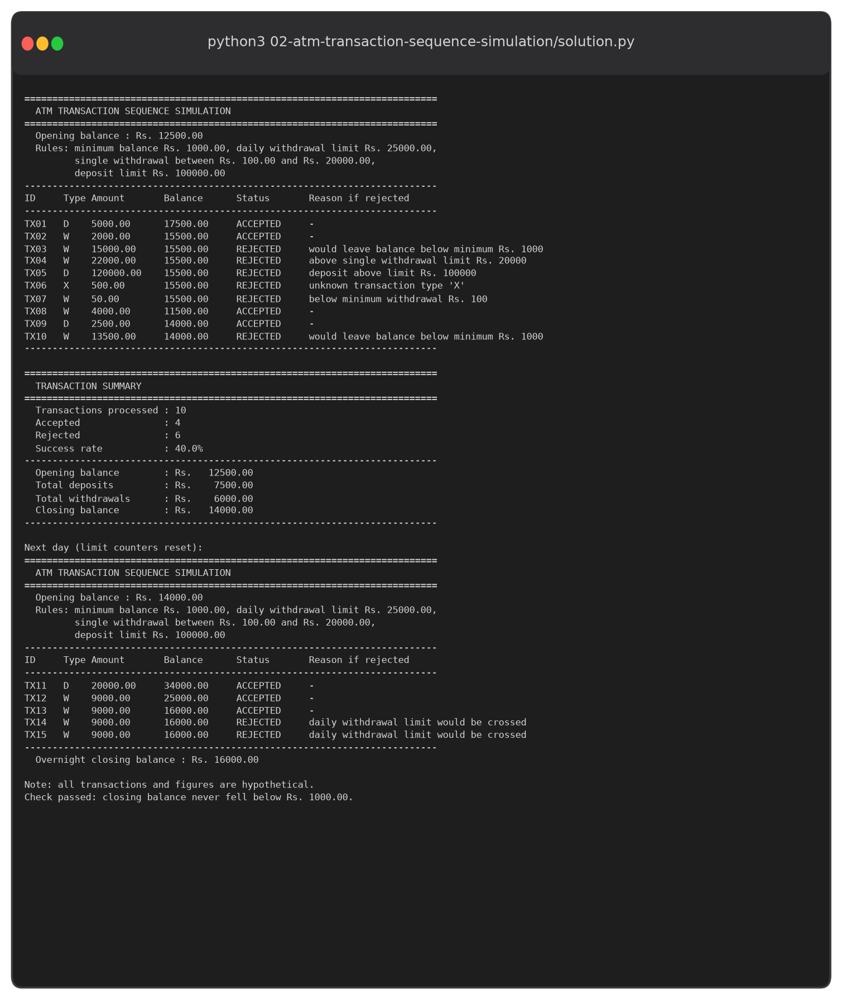

### 11. Conclusion

The simulation correctly applies every rule in sequence: 10 transactions were processed on the first day and exactly 6 were rejected for six different reasons, so the closing balance (Rs 14,000) reconciles perfectly with opening balance plus deposits minus withdrawals. Running a second day showed that the daily withdrawal counter resets overnight but the balance does not. The whole study needed only tuples, unpacking, lists, loops and conditional statements from the syllabus.

---

## Case 03 — Advanced Numeric Pattern Generator

**Case study question Q27** &nbsp;•&nbsp; Folder: [`03-numeric-pattern-generator/`](03-numeric-pattern-generator/)

---

### 1. Problem statement

Produce a hollow diamond or a symmetric numerical pattern based on a user-specified dimension, with validation for invalid dimensions and carefully aligned output.

### 2. Objectives

To build nested loops that control rows and columns; to compute leading spaces with operators so every row is aligned; to generate symmetric number sequences with counting loops; and to validate user input and explain each rejection.

### 3. Assumptions

- Three patterns are supported: hollow diamond (choice 1), symmetric number pyramid (choice 2) and hollow number diamond (choice 3).
- The dimension must be a whole number between 1 and 15; anything outside that range is rejected before any pattern is printed.
- A pattern of dimension *n* has exactly *2n − 1* rows.
- Output is assumed to be viewed in a monospace font so spaces line up.
- The sample runs in `main()` are used as the demonstration input.

### 4. Algorithm

```text
1. START
2. Define MIN_DIMENSION=1, MAX_DIMENSION=15
3. DEFINE FUNCTION validate(choice, size)
   3.1 errors ← empty list
   3.2 IF choice not in (1,2,3) THEN append "invalid pattern choice"
   3.3 IF size < 1 THEN append "too small"
       ELSE IF size > 15 THEN append "too large"
   3.4 RETURN errors
4. DEFINE FUNCTION diamond_row(row, size)
   4.1 inside ← 2*row - 1
   4.2 IF inside = 1 THEN RETURN spaces(size-row) + "*"
   4.3 RETURN spaces(size-row) + "*" + spaces(inside-2) + "*"
5. DEFINE FUNCTION hollow_diamond(size)
   5.1 FOR row ← 1 to size DO PRINT diamond_row(row, size)
   5.2 FOR row ← size-1 down to 1 DO PRINT diamond_row(row, size)
6. DEFINE FUNCTION number_pyramid(size)
   6.1 width ← 2*size - 1
   6.2 FOR row ← 1 to size DO
       6.2.1 line ← "1..row" then "row-1..1"
       6.2.2 PRINT centre(line, width)
7. DEFINE FUNCTION hollow_number_diamond(size)
   7.1 FOR row ← 1 to size DO
       IF row = 1 THEN PRINT centre("1", 2*size-1)
       ELSE PRINT centre(str(row) + spaces(2*row-3) + str(row), 2*size-1)
   7.2 Repeat for row ← size-1 down to 1
8. DEFINE FUNCTION generate(choice, size)
   8.1 errors ← validate(choice, size)
   8.2 IF errors not empty THEN PRINT every error ; RETURN False
   8.3 Call the pattern function for the chosen choice
   8.4 RETURN True
9. FOR each sample (choice, size) DO PRINT heading ; CALL generate(...)
10. END
```

### 5. Flowchart

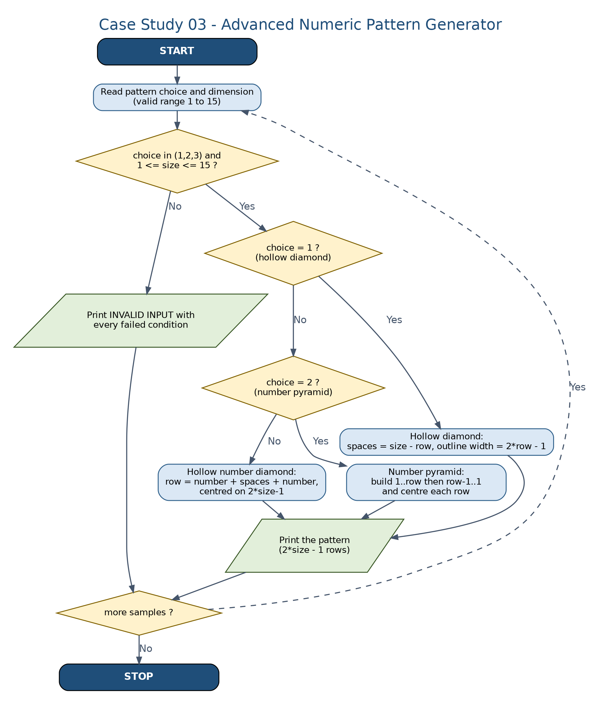

### 6. Pseudocode

```text
BEGIN NUMERIC_PATTERN_GENERATOR

    CONST MIN_DIMENSION <- 1
    CONST MAX_DIMENSION <- 15

    FUNCTION validate(choice, size)
        errors <- []
        IF choice NOT IN (1, 2, 3) THEN
            APPEND "pattern choice must be 1, 2 or 3" TO errors
        END IF
        IF size < MIN_DIMENSION THEN
            APPEND "dimension too small" TO errors
        ELSE IF size > MAX_DIMENSION THEN
            APPEND "dimension too large" TO errors
        END IF
        RETURN errors
    END FUNCTION

    FUNCTION hollow_diamond(size)
        FOR row <- 1 TO size DO
            inside <- 2 * row - 1
            IF inside = 1 THEN
                PRINT SPACES(size - row) + "*"
            ELSE
                PRINT SPACES(size - row) + "*" + SPACES(inside - 2) + "*"
            END IF
        END FOR
        FOR row <- size - 1 DOWNTO 1 DO
            same as above
        END FOR
    END FUNCTION

    FUNCTION number_pyramid(size)
        width <- 2 * size - 1
        FOR row <- 1 TO size DO
            line <- ""
            FOR num <- 1 TO row DO line <- line + STRING(num) END FOR
            FOR num <- row - 1 DOWNTO 1 DO line <- line + STRING(num) END FOR
            PRINT CENTRE(line, width)
        END FOR
    END FUNCTION

    FUNCTION hollow_number_diamond(size)
        FOR row <- 1 TO size DO
            IF row = 1 THEN
                PRINT CENTRE("1", 2 * size - 1)
            ELSE
                PRINT CENTRE(STRING(row) + SPACES(2 * row - 3) + STRING(row),
                             2 * size - 1)
            END IF
        END FOR
        FOR row <- size - 1 DOWNTO 1 DO
            same as above
        END FOR
    END FUNCTION

    FUNCTION generate(choice, size)
        errors <- validate(choice, size)
        IF LENGTH(errors) > 0 THEN
            PRINT "INVALID INPUT"
            FOR each err IN errors DO PRINT err END FOR
            RETURN FALSE
        END IF
        IF choice = 1 THEN hollow_diamond(size)
        ELSE IF choice = 2 THEN number_pyramid(size)
        ELSE hollow_number_diamond(size)
        END IF
        RETURN TRUE
    END FUNCTION

    FOR each sample IN SAMPLES DO
        PRINT heading
        generate(sample.choice, sample.size)
    END FOR
END
```

### 7. Python source code

Complete file — [`03-numeric-pattern-generator/solution.py`](03-numeric-pattern-generator/solution.py)

```python
"""
Case Study 03: Advanced Numeric Pattern Generator
--------------------------------------------------
Produce a hollow diamond or a symmetric numerical pattern based on a
user-specified dimension, with validation for invalid dimensions and
carefully aligned output.

Syllabus used: variables, data types, operators, conditional statements,
loops, strings, pattern generation, lists.
No library is imported - only core Python 3 is used.

Pattern choice:
    1 = hollow diamond (stars)
    2 = symmetric number pyramid (1, 121, 12321, ...)
    3 = hollow number diamond
Anything else is reported as an invalid choice.
"""

# ---------------- validation limits ----------------
MIN_DIMENSION = 1
MAX_DIMENSION = 15         # kept moderate so the output stays aligned on screen


def validate(choice, size):
    """Check the user input and return a list of error messages."""
    errors = []

    if choice not in (1, 2, 3):
        errors.append("pattern choice must be 1, 2 or 3 (got %s)" % choice)

    if size < MIN_DIMENSION:
        errors.append("dimension %d is too small (minimum %d)"
                      % (size, MIN_DIMENSION))
    elif size > MAX_DIMENSION:
        errors.append("dimension %d is too large (maximum %d)"
                      % (size, MAX_DIMENSION))

    return errors


def diamond_row(row, size):
    """One row of a hollow diamond outline: leading spaces then outline."""
    inside = 2 * row - 1
    if inside == 1:
        return " " * (size - row) + "*"
    return " " * (size - row) + "*" + " " * (inside - 2) + "*"


def hollow_diamond(size):
    """Print a hollow diamond of stars with 2*size-1 rows."""
    for row in range(1, size + 1):
        print(diamond_row(row, size).rstrip())
    for row in range(size - 1, 0, -1):
        print(diamond_row(row, size).rstrip())


def number_pyramid(size):
    """Print rows 1, 121, 12321, ... up to size, perfectly centred.

    Each number occupies exactly one character, so centring on the
    widest row keeps every row aligned under a monospace font.
    """
    width = 2 * size - 1
    for row in range(1, size + 1):
        line = ""
        for num in range(1, row + 1):
            line += str(num % 10)          # keep one character per cell
        for num in range(row - 1, 0, -1):
            line += str(num % 10)
        print(line.center(width).rstrip())


def hollow_number_diamond(size):
    """Hollow diamond whose outline rows carry the row number.

    Every outline row has exactly 2*row-1 characters (row number,
    spaces, row number), so centring on 2*size-1 aligns all rows.
    """
    for row in range(1, size + 1):
        label = str(row % 10)
        if row == 1:
            line = label.center(2 * size - 1)
        else:
            line = label + " " * (2 * row - 3) + label
            line = line.center(2 * size - 1)
        print(line.rstrip())

    for row in range(size - 1, 0, -1):
        label = str(row % 10)
        if row == 1:
            line = label.center(2 * size - 1)
        else:
            line = label + " " * (2 * row - 3) + label
            line = line.center(2 * size - 1)
        print(line.rstrip())


def generate(choice, size):
    """Validate and then generate the requested pattern."""
    errors = validate(choice, size)
    if len(errors) > 0:
        print("  INVALID INPUT - pattern not generated:")
        for err in errors:
            print("     - %s" % err)
        return False

    if choice == 1:
        print("  Hollow diamond of size %d:" % size)
        print()
        hollow_diamond(size)
    elif choice == 2:
        print("  Symmetric number pyramid of size %d:" % size)
        print()
        number_pyramid(size)
    else:
        print("  Hollow number diamond of size %d:" % size)
        print()
        hollow_number_diamond(size)

    print()
    return True


def main():
    print("=" * 58)
    print("  ADVANCED NUMERIC PATTERN GENERATOR")
    print("=" * 58)
    print("  1. Hollow diamond (stars)")
    print("  2. Symmetric number pyramid")
    print("  3. Hollow number diamond")
    print("  Valid dimension range: %d to %d" % (MIN_DIMENSION, MAX_DIMENSION))

    # Three sample runs demonstrate the patterns; three more demonstrate
    # the validation messages for invalid dimensions and choices.
    samples = [
        (1, 5, "valid input"),
        (2, 6, "valid input"),
        (3, 5, "valid input"),
        (1, 0, "size too small"),
        (2, 18, "size too large"),
        (5, 4, "unknown pattern choice"),
    ]

    for i in range(len(samples)):
        choice, size, note = samples[i]
        print("\n" + "-" * 58)
        print("  RUN %d  (pattern = %d, dimension = %d, %s)"
              % (i + 1, choice, size, note))
        print("-" * 58)
        generate(choice, size)


if __name__ == "__main__":
    main()
```

### 8. Test cases

| # | Test | Expected | Result |
|---|------|----------|--------|
| TC-01 | choice 1, size 5 | accepted | PASS |
| TC-02 | size 0 | rejected (too small) | PASS |
| TC-03 | size −3 | rejected (too small) | PASS |
| TC-04 | size 18 | rejected (too large) | PASS |
| TC-05 | choice 5 | rejected (unknown pattern) | PASS |
| TC-06 | choice 5, size 0 | two errors reported | PASS |
| TC-07 | diamond size 5 | exactly 9 rows | PASS |
| TC-08 | diamond rows | symmetric top-to-bottom | PASS |
| TC-09 | diamond size 5 | middle row widest | PASS |
| TC-10 | pyramid row 3 | reads 12321 | PASS |
| TC-11 | pyramid size 6 | 6 rows, last row longest | PASS |
| TC-12 | pyramid row 6 | reads 12345654321 | PASS |
| TC-13 | number diamond size 5 | exactly 9 rows | PASS |
| TC-14 | number diamond rows | symmetric top-to-bottom | PASS |
| TC-15 | generate(1, 0) | returns False | PASS |
| TC-16 | generate(1, 5) | returns True | PASS |

All 16 test cases pass when `test_cases.py` is run.

Complete test file — [`03-numeric-pattern-generator/test_cases.py`](03-numeric-pattern-generator/test_cases.py)

```python
"""Automated test cases for Case Study 03 - Advanced Numeric Pattern Generator."""
import importlib.util
import os
import io
import contextlib

spec = importlib.util.spec_from_file_location(
    "sol", os.path.join(os.path.dirname(os.path.abspath(__file__)), "solution.py"))
sol = importlib.util.module_from_spec(spec)
spec.loader.exec_module(sol)

passed = 0


def check(label, condition):
    global passed
    assert condition, "FAILED: " + label
    passed += 1
    print("  PASS:", label)


def capture(fn, *args):
    """Capture what a pattern function prints."""
    buf = io.StringIO()
    with contextlib.redirect_stdout(buf):
        fn(*args)
    return buf.getvalue().splitlines()


# TC-01: valid choice with valid size passes validation
check("choice 1, size 5 accepted",
      sol.validate(1, 5) == [])

# TC-02: size below the minimum rejected
check("size 0 rejected as too small",
      len(sol.validate(1, 0)) == 1)

# TC-03: negative size rejected
check("size -3 rejected as too small",
      len(sol.validate(2, -3)) == 1)

# TC-04: size above the maximum rejected
check("size 18 rejected as too large",
      len(sol.validate(2, 18)) == 1)

# TC-05: unknown pattern choice rejected
check("choice 5 rejected as unknown pattern",
      len(sol.validate(5, 4)) == 1)

# TC-06: two errors reported together
check("choice 5 + size 0 reports both errors",
      len(sol.validate(5, 0)) == 2)

# TC-07: hollow diamond has exactly 2*size-1 rows
rows = capture(sol.hollow_diamond, 5)
check("hollow diamond size 5 has 9 rows", len(rows) == 9)

# TC-08: the diamond is symmetric top to bottom
check("hollow diamond rows are vertically symmetric",
      rows == rows[::-1])

# TC-09: the middle row is the widest
check("diamond row 5 is the widest", len(rows[4]) == max(len(r) for r in rows))

# TC-10: number pyramid row 3 is 12321
rows = capture(sol.number_pyramid, 6)
check("number pyramid row 3 reads 12321", rows[2].strip() == "12321")

# TC-11: pyramid has exactly 'size' rows and last row is longest
check("pyramid size 6 has 6 rows, last row longest",
      len(rows) == 6 and len(rows[5]) == max(len(r) for r in rows))

# TC-12: pyramid rows are centred (palindrome digits)
check("pyramid row 6 reads 12345654321 (palindrome)",
      rows[5].strip() == "12345654321")

# TC-13: hollow number diamond also has 2*size-1 rows
rows = capture(sol.hollow_number_diamond, 5)
check("hollow number diamond size 5 has 9 rows", len(rows) == 9)

# TC-14: hollow number diamond is symmetric
check("hollow number diamond rows symmetric", rows == rows[::-1])

# TC-15: generate() returns False for invalid input
check("generate returns False on invalid dimension",
      sol.generate(1, 0) is False)

# TC-16: generate() returns True for valid input
check("generate returns True on valid input",
      sol.generate(1, 5) is True)

print("\n%d test cases passed" % passed)
```

### 9. Output

Console output produced by running `03-numeric-pattern-generator/solution.py` — [`output.txt`](03-numeric-pattern-generator/output.txt)

```text
==========================================================
  ADVANCED NUMERIC PATTERN GENERATOR
==========================================================
  1. Hollow diamond (stars)
  2. Symmetric number pyramid
  3. Hollow number diamond
  Valid dimension range: 1 to 15

----------------------------------------------------------
  RUN 1  (pattern = 1, dimension = 5, valid input)
----------------------------------------------------------
  Hollow diamond of size 5:

    *
   * *
  *   *
 *     *
*       *
 *     *
  *   *
   * *
    *


----------------------------------------------------------
  RUN 2  (pattern = 2, dimension = 6, valid input)
----------------------------------------------------------
  Symmetric number pyramid of size 6:

     1
    121
   12321
  1234321
 123454321
12345654321


----------------------------------------------------------
  RUN 3  (pattern = 3, dimension = 5, valid input)
----------------------------------------------------------
  Hollow number diamond of size 5:

    1
   2 2
  3   3
 4     4
5       5
 4     4
  3   3
   2 2
    1


----------------------------------------------------------
  RUN 4  (pattern = 1, dimension = 0, size too small)
----------------------------------------------------------
  INVALID INPUT - pattern not generated:
     - dimension 0 is too small (minimum 1)

----------------------------------------------------------
  RUN 5  (pattern = 2, dimension = 18, size too large)
----------------------------------------------------------
  INVALID INPUT - pattern not generated:
     - dimension 18 is too large (maximum 15)

----------------------------------------------------------
  RUN 6  (pattern = 5, dimension = 4, unknown pattern choice)
----------------------------------------------------------
  INVALID INPUT - pattern not generated:
     - pattern choice must be 1, 2 or 3 (got 5)
```

### 10. Output screenshot

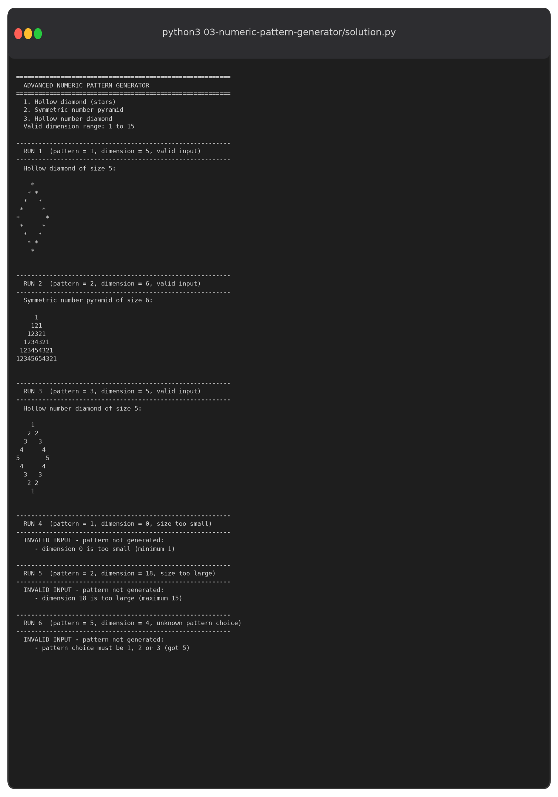

### 11. Conclusion

The generator builds three different patterns from the same two-loop skeleton and validates every input before printing. All invalid cases (size 0, size 18, choice 5) were rejected with clear reasons and produced no partial pattern. Building the rows from a computed number of leading spaces and using `center()` kept every row aligned, even when the numbers reached 11 digits in the size-6 pyramid.

---

## Case 04 — Password Policy Validation Engine

**Case study question Q29** &nbsp;•&nbsp; Folder: [`04-password-policy-validation/`](04-password-policy-validation/)

---

### 1. Problem statement

Evaluate sample password strings against minimum length, character-category, repetition and prohibited-substring rules, and explain each failed condition.

### 2. Objectives

To apply string traversal and comparisons to classify every character; to implement four independent policy rules with conditional statements; to detect runs and frequency of repeated characters with loops; and to produce a human-readable explanation for each failure instead of a single "invalid" message.

### 3. Assumptions

- Password length must be between 10 and 20 characters inclusive.
- At least one uppercase letter and one lowercase letter are required.
- At least two digits and at least one special character from `@#$%&*!?_` are required.
- No character may repeat more than twice consecutively, and no character may appear more than three times in the whole password.
- A short dictionary of prohibited words is checked case-insensitively: password, admin, welcome, 12345, qwerty, letmein.
- Only the characters listed above are considered allowed; anything else (space, hyphen, tilde) is reported as an unknown character.
- All passwords are hypothetical samples.

### 4. Algorithm

```text
1. START
2. Define policy constants and the PROHIBITED_WORDS list
3. DEFINE FUNCTION count_categories(password)
   3.1 upper, lower, digits, specials, others ← 0
   3.2 FOR each character ch in password DO
       IF ch is A-Z → upper ← upper + 1
       ELSE IF ch is a-z → lower ← lower + 1
       ELSE IF ch is 0-9 → digits ← digits + 1
       ELSE IF ch in SPECIAL_CHARS → specials ← specials + 1
       ELSE others ← others + 1
   3.3 RETURN (upper, lower, digits, specials, others)
4. DEFINE FUNCTION max_run_length(password)
   4.1 longest ← 1, current ← 1
   4.2 FOR i ← 1 to len(password)-1 DO
       IF password[i] = password[i-1] THEN current ← current + 1
            IF current > longest THEN longest ← current
       ELSE current ← 1
   4.3 RETURN longest
5. DEFINE FUNCTION most_repeated_character(password)
   5.1 FOR each distinct character DO count its occurrences
   5.2 RETURN the character with the highest count
6. DEFINE FUNCTION find_prohibited(password)
   6.1 Convert password to lowercase
   6.2 FOR each word in PROHIBITED_WORDS DO
       IF word is inside the lowercase password THEN add word to found
   6.3 RETURN found
7. DEFINE FUNCTION validate_password(password)
   7.1 failures ← empty list
   7.2 Check length lower/upper bounds → append reasons
   7.3 Check the four category minimums and the unknown-character count
   7.4 Check max run length and max frequency → append reasons
   7.5 Check prohibited words → append one reason per word
   7.6 RETURN failures
8. FOR each sample password DO
   8.1 PRINT masked password and strength label
   8.2 IF failures empty THEN PRINT "all conditions satisfied"
       ELSE PRINT every failure line
9. PRINT summary counts and the rule that failed most often
10. END
```

### 5. Flowchart

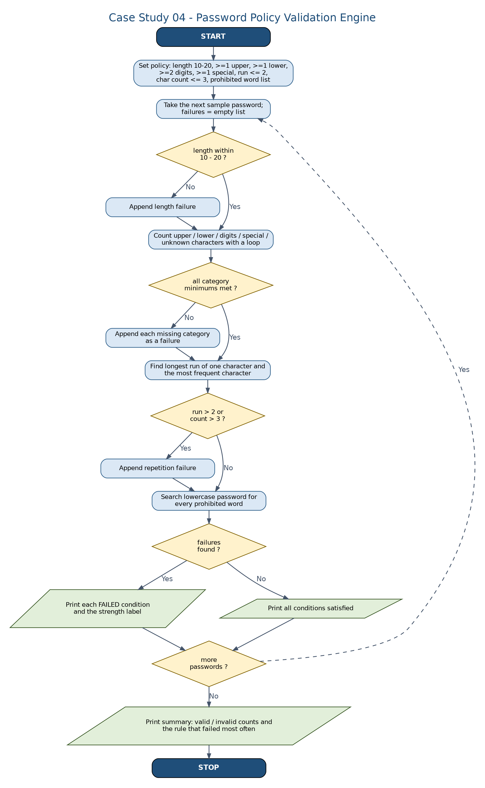

### 6. Pseudocode

```text
BEGIN PASSWORD_POLICY_VALIDATION

    CONST MIN_LENGTH     <- 10
    CONST MAX_LENGTH     <- 20
    CONST MIN_UPPER      <- 1
    CONST MIN_LOWER      <- 1
    CONST MIN_DIGITS     <- 2
    CONST MIN_SPECIALS   <- 1
    SPECIAL_CHARS        <- "@#$%&*!?_"
    CONST MAX_REPEAT_RUN <- 2
    CONST MAX_REPEATED   <- 3
    PROHIBITED_WORDS     <- ["password","admin","welcome","12345","qwerty","letmein"]

    FUNCTION validate_password(password)
        failures <- []

        IF LENGTH(password) < MIN_LENGTH THEN
            APPEND "length below minimum" TO failures
        ELSE IF LENGTH(password) > MAX_LENGTH THEN
            APPEND "length above maximum" TO failures
        END IF

        (upper, lower, digits, specials, others) <- count_categories(password)
        IF upper   < MIN_UPPER    THEN APPEND "needs uppercase"  TO failures
        IF lower   < MIN_LOWER    THEN APPEND "needs lowercase"  TO failures
        IF digits  < MIN_DIGITS   THEN APPEND "needs 2 digits"   TO failures
        IF specials < MIN_SPECIALS THEN APPEND "needs special"   TO failures
        IF others > 0              THEN APPEND "unknown character" TO failures

        IF max_run_length(password) > MAX_REPEAT_RUN THEN
            APPEND "character repeated too many times in a row" TO failures
        END IF
        (ch, count) <- most_repeated_character(password)
        IF count > MAX_REPEATED THEN
            APPEND "character appears too many times" TO failures
        END IF

        FOR each word IN find_prohibited(password) DO
            APPEND "contains prohibited word" TO failures
        END FOR

        RETURN failures
    END FUNCTION

    valid <- 0 ; invalid <- 0
    FOR each password IN PASSWORDS DO
        failures <- validate_password(password)
        PRINT MASK(password), strength_label(failures, password)
        IF LENGTH(failures) = 0 THEN
            valid <- valid + 1
            PRINT "all conditions satisfied"
        ELSE
            invalid <- invalid + 1
            FOR each f IN failures DO PRINT "FAILED:", f END FOR
        END IF
    END FOR
    PRINT summary
END
```

### 7. Python source code

Complete file — [`04-password-policy-validation/solution.py`](04-password-policy-validation/solution.py)

```python
"""
Case Study 04: Password Policy Validation Engine
-------------------------------------------------
Evaluate sample password strings against minimum length, character
category, repetition and prohibited-substring rules, and explain each
failed condition.

Syllabus used: variables, data types, operators, conditional statements,
loops, strings and string methods, lists.
No library is imported - only core Python 3 is used.
"""

# ------------------------------------------------------------------
# Policy constants (hypothetical values chosen for this study)
# ------------------------------------------------------------------
MIN_LENGTH = 10
MAX_LENGTH = 20
MIN_UPPER = 1
MIN_LOWER = 1
MIN_DIGITS = 2
MIN_SPECIALS = 1
SPECIAL_CHARS = "@#$%&*!?_"
MAX_REPEAT_RUN = 2           # same character at most twice in a row
MAX_REPEATED_CODE = 3        # any character may appear at most 3 times
PROHIBITED_WORDS = ["password", "admin", "welcome", "12345", "qwerty", "letmein"]

# Sample passwords - a mix of good and deliberately bad ones
PASSWORDS = [
    "Sun@2024",              # too short (8) and only one digit
    "Tr@ilBlazer99",         # fully valid
    "password@1234",         # prohibited word, no uppercase
    "C0mpLex@Pass_88",       # valid and long
    "Super@Aaaa11",          # 'aaaa' run of four
    "Monsoon#Rain77",        # valid
    "admin#Secure1",         # prohibited word and only one digit
    "Tr@ilBlazer99",         # repeat of a valid password, still valid
    "R@inyDay_5555",         # run of four 5s, '5' appears four times
    "Breezy@Sky42",          # valid
]


def count_categories(password):
    """Count how many characters belong to each category."""
    upper = 0
    lower = 0
    digits = 0
    specials = 0
    others = 0

    for ch in password:
        if "A" <= ch <= "Z":
            upper += 1
        elif "a" <= ch <= "z":
            lower += 1
        elif "0" <= ch <= "9":
            digits += 1
        elif ch in SPECIAL_CHARS:
            specials += 1
        else:
            others += 1

    return upper, lower, digits, specials, others


def max_run_length(password):
    """Longest run of the same character repeated consecutively."""
    if len(password) == 0:
        return 0
    longest = 1
    current = 1
    for i in range(1, len(password)):
        if password[i] == password[i - 1]:
            current += 1
            if current > longest:
                longest = current
        else:
            current = 1
    return longest


def most_repeated_character(password):
    """Return (character, count) of the most frequent character."""
    best_char = ""
    best_count = 0
    checked = ""
    for i in range(len(password)):
        ch = password[i]
        if ch in checked:
            continue
        checked += ch
        count = 0
        for c in password:
            if c == ch:
                count += 1
        if count > best_count:
            best_count = count
            best_char = ch
    return best_char, best_count


def find_prohibited(password):
    """List any prohibited substrings present (case-insensitive)."""
    lowered = ""
    for ch in password:
        if "A" <= ch <= "Z":
            lowered += chr(ord(ch) + 32)
        else:
            lowered += ch

    found = []
    for word in PROHIBITED_WORDS:
        if word in lowered:
            found.append(word)
    return found


def validate_password(password):
    """Return the list of failed conditions (empty list = valid)."""
    failures = []

    # ---- rule 1: length ----
    if len(password) < MIN_LENGTH:
        failures.append("length %d is below minimum %d" % (len(password), MIN_LENGTH))
    elif len(password) > MAX_LENGTH:
        failures.append("length %d is above maximum %d" % (len(password), MAX_LENGTH))

    # ---- rule 2: character categories ----
    upper, lower, digits, specials, others = count_categories(password)

    if upper < MIN_UPPER:
        failures.append("needs at least %d uppercase letter(s)" % MIN_UPPER)
    if lower < MIN_LOWER:
        failures.append("needs at least %d lowercase letter(s)" % MIN_LOWER)
    if digits < MIN_DIGITS:
        failures.append("needs at least %d digits (found %d)" % (MIN_DIGITS, digits))
    if specials < MIN_SPECIALS:
        failures.append("needs at least %d special character(s) from %s"
                        % (MIN_SPECIALS, SPECIAL_CHARS))
    if others > 0:
        failures.append("contains %d character(s) outside the allowed set" % others)

    # ---- rule 3: repetition ----
    run = max_run_length(password)
    if run > MAX_REPEAT_RUN:
        failures.append("character repeated %d times in a row (max %d)"
                        % (run, MAX_REPEAT_RUN))

    rep_char, rep_count = most_repeated_character(password)
    if rep_count > MAX_REPEATED_CODE:
        failures.append("character '%s' appears %d times (max %d)"
                        % (rep_char, rep_count, MAX_REPEATED_CODE))

    # ---- rule 4: prohibited substrings ----
    found = find_prohibited(password)
    if len(found) > 0:
        for word in found:
            failures.append("contains prohibited word '%s'" % word)

    return failures


def strength_label(failures, password):
    """Simple descriptive label based on how many rules were broken."""
    if len(failures) == 0:
        if len(password) >= 14:
            return "STRONG"
        return "ACCEPTABLE"
    elif len(failures) == 1:
        return "WEAK (1 rule broken)"
    elif len(failures) <= 3:
        return "WEAK (%d rules broken)" % len(failures)
    return "VERY WEAK (%d rules broken)" % len(failures)


def mask(password):
    """Show the first two characters and hide the remainder."""
    if len(password) <= 2:
        return password
    return password[0:2] + "*" * (len(password) - 2)


def main():
    print("=" * 72)
    print("  PASSWORD POLICY VALIDATION ENGINE")
    print("=" * 72)
    print("  Policy: length %d-%d, >=%d upper, >=%d lower, >=%d digits,"
          % (MIN_LENGTH, MAX_LENGTH, MIN_UPPER, MIN_LOWER, MIN_DIGITS))
    print("          >=%d special from %s, no run longer than %d,"
          % (MIN_SPECIALS, SPECIAL_CHARS, MAX_REPEAT_RUN))
    print("          any character at most %d times, no dictionary words."
          % MAX_REPEATED_CODE)
    print("-" * 72)

    valid_count = 0
    invalid_count = 0

    for i in range(len(PASSWORDS)):
        password = PASSWORDS[i]
        failures = validate_password(password)
        label = strength_label(failures, password)

        print("\n%2d. %-20s  ->  %s" % (i + 1, mask(password), label))

        if len(failures) == 0:
            valid_count += 1
            print("      All conditions satisfied.")
        else:
            invalid_count += 1
            for f in failures:
                print("      FAILED: %s" % f)

    print("\n" + "-" * 72)
    print("  Summary: %d valid, %d invalid out of %d sample passwords."
          % (valid_count, invalid_count, len(PASSWORDS)))

    # ---- report which rule fails most often ----
    rule_tally = [0, 0, 0, 0]
    for password in PASSWORDS:
        upper, lower, digits, specials, others = count_categories(password)
        if len(password) < MIN_LENGTH or len(password) > MAX_LENGTH:
            rule_tally[0] += 1
        if (upper < MIN_UPPER or lower < MIN_LOWER or digits < MIN_DIGITS
                or specials < MIN_SPECIALS or others > 0):
            rule_tally[1] += 1
        if max_run_length(password) > MAX_REPEAT_RUN:
            rule_tally[2] += 1
        if len(find_prohibited(password)) > 0:
            rule_tally[3] += 1

    rule_names = ["length", "character categories", "repetition", "prohibited words"]
    worst = 0
    for i in range(1, 4):
        if rule_tally[i] > rule_tally[worst]:
            worst = i
    print("  Most frequently failed rule: %s (%d times)."
          % (rule_names[worst], rule_tally[worst]))
    print("\nAll passwords are hypothetical samples for this activity.")


if __name__ == "__main__":
    main()
```

### 8. Test cases

| # | Test | Expected | Result |
|---|------|----------|--------|
| TC-01 | `Tr@ilBlazer99` | valid | PASS |
| TC-02 | `Sun@2024` | length failure | PASS |
| TC-03 | 22-character password | length failure | PASS |
| TC-04 | `password@1234` | uppercase + prohibited word | PASS |
| TC-05 | `Monsoon#Rain1` | two-digit rule failure | PASS |
| TC-06 | `MonsoonRain77` | special character failure | PASS |
| TC-07 | `Super@Aaaa11` | 3-in-a-row failure | PASS |
| TC-08 | `R@inyDay_5555` | max-frequency failure | PASS |
| TC-09 | `PASSWORD@2024` | prohibited word (case-insensitive) | PASS |
| TC-10 | all six prohibited words | every one caught | PASS |
| TC-11 | `max_run_length('aabbbbcc')` | 4 | PASS |
| TC-12 | `max_run_length('')` | 0 | PASS |
| TC-13 | `most_repeated_character('aabbbbcc')` | ('b', 4) | PASS |
| TC-14 | `count_categories('Ab1@x')` | (1, 2, 1, 1, 0) | PASS |
| TC-15 | `Ab1@x~` | unknown character reported | PASS |
| TC-16 | sample list | exactly 5 of 10 valid | PASS |

All 16 test cases pass when `test_cases.py` is run.

Complete test file — [`04-password-policy-validation/test_cases.py`](04-password-policy-validation/test_cases.py)

```python
"""Automated test cases for Case Study 04 - Password Policy Validation Engine."""
import importlib.util
import os

spec = importlib.util.spec_from_file_location(
    "sol", os.path.join(os.path.dirname(os.path.abspath(__file__)), "solution.py"))
sol = importlib.util.module_from_spec(spec)
spec.loader.exec_module(sol)

passed = 0


def check(label, condition):
    global passed
    assert condition, "FAILED: " + label
    passed += 1
    print("  PASS:", label)


def fails(password):
    return sol.validate_password(password)


# TC-01: a fully valid password has no failures
check("'Tr@ilBlazer99' is valid", fails("Tr@ilBlazer99") == [])

# TC-02: too short
check("'Sun@2024' fails the length rule",
      any("below minimum" in f for f in fails("Sun@2024")))

# TC-03: too long
long_pw = "Alpha@Beta99GammaDelta77"
check("22 character password fails the length rule",
      any("above maximum" in f for f in fails(long_pw)))

# TC-04: missing uppercase
check("'password@1234' fails uppercase and prohibited word rules",
      any("uppercase" in f for f in fails("password@1234")) and
      any("prohibited" in f for f in fails("password@1234")))

# TC-05: not enough digits
check("'Monsoon#Rain1' fails the two-digit rule",
      any("2 digits" in f for f in fails("Monsoon#Rain1")))

# TC-06: missing special character
check("'MonsoonRain77' fails the special character rule",
      any("special character" in f for f in fails("MonsoonRain77")))

# TC-07: consecutive repetition detected
check("'Super@Aaaa11' fails the 3-in-a-row rule",
      any("in a row" in f for f in fails("Super@Aaaa11")))

# TC-08: overall frequency detected
check("'R@inyDay_5555' fails the max-times rule",
      any("appears 4 times" in f for f in fails("R@inyDay_5555")))

# TC-09: prohibited words detected regardless of case
check("'PASSWORD@2024' detected as prohibited (case-insensitive)",
      any("prohibited" in f for f in fails("PASSWORD@2024")))

# TC-10: every prohibited word in the list is caught
caught = 0
for word in sol.PROHIBITED_WORDS:
    test_pw = "Ab1@" + word + "Xy9"
    if any("prohibited" in f for f in fails(test_pw)):
        caught += 1
check("all %d prohibited words are caught" % len(sol.PROHIBITED_WORDS),
      caught == len(sol.PROHIBITED_WORDS))

# TC-11: run length function correct
check("max_run_length('aabbbbcc') = 4", sol.max_run_length("aabbbbcc") == 4)

# TC-12: run length of an empty string is 0
check("max_run_length('') = 0", sol.max_run_length("") == 0)

# TC-13: most repeated character found
check("most_repeated_character('aabbbbcc') = ('b', 4)",
      sol.most_repeated_character("aabbbbcc") == ("b", 4))

# TC-14: category counting
check("count_categories('Ab1@x') = (1, 2, 1, 1, 0)",
      sol.count_categories("Ab1@x") == (1, 2, 1, 1, 0))

# TC-15: unknown characters are caught by the 'others' count
check("'Ab1@x~' has one character outside the allowed set",
      sol.count_categories("Ab1@x~")[4] == 1 and
      any("outside the allowed set" in f for f in fails("Ab1@x~")))

# TC-16: the sample list yields 6 valid passwords
valid = 0
for pw in sol.PASSWORDS:
    if fails(pw) == []:
        valid += 1
check("exactly 5 of the 10 sample passwords are valid", valid == 5)

print("\n%d test cases passed" % passed)
```

### 9. Output

Console output produced by running `04-password-policy-validation/solution.py` — [`output.txt`](04-password-policy-validation/output.txt)

```text
========================================================================
  PASSWORD POLICY VALIDATION ENGINE
========================================================================
  Policy: length 10-20, >=1 upper, >=1 lower, >=2 digits,
          >=1 special from @#$%&*!?_, no run longer than 2,
          any character at most 3 times, no dictionary words.
------------------------------------------------------------------------

 1. Su******              ->  WEAK (1 rule broken)
      FAILED: length 8 is below minimum 10

 2. Tr***********         ->  ACCEPTABLE
      All conditions satisfied.

 3. pa***********         ->  WEAK (2 rules broken)
      FAILED: needs at least 1 uppercase letter(s)
      FAILED: contains prohibited word 'password'

 4. C0*************       ->  STRONG
      All conditions satisfied.

 5. Su**********          ->  WEAK (1 rule broken)
      FAILED: character repeated 3 times in a row (max 2)

 6. Mo************        ->  STRONG
      All conditions satisfied.

 7. ad***********         ->  WEAK (2 rules broken)
      FAILED: needs at least 2 digits (found 1)
      FAILED: contains prohibited word 'admin'

 8. Tr***********         ->  ACCEPTABLE
      All conditions satisfied.

 9. R@***********         ->  WEAK (2 rules broken)
      FAILED: character repeated 4 times in a row (max 2)
      FAILED: character '5' appears 4 times (max 3)

10. Br**********          ->  ACCEPTABLE
      All conditions satisfied.

------------------------------------------------------------------------
  Summary: 5 valid, 5 invalid out of 10 sample passwords.
  Most frequently failed rule: character categories (2 times).

All passwords are hypothetical samples for this activity.
```

### 10. Output screenshot

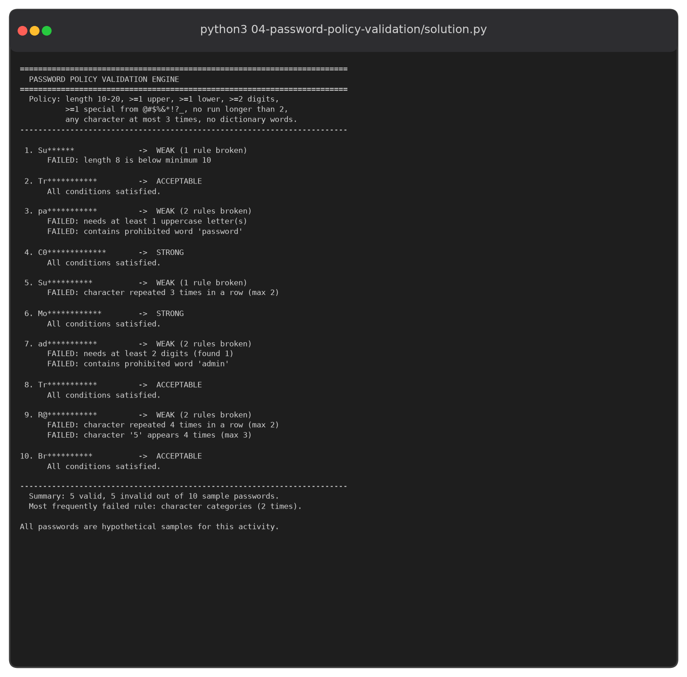

### 11. Conclusion

The engine evaluates every sample password against all four rule groups and lists each broken condition separately, which makes the result easy to act on. Of the ten samples, five were valid; the most frequent problem was a missing character category. The repetition checks (consecutive run and overall frequency) correctly separated `Super@Aaaa11` from `R@inyDay_5555`, which break different repetition rules. Only string methods, loops, conditionals and lists were needed.

---

## Case 05 — String-Based Examination Answer Evaluation

**Case study question Q31** &nbsp;•&nbsp; Folder: [`05-exam-answer-evaluation/`](05-exam-answer-evaluation/)

---

### 1. Problem statement

Compare answer strings against an answer key, calculate correct, incorrect and unanswered responses, apply negative marking and produce student-wise results.

### 2. Objectives

To index and compare characters of two strings with loops; to classify each response as correct, wrong or blank using conditional statements; to apply a marking scheme with negative marks; and to summarise results per student, per question and for the class as a whole.

### 3. Assumptions

- The paper has 20 multiple-choice questions with options A, B, C and D.
- Marking scheme: correct +4, wrong −1, blank 0, so the maximum is 80 marks.
- An unanswered question is written as `?`; a blank position in a short string is also treated as unanswered.
- Lowercase answers are accepted after conversion to uppercase.
- A response shorter than 20 characters is padded with `?` and a longer one is truncated to the first 20.
- Pass mark is 40% of the maximum. All students, roll numbers and responses are hypothetical.

### 4. Algorithm

```text
1. START
2. Define ANSWER_KEY (20 characters), marks constants and STUDENTS list
3. DEFINE FUNCTION normalise(response)
   3.1 Convert every lowercase letter to uppercase
   3.2 Pad with '?' until length is 20 ; truncate if longer
   3.3 RETURN the fixed string
4. DEFINE FUNCTION evaluate(response)
   4.1 ans ← normalise(response)
   4.2 correct, wrong, blank ← 0
   4.3 FOR i ← 0 to 19 DO
       given ← ans[i] ; expected ← ANSWER_KEY[i]
       IF given = '?' THEN blank ← blank + 1 ; mark '-'
       ELSE IF given = expected THEN correct ← correct + 1 ; mark '+'
       ELSE wrong ← wrong + 1 ; mark 'x'
   4.4 score ← correct*4 + wrong*(-1) + blank*0
   4.5 RETURN (correct, wrong, blank, score, detail string)
5. FOR each student DO
   5.1 UNPACK (roll, name, response)
   5.2 (correct, wrong, blank, score, detail) ← evaluate(response)
   5.3 percent ← score * 100 / 80
   5.4 grade ← grade(percent)
   5.5 PRINT one result row
6. PRINT the answer-wise pattern (+, x, -) for every student
7. FIND topper ; COMPUTE class average and pass/fail counts
8. FOR each question DO count correct / wrong / blank across students
   and mark well answered / weakly answered questions
9. PRINT the most often missed question
10. END
```

### 5. Flowchart

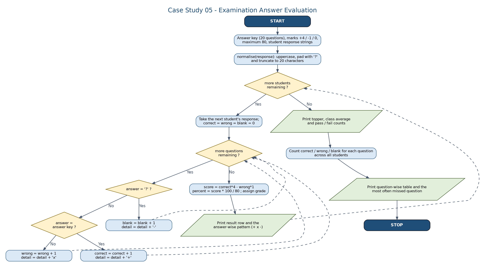

### 6. Pseudocode

```text
BEGIN EXAM_ANSWER_EVALUATION

    CONST CORRECT_MARKS <- 4
    CONST WRONG_MARKS   <- -1
    CONST BLANK_MARKS   <- 0
    CONST NUM_QUESTIONS <- 20
    CONST PASS_PERCENT  <- 40
    ANSWER_KEY <- "ABCDACBDABCDADCBBACD"
    MAXIMUM    <- NUM_QUESTIONS * CORRECT_MARKS

    FUNCTION normalise(response)
        fixed <- UPPERCASE(response)
        WHILE LENGTH(fixed) < NUM_QUESTIONS DO fixed <- fixed + "?" END WHILE
        IF LENGTH(fixed) > NUM_QUESTIONS THEN
            fixed <- first NUM_QUESTIONS characters of fixed
        END IF
        RETURN fixed
    END FUNCTION

    FUNCTION evaluate(response)
        ans <- normalise(response)
        correct <- 0 ; wrong <- 0 ; blank <- 0 ; detail <- ""
        FOR i <- 0 TO NUM_QUESTIONS - 1 DO
            IF ans[i] = "?" THEN
                blank <- blank + 1 ; detail <- detail + "-"
            ELSE IF ans[i] = ANSWER_KEY[i] THEN
                correct <- correct + 1 ; detail <- detail + "+"
            ELSE
                wrong <- wrong + 1 ; detail <- detail + "x"
            END IF
        END FOR
        score <- correct * CORRECT_MARKS + wrong * WRONG_MARKS + blank * BLANK_MARKS
        RETURN (correct, wrong, blank, score, detail)
    END FUNCTION

    FUNCTION grade(percent)
        IF percent >= 90 THEN RETURN "A+"
        ELSE IF percent >= 80 THEN RETURN "A"
        ELSE IF percent >= 70 THEN RETURN "B"
        ELSE IF percent >= 60 THEN RETURN "C"
        ELSE IF percent >= PASS_PERCENT THEN RETURN "D (pass)"
        ELSE RETURN "F (fail)"
        END IF
    END FUNCTION

    FOR each (roll, name, response) IN STUDENTS DO
        (c, w, b, score, detail) <- evaluate(response)
        percent <- score * 100 / MAXIMUM
        PRINT roll, name, c, w, b, score, percent, grade(percent)
    END FOR

    topper <- student with maximum score
    average <- TOTAL(scores) / COUNT(students)
    FOR q <- 0 TO NUM_QUESTIONS - 1 DO
        count correct, wrong and blank answers for question q
        PRINT row
    END FOR
    PRINT question with highest (wrong + blank) count
END
```

### 7. Python source code

Complete file — [`05-exam-answer-evaluation/solution.py`](05-exam-answer-evaluation/solution.py)

```python
"""
Case Study 05: String-Based Examination Answer Evaluation
----------------------------------------------------------
Compare answer strings against an answer key, calculate correct,
incorrect and unanswered responses, apply negative marking and
produce student-wise results.

Syllabus used: variables, data types, operators, conditional statements,
loops, strings, lists, tuples and tuple unpacking.
No library is imported - only core Python 3 is used.
"""

# ------------------------------------------------------------------
# Marking scheme (hypothetical values for this study)
# ------------------------------------------------------------------
CORRECT_MARKS = 4
WRONG_MARKS = -1
BLANK_MARKS = 0
NUM_QUESTIONS = 20
PASS_PERCENT = 40.0          # pass mark as a percentage of maximum

# '?' marks an unanswered question
ANSWER_KEY = "ABCDACBDABCDADCBBACD"

# (roll, name, response string of length 20)
STUDENTS = [
    ("26000477", "Vinay",  "ABCDACBDABCDADCBBA"),   # short response, padded with blanks
    ("26000478", "Meghana", "ABCDACBDABCDADCBBACD"),  # identical to key
    ("26000479", "Arjun",  "ABBDCCBDABCDA?CBBACD"),  # a few wrong, one blank
    ("26000480", "Sneha",  "ABCDACBDABCDADCBBADC"),  # one swapped at the end
    ("26000481", "Rohit",  "????????????????????"),  # all blank
    ("26000482", "Divya",  "BBBBBBBBBBBBBBBBBBBB"),  # all wrong
]


def normalise(response):
    """Pad short responses with '?' and upper-case every letter."""
    fixed = ""
    for ch in response:
        if "a" <= ch <= "z":
            fixed += chr(ord(ch) - 32)      # convert lower to upper
        else:
            fixed += ch
    while len(fixed) < NUM_QUESTIONS:
        fixed += "?"
    if len(fixed) > NUM_QUESTIONS:
        fixed = fixed[0:NUM_QUESTIONS]
    return fixed


def evaluate(response):
    """Return (correct, wrong, blank, score, detail_string)."""
    ans = normalise(response)

    correct = 0
    wrong = 0
    blank = 0
    detail = ""

    for i in range(NUM_QUESTIONS):
        given = ans[i]
        expected = ANSWER_KEY[i]

        if given == "?":
            blank += 1
            detail += "-"
        elif given == expected:
            correct += 1
            detail += "+"
        else:
            wrong += 1
            detail += "x"

    score = correct * CORRECT_MARKS + wrong * WRONG_MARKS + blank * BLANK_MARKS
    return correct, wrong, blank, score, detail


def grade(percentage):
    """Convert percentage to a letter grade."""
    if percentage >= 90:
        return "A+"
    elif percentage >= 80:
        return "A"
    elif percentage >= 70:
        return "B"
    elif percentage >= 60:
        return "C"
    elif percentage >= PASS_PERCENT:
        return "D (pass)"
    else:
        return "F (fail)"


def main():
    maximum = NUM_QUESTIONS * CORRECT_MARKS

    print("=" * 82)
    print("  EXAMINATION ANSWER EVALUATION  (negative marking)")
    print("=" * 82)
    print("  Questions: %d   Correct: +%d   Wrong: %d   Blank: %d   Maximum: %d"
          % (NUM_QUESTIONS, CORRECT_MARKS, WRONG_MARKS, BLANK_MARKS, maximum))
    print("  Answer key : %s" % ANSWER_KEY)
    print("-" * 82)
    print("%-10s %-9s %4s %5s %5s %6s %8s  %s"
          % ("Roll", "Name", "Corr", "Wrong", "Blank", "Score", "Percent", "Grade"))
    print("-" * 82)

    results = []       # (roll, name, correct, wrong, blank, score, percent, grade)

    for student in STUDENTS:
        # ---- tuple unpacking ----
        roll, name, response = student

        correct, wrong, blank, score, detail = evaluate(response)
        percent = score * 100.0 / maximum
        g = grade(percent)

        results.append((roll, name, correct, wrong, blank, score, percent, g))

        print("%-10s %-9s %4d %5d %5d %6d %7.1f%%  %s"
              % (roll, name, correct, wrong, blank, score, percent, g))

    print("-" * 82)

    # ---- answer-wise pattern for each student ----
    print("\n  ANSWER-WISE PATTERN  ( + correct, x wrong, - blank )")
    print("  Question:  1         2         3")
    print("             12345678901234567890")
    print("  Key       : %s" % ANSWER_KEY)

    for student in STUDENTS:
        roll, name, response = student
        _, _, _, _, detail = evaluate(response)
        print("  %-9s : %s" % (name, detail))

    # ---- topper and statistics ----
    print("\n" + "-" * 82)
    topper_index = 0
    for i in range(1, len(results)):
        if results[i][5] > results[topper_index][5]:
            topper_index = i

    top = results[topper_index]
    print("  Topper        : %s (%s) with %d marks (%.1f%%)"
          % (top[1], top[0], top[5], top[6]))

    total_score = 0
    passed_count = 0
    failed_count = 0
    for r in results:
        total_score += r[5]
        if r[6] >= PASS_PERCENT:
            passed_count += 1
        else:
            failed_count += 1

    avg = total_score * 1.0 / len(results)
    print("  Class average : %.2f marks out of %d" % (avg, maximum))
    print("  Passed        : %d    Failed: %d" % (passed_count, failed_count))

    # ---- question-wise analysis: which questions were missed most? ----
    print("\n" + "-" * 82)
    print("  QUESTION-WISE ANALYSIS (across all students)")
    print("  Q  Key  Correct  Wrong  Blank   Remark")
    hardest_q = 1
    hardest_missed = -1
    for q in range(NUM_QUESTIONS):
        c = 0
        w = 0
        b = 0
        for student in STUDENTS:
            roll, name, response = student
            ans = normalise(response)
            if ans[q] == "?":
                b += 1
            elif ans[q] == ANSWER_KEY[q]:
                c += 1
            else:
                w += 1
        remark = ""
        if c >= len(STUDENTS) - 1:
            remark = "well answered"
        elif w + b >= len(STUDENTS) * 0.6:
            remark = "weakly answered"
        print("  %-3d %-4s %-8d %-6d %-6d %s" % (q + 1, ANSWER_KEY[q], c, w, b, remark))
        if w + b > hardest_missed:
            hardest_missed = w + b
            hardest_q = q + 1

    print("\n  Most often missed question: Q%d (%d of %d students did not score on it)."
          % (hardest_q, hardest_missed, len(STUDENTS)))
    print("\nAll names, roll numbers and responses are hypothetical.")


if __name__ == "__main__":
    main()
```

### 8. Test cases

| # | Test | Expected | Result |
|---|------|----------|--------|
| TC-01 | Response identical to key | 20 correct, 80 marks | PASS |
| TC-02 | All blanks | 20 blank, 0 marks | PASS |
| TC-03 | All wrong | 20 wrong, −20 marks | PASS |
| TC-04 | One wrong, rest correct | 75 marks | PASS |
| TC-05 | One blank, rest correct | 76 marks | PASS |
| TC-06 | 10-character response | padded to 20, 10 blank | PASS |
| TC-07 | 25-character response | truncated to 20 | PASS |
| TC-08 | Key in lowercase | scores 80 | PASS |
| TC-09 | Mixed-case response | 20 correct | PASS |
| TC-10 | Detail string | length 20 | PASS |
| TC-11 | First answer wrong | detail starts with 'x' | PASS |
| TC-12 | Grade boundaries | A+/A/B/C/D/F correct | PASS |
| TC-13 | Sample data | topper scores 80 | PASS |
| TC-14 | All-blank student | scores 0 | PASS |

All 20 checks pass when `test_cases.py` is run.

Complete test file — [`05-exam-answer-evaluation/test_cases.py`](05-exam-answer-evaluation/test_cases.py)

```python
"""Automated test cases for Case Study 05 - String-Based Examination Answer Evaluation."""
import importlib.util
import os

spec = importlib.util.spec_from_file_location(
    "sol", os.path.join(os.path.dirname(os.path.abspath(__file__)), "solution.py"))
sol = importlib.util.module_from_spec(spec)
spec.loader.exec_module(sol)

passed = 0


def check(label, condition):
    global passed
    assert condition, "FAILED: " + label
    passed += 1
    print("  PASS:", label)


KEY = sol.ANSWER_KEY

# TC-01: a response identical to the key scores the maximum
c, w, b, score, _ = sol.evaluate(KEY)
check("identical response: 20 correct, score 80",
      c == 20 and w == 0 and b == 0 and score == 80)

# TC-02: all blanks score zero
c, w, b, score, _ = sol.evaluate("?" * 20)
check("all blanks: 0 correct, 20 blank, score 0",
      c == 0 and b == 20 and score == 0)

# TC-03: all wrong incurs negative marking
wrong_all = ""
for ch in KEY:
    wrong_all += "B" if ch != "B" else "C"     # pick a letter different from the key
c, w, b, score, _ = sol.evaluate(wrong_all)
check("all wrong: score is negative (20 wrong -> -20)",
      w == 20 and score == -20)

# TC-04: one wrong answer costs 4 + 1 = 5 marks
c, w, b, score, _ = sol.evaluate("B" + KEY[1:])
check("one wrong answer: score 80 - 5 = 75", score == 75)

# TC-05: one blank costs 4 marks
c, w, b, score, _ = sol.evaluate("?" + KEY[1:])
check("one blank answer: score 80 - 4 = 76", score == 76)

# TC-06: short responses are padded with blanks
c, w, b, score, _ = sol.evaluate(KEY[0:10])
check("10-char response padded to 20 with 10 blanks",
      b == 10 and c == 10)

# TC-07: very long responses are truncated to 20
c, w, b, score, _ = sol.evaluate(KEY + "ABCDE")
check("25-char response truncated to 20, all correct",
      c == 20 and b == 0)

# TC-08: lowercase answers are accepted as correct
c, w, b, score, _ = sol.evaluate(KEY.lower())
check("lowercase response still scores 80", score == 80)

# TC-09: mixed-case answers are normalised
mixed = "abcdACBDabcdADCBBAcd"
c, w, b, score, _ = sol.evaluate(mixed)
check("mixed-case response equals key -> 20 correct", c == 20)

# TC-10: the detail string has one symbol per question
_, _, _, _, detail = sol.evaluate(KEY)
check("detail string length = 20", len(detail) == 20)

# TC-11: detail string marks are correct
_, _, _, _, detail = sol.evaluate(wrong_all[0] + KEY[1:])
check("detail string starts with 'x' then all '+'",
      detail[0] == "x" and detail[1] == "+")

# TC-12: grade boundaries
check("grade: 100% -> A+", sol.grade(100) == "A+")
check("grade: 90% -> A+", sol.grade(90) == "A+")
check("grade: 89.9% -> A", sol.grade(89.9) == "A")
check("grade: 75% -> B", sol.grade(75) == "B")
check("grade: 65% -> C", sol.grade(65) == "C")
check("grade: 45% -> D (pass)", sol.grade(45) == "D (pass)")
check("grade: 39% -> F (fail)", sol.grade(39) == "F (fail)")

# TC-13: topper of the sample data scores 80
scores = []
for roll, name, resp in sol.STUDENTS:
    scores.append(sol.evaluate(resp)[3])
check("topper score in sample data is 80", max(scores) == 80)

# TC-14: the all-blank student scores exactly 0
c, w, b, score, _ = sol.evaluate(sol.STUDENTS[4][2])
check("Rohit (all blank) scores 0", score == 0)

print("\n%d test cases passed" % passed)
```

### 9. Output

Console output produced by running `05-exam-answer-evaluation/solution.py` — [`output.txt`](05-exam-answer-evaluation/output.txt)

```text
==================================================================================
  EXAMINATION ANSWER EVALUATION  (negative marking)
==================================================================================
  Questions: 20   Correct: +4   Wrong: -1   Blank: 0   Maximum: 80
  Answer key : ABCDACBDABCDADCBBACD
----------------------------------------------------------------------------------
Roll       Name      Corr Wrong Blank  Score  Percent  Grade
----------------------------------------------------------------------------------
26000477   Vinay       18     0     2     72    90.0%  A+
26000478   Meghana     20     0     0     80   100.0%  A+
26000479   Arjun       17     2     1     66    82.5%  A
26000480   Sneha       18     2     0     70    87.5%  A
26000481   Rohit        0     0    20      0     0.0%  F (fail)
26000482   Divya        5    15     0      5     6.2%  F (fail)
----------------------------------------------------------------------------------

  ANSWER-WISE PATTERN  ( + correct, x wrong, - blank )
  Question:  1         2         3
             12345678901234567890
  Key       : ABCDACBDABCDADCBBACD
  Vinay     : ++++++++++++++++++--
  Meghana   : ++++++++++++++++++++
  Arjun     : ++x+x++++++++-++++++
  Sneha     : ++++++++++++++++++xx
  Rohit     : --------------------
  Divya     : x+xxxx+xx+xxxxx++xxx

----------------------------------------------------------------------------------
  Topper        : Meghana (26000478) with 80 marks (100.0%)
  Class average : 48.83 marks out of 80
  Passed        : 4    Failed: 2

----------------------------------------------------------------------------------
  QUESTION-WISE ANALYSIS (across all students)
  Q  Key  Correct  Wrong  Blank   Remark
  1   A    4        1      1      
  2   B    5        0      1      well answered
  3   C    3        2      1      
  4   D    4        1      1      
  5   A    3        2      1      
  6   C    4        1      1      
  7   B    5        0      1      well answered
  8   D    4        1      1      
  9   A    4        1      1      
  10  B    5        0      1      well answered
  11  C    4        1      1      
  12  D    4        1      1      
  13  A    4        1      1      
  14  D    3        1      2      
  15  C    4        1      1      
  16  B    5        0      1      well answered
  17  B    5        0      1      well answered
  18  A    4        1      1      
  19  C    2        2      2      weakly answered
  20  D    2        2      2      weakly answered

  Most often missed question: Q19 (4 of 6 students did not score on it).

All names, roll numbers and responses are hypothetical.
```

### 10. Output screenshot

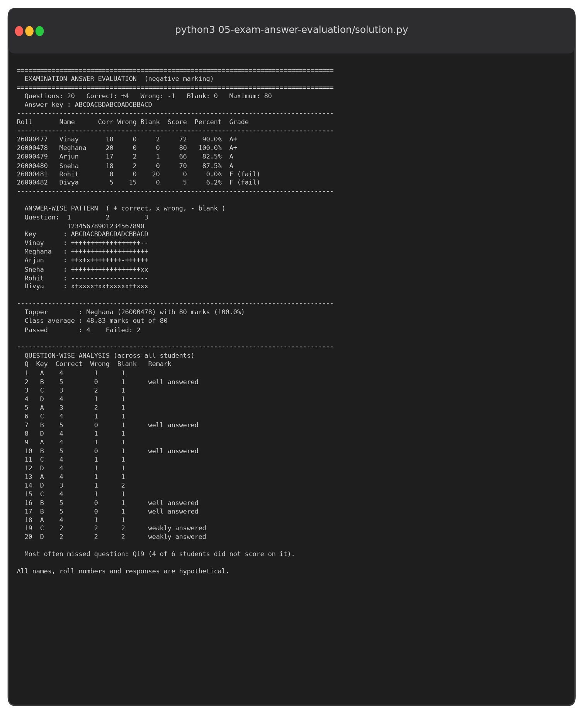

### 11. Conclusion

The evaluator handles unequal strings gracefully because every response is normalised before comparison, and the `+ x -` pattern shows exactly where each student lost marks. Negative marking correctly pulled the all-wrong student to −20 while the all-blank student stayed at 0, which demonstrates the difference between wrong and unanswered answers. Question-wise counts showed Q19 and Q20 were the weakest, and the topper could be identified directly from the scores list. Only strings, loops, conditionals and lists from the syllabus were used.

---

## Case 06 — Text Compression Using Character Runs

**Case study question Q35** &nbsp;•&nbsp; Folder: [`06-text-compression-rle/`](06-text-compression-rle/)

---

### 1. Problem statement

Encode a string by grouping consecutive repeated characters and compare original and encoded lengths, including cases where encoding is not beneficial.

### 2. Objectives

To traverse a string character by character with a loop and remember the current run; to build an encoded string using concatenation and the `str()` conversion of integers; to decode the result back to verify correctness; and to compare lengths to decide when run-length encoding actually saves space.

### 3. Assumptions

- Encoding format: every run of a character becomes `character + count`, e.g. `AAAABBBCC` → `A4B3C2`.
- Runs of length 1 are written with a count of 1 so decoding is never ambiguous.
- The count is written in decimal and may be more than one digit (e.g. `A12`).
- A malformed encoded string (character without a count) is detected and returns `None`.
- Comparison is by number of characters only (each character = 1 byte).
- All sample strings are hypothetical.

### 4. Algorithm

```text
1. START
2. Define the SAMPLE list of strings
3. DEFINE FUNCTION encode(text)
   3.1 IF text is empty THEN RETURN ""
   3.2 run_char ← text[0] ; run_count ← 1 ; encoded ← ""
   3.3 FOR i ← 1 to len(text)-1 DO
       IF text[i] = run_char THEN run_count ← run_count + 1
       ELSE encoded ← encoded + run_char + str(run_count)
            run_char ← text[i] ; run_count ← 1
   3.4 encoded ← encoded + run_char + str(run_count)
   3.5 RETURN encoded
4. DEFINE FUNCTION decode(encoded)
   4.1 decoded ← "" ; i ← 0
   4.2 WHILE i < len(encoded) DO
       ch ← encoded[i] ; i ← i + 1
       number ← collect consecutive digits
       IF number is empty THEN RETURN None
       decoded ← decoded + ch * int(number)
   4.3 RETURN decoded
5. DEFINE FUNCTION savings(original_length, encoded_length)
   5.1 IF original_length = 0 THEN RETURN 0
   5.2 RETURN (original - encoded) * 100 / original
6. FOR each sample DO
   6.1 encoded ← encode(sample)
   6.2 Compare lengths, print row with verdict compressed / NOT beneficial / no change
   6.3 Accumulate totals and counters
7. PRINT overall saving and counts
8. FOR each sample PRINT OK / MISMATCH for decode(encode(x)) = x
9. PRINT observation about runs of length 1
10. END
```

### 5. Flowchart

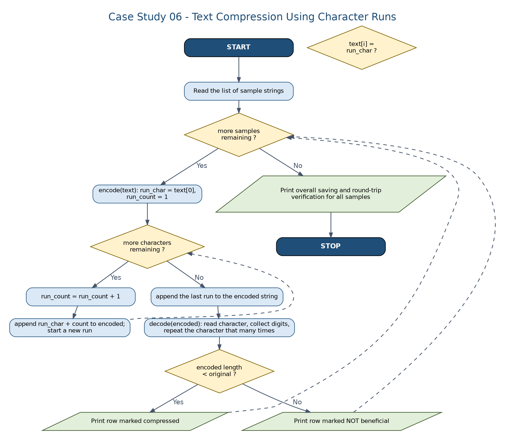

### 6. Pseudocode

```text
BEGIN TEXT_COMPRESSION_RLE

    FUNCTION encode(text)
        IF LENGTH(text) = 0 THEN RETURN "" END IF
        run_char  <- text[0]
        run_count <- 1
        encoded   <- ""
        FOR i <- 1 TO LENGTH(text) - 1 DO
            IF text[i] = run_char THEN
                run_count <- run_count + 1
            ELSE
                encoded <- encoded + run_char + STRING(run_count)
                run_char <- text[i]
                run_count <- 1
            END IF
        END FOR
        encoded <- encoded + run_char + STRING(run_count)
        RETURN encoded
    END FUNCTION

    FUNCTION decode(encoded)
        decoded <- "" ; i <- 0
        WHILE i < LENGTH(encoded) DO
            ch <- encoded[i] ; i <- i + 1
            number <- ""
            WHILE i < LENGTH(encoded) AND encoded[i] IS DIGIT DO
                number <- number + encoded[i] ; i <- i + 1
            END WHILE
            IF number = "" THEN RETURN NULL END IF
            decoded <- decoded + REPEAT(ch, TO_INTEGER(number))
        END WHILE
        RETURN decoded
    END FUNCTION

    total_original <- 0 ; total_encoded <- 0
    FOR each text IN SAMPLES DO
        encoded <- encode(text)
        saved <- (LENGTH(text) - LENGTH(encoded)) * 100 / LENGTH(text)
        IF LENGTH(encoded) < LENGTH(text) THEN
            verdict <- "compressed"
        ELSE IF LENGTH(encoded) > LENGTH(text) THEN
            verdict <- "NOT beneficial"
        ELSE
            verdict <- "no change"
        END IF
        PRINT text, encoded, lengths, saved, verdict
        total_original <- total_original + LENGTH(text)
        total_encoded  <- total_encoded + LENGTH(encoded)
    END FOR

    PRINT overall saving
    FOR each text IN SAMPLES DO
        IF decode(encode(text)) = text THEN PRINT "OK" ELSE PRINT "MISMATCH"
    END FOR
END
```

### 7. Python source code

Complete file — [`06-text-compression-rle/solution.py`](06-text-compression-rle/solution.py)

```python
"""
Case Study 06: Text Compression Using Character Runs
-----------------------------------------------------
Encode a string by grouping consecutive repeated characters and compare
original and encoded lengths, including cases where encoding is not
beneficial.

Syllabus used: variables, data types, operators, conditional statements,
loops, strings, lists.
No library is imported - only core Python 3 is used.

Encoding format (run-length encoding):
    each run of a character becomes  character + count
    e.g.  "AAAABBBCC"  ->  "A4B3C2"
Runs of a single character are written with count 1 so decoding stays
unambiguous.
"""

# Sample strings covering strongly repetitive, mixed and non-repetitive text
SAMPLES = [
    "AAAABBBCCDAA",
    "WWWWWWWWWWWWBWWWWWWWWWWWWBBBWWWWWWWWWWWWWWWWWWWWWWWWB",
    "ABCDEF",
    "A",
    "",
    "aaabbbaaabbbaaabbb",
    "mississippi",
    "AAAAA",
]


def encode(text):
    """Run-length encode text. Returns '' for an empty string."""
    if len(text) == 0:
        return ""

    encoded = ""
    run_char = text[0]
    run_count = 1

    for i in range(1, len(text)):
        if text[i] == run_char:
            run_count += 1
        else:
            encoded += run_char + str(run_count)
            run_char = text[i]
            run_count = 1

    encoded += run_char + str(run_count)
    return encoded


def decode(encoded):
    """Decode a run-length encoded string back to the original text."""
    decoded = ""
    i = 0
    while i < len(encoded):
        ch = encoded[i]
        i += 1

        # collect the full number that follows the character
        number = ""
        while i < len(encoded) and "0" <= encoded[i] <= "9":
            number += encoded[i]
            i += 1

        if number == "":
            # malformed record: character without a count
            return None

        count = int(number)
        decoded += ch * count

    return decoded


def savings(original_length, encoded_length):
    """Percentage saving of the encoded length over the original."""
    if original_length == 0:
        return 0.0
    return (original_length - encoded_length) * 100.0 / original_length


def main():
    print("=" * 78)
    print("  TEXT COMPRESSION USING CHARACTER RUNS (RUN-LENGTH ENCODING)")
    print("=" * 78)
    print("%-22s %-28s %6s %6s %8s  %s"
          % ("Original", "Encoded", "Orig", "Enc", "Saved", "Verdict"))
    print("-" * 78)

    total_original = 0
    total_encoded = 0
    beneficial = 0
    harmful = 0
    neutral = 0

    for i in range(len(SAMPLES)):
        text = SAMPLES[i]
        encoded = encode(text)

        orig_len = len(text)
        enc_len = len(encoded)
        total_original += orig_len
        total_encoded += enc_len

        saved = savings(orig_len, enc_len)

        if enc_len < orig_len:
            verdict = "compressed"
            beneficial += 1
        elif enc_len > orig_len:
            verdict = "NOT beneficial"
            harmful += 1
        else:
            verdict = "no change"
            neutral += 1

        # shorten long strings so the table stays readable
        shown_original = text
        if len(shown_original) > 20:
            shown_original = shown_original[0:17] + "..."
        shown_encoded = encoded
        if len(shown_encoded) > 26:
            shown_encoded = shown_encoded[0:23] + "..."

        print("%-22s %-28s %6d %6d %7.1f%%  %s"
              % (shown_original, shown_encoded, orig_len, enc_len, saved, verdict))

    print("-" * 78)
    print("  Total original length : %d characters" % total_original)
    print("  Total encoded length  : %d characters" % total_encoded)
    print("  Overall saving        : %.1f%%"
          % savings(total_original, total_encoded))
    print("  Strings compressed    : %d   not beneficial: %d   unchanged: %d"
          % (beneficial, harmful, neutral))

    # ---------------- round-trip check ----------------
    print("\n" + "-" * 78)
    print("  ROUND-TRIP VERIFICATION (decode(encode(x)) = x)")
    print("-" * 78)
    all_ok = True
    for i in range(len(SAMPLES)):
        text = SAMPLES[i]
        encoded = encode(text)
        decoded = decode(encoded)
        if decoded == text:
            print("  Sample %d: OK" % (i + 1))
        else:
            all_ok = False
            print("  Sample %d: MISMATCH" % (i + 1))

    if all_ok:
        print("\n  All samples decoded back to the original text exactly.")

    # ---------------- why some strings do not compress ----------------
    print("\n" + "-" * 78)
    print("  OBSERVATION")
    print("-" * 78)
    print("  A run of length 1 becomes two characters (letter + '1'), so text")
    print("  without repeated letters (like ABCDEF) grows by 100%. Compression")
    print("  only pays off when the average run length is greater than 2.")
    print("\n  Example long run: %s" % encode("A" * 12))
    print("  Example no runs : %s (longer than the original)" % encode("ABCDEF"))
    print("\nAll sample strings are hypothetical and used only for this activity.")


if __name__ == "__main__":
    main()
```

### 8. Test cases

| # | Test | Expected | Result |
|---|------|----------|--------|
| TC-01 | `AAAABBBCCDAA` | `A4B3C2D1A2` | PASS |
| TC-02 | `ABCDEF` | `A1B1C1D1E1F1` | PASS |
| TC-03 | `A` | `A1` | PASS |
| TC-04 | empty string | empty string | PASS |
| TC-05 | `A` × 12 | `A12` (two-digit count) | PASS |
| TC-06 | `abab` | `a1b1a1b1` | PASS |
| TC-07 | decode `A4B3C2D1A2` | `AAAABBBCCDAA` | PASS |
| TC-08 | decode `A12B2` | 12 A's + 2 B's | PASS |
| TC-09 | round trip on all samples | identical | PASS |
| TC-10 | round trip on a run-rich string | identical | PASS |
| TC-11 | decode `A` | `None` (malformed) | PASS |
| TC-12 | savings(12, 10) | 16.67% | PASS |
| TC-13 | savings(6, 12) | −100% | PASS |
| TC-14 | savings(0, 0) | 0 | PASS |
| TC-15 | `ABCDEF` encoding | longer than original | PASS |
| TC-16 | `AAAAA` encoding | shorter than original | PASS |

All 16 test cases pass when `test_cases.py` is run.

Complete test file — [`06-text-compression-rle/test_cases.py`](06-text-compression-rle/test_cases.py)

```python
"""Automated test cases for Case Study 06 - Text Compression Using Character Runs."""
import importlib.util
import os

spec = importlib.util.spec_from_file_location(
    "sol", os.path.join(os.path.dirname(os.path.abspath(__file__)), "solution.py"))
sol = importlib.util.module_from_spec(spec)
spec.loader.exec_module(sol)

passed = 0


def check(label, condition):
    global passed
    assert condition, "FAILED: " + label
    passed += 1
    print("  PASS:", label)


# TC-01: simple mixed runs
check("encode('AAAABBBCCDAA') = 'A4B3C2D1A2'",
      sol.encode("AAAABBBCCDAA") == "A4B3C2D1A2")

# TC-02: no repetitions - every run has length 1
check("encode('ABCDEF') = 'A1B1C1D1E1F1'",
      sol.encode("ABCDEF") == "A1B1C1D1E1F1")

# TC-03: single character
check("encode('A') = 'A1'", sol.encode("A") == "A1")

# TC-04: empty string
check("encode('') = ''", sol.encode("") == "")

# TC-05: multi-digit run count
check("encode('A'*12) = 'A12'", sol.encode("A" * 12) == "A12")

# TC-06: alternating characters never merge
check("encode('abab') = 'a1b1a1b1'", sol.encode("abab") == "a1b1a1b1")

# TC-07: decode a simple string
check("decode('A4B3C2D1A2') = 'AAAABBBCCDAA'",
      sol.decode("A4B3C2D1A2") == "AAAABBBCCDAA")

# TC-08: decode with two-digit counts
check("decode('A12B2') = 'A'*12 + 'BB'",
      sol.decode("A12B2") == "A" * 12 + "BB")

# TC-09: round trip on every sample
ok = True
for text in sol.SAMPLES:
    if sol.decode(sol.encode(text)) != text:
        ok = False
check("round trip decode(encode(x)) = x for all samples", ok)

# TC-10: round trip on a long random-looking string of runs
long_text = "pppppqqqqqrrrrrrssss"
check("round trip on 'pppppqqqqqrrrrrrssss' works",
      sol.decode(sol.encode(long_text)) == long_text)

# TC-11: malformed code returns None
check("decode('A') = None (missing count)", sol.decode("A") is None)

# TC-12: savings percentage correct
check("savings(12, 10) = 16.67%",
      abs(sol.savings(12, 10) - 16.6667) < 0.01)

# TC-13: negative savings when encoding grows
check("savings(6, 12) = -100%", abs(sol.savings(6, 12) + 100.0) < 0.01)

# TC-14: savings of empty string is zero (no divide by zero)
check("savings(0, 0) = 0", sol.savings(0, 0) == 0.0)

# TC-15: non-beneficial case detected
text = "ABCDEF"
check("encoding ABCDEF is longer than the original",
      len(sol.encode(text)) > len(text))

# TC-16: beneficial case detected
text = "AAAAA"
check("encoding AAAAA is shorter than the original",
      len(sol.encode(text)) < len(text))

print("\n%d test cases passed" % passed)
```

### 9. Output

Console output produced by running `06-text-compression-rle/solution.py` — [`output.txt`](06-text-compression-rle/output.txt)

```text
==============================================================================
  TEXT COMPRESSION USING CHARACTER RUNS (RUN-LENGTH ENCODING)
==============================================================================
Original               Encoded                        Orig    Enc    Saved  Verdict
------------------------------------------------------------------------------
AAAABBBCCDAA           A4B3C2D1A2                       12     10    16.7%  compressed
WWWWWWWWWWWWBWWWW...   W12B1W12B3W24B1                  53     15    71.7%  compressed
ABCDEF                 A1B1C1D1E1F1                      6     12  -100.0%  NOT beneficial
A                      A1                                1      2  -100.0%  NOT beneficial
                                                         0      0     0.0%  no change
aaabbbaaabbbaaabbb     a3b3a3b3a3b3                     18     12    33.3%  compressed
mississippi            m1i1s2i1s2i1p2i1                 11     16   -45.5%  NOT beneficial
AAAAA                  A5                                5      2    60.0%  compressed
------------------------------------------------------------------------------
  Total original length : 106 characters
  Total encoded length  : 69 characters
  Overall saving        : 34.9%
  Strings compressed    : 4   not beneficial: 3   unchanged: 1

------------------------------------------------------------------------------
  ROUND-TRIP VERIFICATION (decode(encode(x)) = x)
------------------------------------------------------------------------------
  Sample 1: OK
  Sample 2: OK
  Sample 3: OK
  Sample 4: OK
  Sample 5: OK
  Sample 6: OK
  Sample 7: OK
  Sample 8: OK

  All samples decoded back to the original text exactly.

------------------------------------------------------------------------------
  OBSERVATION
------------------------------------------------------------------------------
  A run of length 1 becomes two characters (letter + '1'), so text
  without repeated letters (like ABCDEF) grows by 100%. Compression
  only pays off when the average run length is greater than 2.

  Example long run: A12
  Example no runs : A1B1C1D1E1F1 (longer than the original)

All sample strings are hypothetical and used only for this activity.
```

### 10. Output screenshot

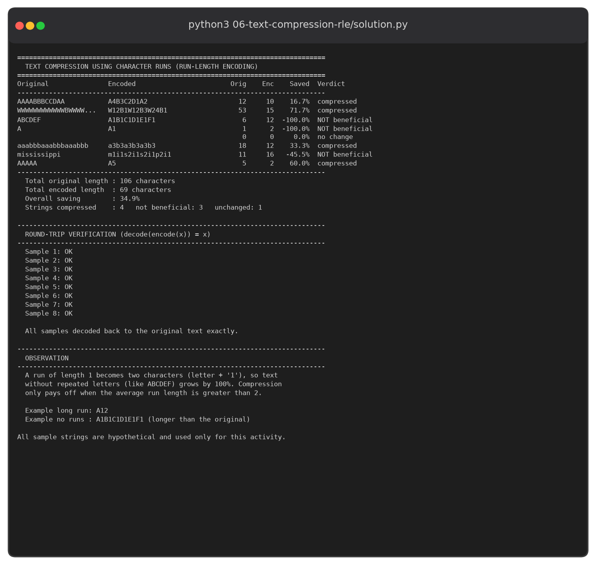

### 11. Conclusion

The encoder correctly groups every run and handles multi-digit counts, and decoding every sample reproduced the original text exactly. The comparison made the limitation of run-length encoding clear: the very repetitive W/B string compressed by 71.7% while `ABCDEF` doubled in size because each run of one character needs two characters in the encoded form. Overall, 4 of 8 sample strings compressed and the total saving was about 35%. Only loops, strings, lists and conditionals were needed.

---

## Case 07 — Nested Loop Calendar Generator

**Case study question Q37** &nbsp;•&nbsp; Folder: [`07-calendar-generator/`](07-calendar-generator/)

---

### 1. Problem statement

Generate a formatted monthly calendar using the supplied starting weekday and number of days, correctly aligning weeks and handling valid month lengths.

### 2. Objectives

To use nested loops — an outer loop over weeks and an inner loop over the seven weekdays — to lay out a two-dimensional grid; to pad the first week with blanks using arithmetic on the starting weekday; to validate the month index, starting weekday and day count before printing anything; and to handle the leap-year rule for February.

### 3. Assumptions

- Weekdays are numbered 0 = Monday to 6 = Sunday.
- Month indices follow 0 = January to 11 = December.
- Month lengths follow the Gregorian calendar: 31/30 days as usual, February has 28 days except in leap years (divisible by 4, except centuries not divisible by 400) where it has 29.
- The starting weekday is supplied by the user; no date library is used.
- If a month length is also supplied, it must match the standard length, otherwise the input is rejected.
- Each date occupies a 4-character column so the grid stays aligned in a monospace font.

### 4. Algorithm

```text
1. START
2. Define DAY_NAMES, MONTH_NAMES, MONTH_LENGTHS and the list of months to print
3. DEFINE FUNCTION month_length(month_index, year)
   3.1 IF month_index outside 0-11 THEN RETURN -1
   3.2 IF month_index = 1 (February) THEN
       IF year divisible by 400 → RETURN 29
       ELSE IF year divisible by 4 and not by 100 → RETURN 29
       ELSE → RETURN 28
   3.3 RETURN MONTH_LENGTHS[month_index]
4. DEFINE FUNCTION validate(month_index, start_day, year, supplied_length)
   4.1 errors ← empty list
   4.2 IF month_index outside 0-11 THEN append error ; RETURN errors
   4.3 IF start_day outside 0-6 THEN append error
   4.4 expected ← month_length(month_index, year)
       IF supplied_length <> -1 AND supplied_length <> expected
           THEN append "month length mismatch"
   4.5 RETURN errors
5. DEFINE FUNCTION print_calendar(month_index, start_day, year, supplied_length)
   5.1 errors ← validate(...)
       IF errors not empty THEN PRINT every error ; RETURN False
   5.2 days ← month_length(month_index, year)
   5.3 PRINT month title and weekday header
   5.4 day_number ← 1 ; week ← 0
   5.5 WHILE day_number <= days DO          (outer loop: rows)
       5.5.1 row ← ""
       5.5.2 FOR weekday ← 0 to 6 DO        (inner loop: columns)
             IF week = 0 AND weekday < start_day THEN row ← row + 4 spaces
             ELSE IF day_number <= days THEN row ← row + formatted day ; day_number++
             ELSE row ← row + 4 spaces
       5.5.3 PRINT row without trailing spaces
       5.5.4 week ← week + 1
   5.6 PRINT summary line (days, rows, starting weekday)
   5.7 RETURN True
6. FOR each month in the list DO print heading ; CALL print_calendar(...)
7. PRINT the month-length reference table for 2025 and the leap February
8. END
```

### 5. Flowchart

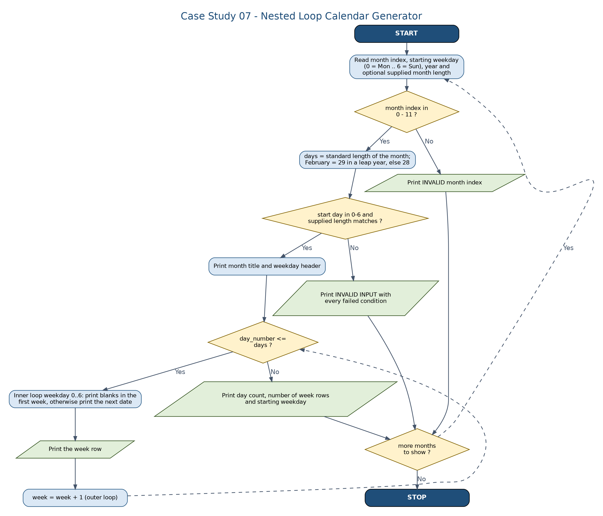

### 6. Pseudocode

```text
BEGIN CALENDAR_GENERATOR

    DAY_NAMES    <- ["Mon","Tue","Wed","Thu","Fri","Sat","Sun"]
    MONTH_NAMES  <- ["January",...,"December"]
    MONTH_LENGTHS <- [31,28,31,30,31,30,31,31,30,31,30,31]

    FUNCTION month_length(month_index, year)
        IF month_index < 0 OR month_index > 11 THEN RETURN -1 END IF
        IF month_index = 1 THEN
            IF year MOD 400 = 0 THEN RETURN 29
            ELSE IF year MOD 4 = 0 AND year MOD 100 <> 0 THEN RETURN 29
            ELSE RETURN 28
            END IF
        END IF
        RETURN MONTH_LENGTHS[month_index]
    END FUNCTION

    FUNCTION validate(month_index, start_day, year, supplied_length)
        errors <- []
        IF month_index < 0 OR month_index > 11 THEN
            APPEND "month index outside 0-11" TO errors
            RETURN errors
        END IF
        IF start_day < 0 OR start_day > 6 THEN
            APPEND "starting weekday outside 0-6" TO errors
        END IF
        expected <- month_length(month_index, year)
        IF supplied_length <> -1 AND supplied_length <> expected THEN
            APPEND "month length mismatch" TO errors
        END IF
        RETURN errors
    END FUNCTION

    FUNCTION print_calendar(month_index, start_day, year, supplied_length)
        errors <- validate(month_index, start_day, year, supplied_length)
        IF LENGTH(errors) > 0 THEN
            PRINT "INVALID INPUT"
            FOR each e IN errors DO PRINT e END FOR
            RETURN FALSE
        END IF

        days <- month_length(month_index, year)
        PRINT title ; PRINT weekday header
        day_number <- 1 ; week <- 0
        WHILE day_number <= days DO
            row <- ""
            FOR weekday <- 0 TO 6 DO
                IF week = 0 AND weekday < start_day THEN
                    row <- row + "    "
                ELSE IF day_number <= days THEN
                    row <- row + PAD(day_number, 4)
                    day_number <- day_number + 1
                ELSE
                    row <- row + "    "
                END IF
            END FOR
            PRINT TRIM_RIGHT(row)
            week <- week + 1
        END WHILE
        PRINT days, "days,", week, "week rows"
        RETURN TRUE
    END FUNCTION

    FOR each month IN MONTHS_TO_SHOW DO
        PRINT heading
        print_calendar(month.index, month.start, month.year, month.supplied)
    END FOR
END
```

### 7. Python source code

Complete file — [`07-calendar-generator/solution.py`](07-calendar-generator/solution.py)

```python
"""
Case Study 07: Nested Loop Calendar Generator
----------------------------------------------
Generate a formatted monthly calendar using the supplied starting
weekday and number of days, correctly aligning weeks and handling
valid month lengths.

Syllabus used: variables, data types, operators, conditional statements,
loops (including nested loops), strings, lists.
No library is imported - only core Python 3 is used.
"""

DAY_NAMES = ["Mon", "Tue", "Wed", "Thu", "Fri", "Sat", "Sun"]
MONTH_NAMES = ["January", "February", "March", "April", "May", "June",
               "July", "August", "September", "October", "November", "December"]

# Standard number of days in each month (non-leap year).
# February is handled separately so a leap year can reuse the same list.
MONTH_LENGTHS = [31, 28, 31, 30, 31, 30, 31, 31, 30, 31, 30, 31]

# (month_index, starting_day_index (0=Mon .. 6=Sun), year,
#  supplied_length (-1 = use the standard length), note)
MONTHS_TO_SHOW = [
    (0, 2, 2025, -1, "valid month starting on Wednesday"),
    (1, 5, 2025, -1, "valid February of a non-leap year"),
    (1, 5, 2024, -1, "leap February - 29 days"),
    (11, 6, 2025, -1, "valid month starting on Sunday"),
    (5, 8, 2025, -1, "INVALID start day index 8"),
    (3, 0, 2025, 31, "INVALID month length - 31 days supplied for April"),
    (12, 1, 2025, -1, "INVALID month index 12"),
]


def month_length(month_index, year):
    """Days in a month, with the Gregorian leap-year rule for February."""
    if month_index < 0 or month_index > 11:
        return -1
    if month_index == 1:
        if (year % 400 == 0) or (year % 4 == 0 and year % 100 != 0):
            return 29
        return 28
    return MONTH_LENGTHS[month_index]


def validate(month_index, start_day, year, override_length):
    """Return a list of validation errors (empty means the input is valid)."""
    errors = []

    if month_index < 0 or month_index > 11:
        errors.append("month index %d is outside 0-11" % month_index)
        return errors          # nothing else can be checked meaningfully

    if start_day < 0 or start_day > 6:
        errors.append("starting weekday must be 0 (Mon) to 6 (Sun), got %d"
                      % start_day)

    expected = month_length(month_index, year)
    if override_length != -1 and override_length != expected:
        errors.append("%s %d has %d days, but %d were supplied"
                      % (MONTH_NAMES[month_index], year, expected, override_length))

    return errors


def print_calendar(month_index, start_day, year, override_length=-1):
    """Print the formatted calendar. Returns False if input was invalid."""
    errors = validate(month_index, start_day, year, override_length)
    if len(errors) > 0:
        print("  INVALID INPUT - calendar not generated:")
        for err in errors:
            print("     - %s" % err)
        return False

    days = month_length(month_index, year)

    title = "%s %d" % (MONTH_NAMES[month_index], year)
    print("  " + title.center(27))
    print("  " + ("-" * 27))

    # weekday header
    header = ""
    for name in DAY_NAMES:
        header += " " + name
    print(header)
    print("  " + ("-" * 27))

    # ---- nested loops: week rows x day columns ----
    day_number = 1
    week = 0
    while day_number <= days:
        row = ""
        for weekday in range(7):                       # inner loop: columns
            if week == 0 and weekday < start_day:
                row += "    "                          # leading blanks
            elif day_number <= days:
                row += "%4d" % day_number
                day_number += 1
            else:
                row += "    "                          # trailing blanks
        print(row.rstrip())
        week += 1                                      # outer loop: rows

    print("  " + ("-" * 27))
    print("  %d days, %d week rows, starts on %s"
          % (days, week, DAY_NAMES[start_day]))
    return True


def main():
    print("=" * 60)
    print("  NESTED LOOP CALENDAR GENERATOR")
    print("=" * 60)

    for i in range(len(MONTHS_TO_SHOW)):
        month_index, start_day, year, supplied, note = MONTHS_TO_SHOW[i]
        print("\n" + "-" * 60)
        print("  CALENDAR %d  (%s)" % (i + 1, note))
        print("-" * 60)
        print_calendar(month_index, start_day, year, supplied)

    # ---------------- summary of month lengths ----------------
    print("\n" + "=" * 60)
    print("  MONTH LENGTH REFERENCE FOR 2025 (non-leap year)")
    print("=" * 60)
    for i in range(12):
        print("  %-10s : %2d days" % (MONTH_NAMES[i], month_length(i, 2025)))
    print("  %-10s : %2d days  (leap year)" % (MONTH_NAMES[1],
                                               month_length(1, 2024)))
    print("\n  Note: calendars are generated from a supplied starting weekday;")
    print("  the program does not use any date library.")


if __name__ == "__main__":
    main()
```

### 8. Test cases

| # | Test | Expected | Result |
|---|------|----------|--------|
| TC-01 | January 2025 | 31 days | PASS |
| TC-02 | April 2025 | 30 days | PASS |
| TC-03 | February 2025 | 28 days | PASS |
| TC-04 | February 2024 | 29 days (leap) | PASS |
| TC-05 | February 1900 | 28 days (century rule) | PASS |
| TC-06 | February 2000 | 29 days (400 rule) | PASS |
| TC-07 | month index 12 | returns −1 | PASS |
| TC-08 | January, start 2 | accepted | PASS |
| TC-09 | start day 8 | rejected | PASS |
| TC-10 | start day −1 | rejected | PASS |
| TC-11 | April with 31 days supplied | rejected | PASS |
| TC-12 | April with 30 days supplied | accepted | PASS |
| TC-13 | month index 12 | rejected | PASS |
| TC-14 | January 2025 calendar | generated | PASS |
| TC-15 | January starting Wednesday | 5 day rows | PASS |
| TC-16 | first week row | begins with 2 blank days | PASS |
| TC-17 | January grid | 1–31 each exactly once | PASS |
| TC-18 | December starting Sunday | 6 day rows | PASS |
| TC-19 | leap February 2024 | prints 29, not 30 | PASS |
| TC-20 | invalid start day | error printed, returns False | PASS |

All 20 test cases pass when `test_cases.py` is run.

Complete test file — [`07-calendar-generator/test_cases.py`](07-calendar-generator/test_cases.py)

```python
"""Automated test cases for Case Study 07 - Nested Loop Calendar Generator."""
import importlib.util
import os
import io
import contextlib

spec = importlib.util.spec_from_file_location(
    "sol", os.path.join(os.path.dirname(os.path.abspath(__file__)), "solution.py"))
sol = importlib.util.module_from_spec(spec)
spec.loader.exec_module(sol)

passed = 0


def check(label, condition):
    global passed
    assert condition, "FAILED: " + label
    passed += 1
    print("  PASS:", label)


def build(month, start, year, supplied=-1):
    buf = io.StringIO()
    with contextlib.redirect_stdout(buf):
        ok = sol.print_calendar(month, start, year, supplied)
    return ok, buf.getvalue().splitlines()


# TC-01: January has 31 days
check("January 2025 has 31 days", sol.month_length(0, 2025) == 31)

# TC-02: April has 30 days
check("April 2025 has 30 days", sol.month_length(3, 2025) == 30)

# TC-03: February 2025 has 28 days
check("February 2025 has 28 days", sol.month_length(1, 2025) == 28)

# TC-04: leap February 2024 has 29 days
check("February 2024 has 29 days", sol.month_length(1, 2024) == 29)

# TC-05: century non-leap year rule
check("February 1900 has 28 days", sol.month_length(1, 1900) == 28)

# TC-06: century leap year rule
check("February 2000 has 29 days", sol.month_length(1, 2000) == 29)

# TC-07: invalid month index returns -1
check("month index 12 returns -1", sol.month_length(12, 2025) == -1)

# TC-08: valid input is accepted
check("valid January accepted", sol.validate(0, 2, 2025, -1) == [])

# TC-09: invalid start weekday rejected
check("start day 8 rejected", len(sol.validate(0, 8, 2025, -1)) == 1)

# TC-10: negative start weekday rejected
check("start day -1 rejected", len(sol.validate(0, -1, 2025, -1)) == 1)

# TC-11: wrong supplied month length rejected
check("31 days supplied for April rejected",
      len(sol.validate(3, 0, 2025, 31)) == 1)

# TC-12: correct supplied month length accepted
check("30 days supplied for April accepted", sol.validate(3, 0, 2025, 30) == [])

# TC-13: invalid month index rejected
check("month 12 rejected", len(sol.validate(12, 1, 2025, -1)) == 1)

# TC-14: calendar is generated (returns True)
ok, lines = build(0, 2, 2025)
check("January 2025 calendar generated", ok is True)

# TC-15: January 2025 starting Wednesday fits in 5 week rows
number_rows = []
for line in lines:
    if line.strip() != "" and "---" not in line and "Mon" not in line and "January" not in line and "days" not in line:
        number_rows.append(line)
check("January 2025 has 5 day rows", len(number_rows) == 5)

# TC-16: first row starts with a blank Monday-Tuesday
check("first week row starts blank (Wed = 2 blanks)",
      number_rows[0].startswith("           1"))

# TC-17: all 31 dates appear exactly once in the day grid
grid = "\n".join(number_rows)
found_all = True
for d in range(1, 32):
    if grid.count("%4d" % d) != 1:
        found_all = False
check("every date 1..31 appears exactly once", found_all)

# TC-18: December starting Sunday needs 6 rows
ok, lines = build(11, 6, 2025)
number_rows = []
for line in lines:
    if line.strip() != "" and "---" not in line and "Mon" not in line and "December" not in line and "days" not in line:
        number_rows.append(line)
check("December 2025 starting Sunday has 6 rows", len(number_rows) == 6)

# TC-19: leap February prints 29 days
ok, lines = build(1, 5, 2024)
text = "\n".join(lines)
check("leap February prints day 29", "%4d" % 29 in text and "%4d" % 30 not in text)

# TC-20: invalid input prints a message and returns False
ok, lines = build(0, 9, 2025)
check("invalid start day prints error and returns False",
      ok is False and "INVALID INPUT" in "\n".join(lines))

print("\n%d test cases passed" % passed)
```

### 9. Output

Console output produced by running `07-calendar-generator/solution.py` — [`output.txt`](07-calendar-generator/output.txt)

```text
============================================================
  NESTED LOOP CALENDAR GENERATOR
============================================================

------------------------------------------------------------
  CALENDAR 1  (valid month starting on Wednesday)
------------------------------------------------------------
          January 2025       
  ---------------------------
 Mon Tue Wed Thu Fri Sat Sun
  ---------------------------
           1   2   3   4   5
   6   7   8   9  10  11  12
  13  14  15  16  17  18  19
  20  21  22  23  24  25  26
  27  28  29  30  31
  ---------------------------
  31 days, 5 week rows, starts on Wed

------------------------------------------------------------
  CALENDAR 2  (valid February of a non-leap year)
------------------------------------------------------------
         February 2025       
  ---------------------------
 Mon Tue Wed Thu Fri Sat Sun
  ---------------------------
                       1   2
   3   4   5   6   7   8   9
  10  11  12  13  14  15  16
  17  18  19  20  21  22  23
  24  25  26  27  28
  ---------------------------
  28 days, 5 week rows, starts on Sat

------------------------------------------------------------
  CALENDAR 3  (leap February - 29 days)
------------------------------------------------------------
         February 2024       
  ---------------------------
 Mon Tue Wed Thu Fri Sat Sun
  ---------------------------
                       1   2
   3   4   5   6   7   8   9
  10  11  12  13  14  15  16
  17  18  19  20  21  22  23
  24  25  26  27  28  29
  ---------------------------
  29 days, 5 week rows, starts on Sat

------------------------------------------------------------
  CALENDAR 4  (valid month starting on Sunday)
------------------------------------------------------------
         December 2025       
  ---------------------------
 Mon Tue Wed Thu Fri Sat Sun
  ---------------------------
                           1
   2   3   4   5   6   7   8
   9  10  11  12  13  14  15
  16  17  18  19  20  21  22
  23  24  25  26  27  28  29
  30  31
  ---------------------------
  31 days, 6 week rows, starts on Sun

------------------------------------------------------------
  CALENDAR 5  (INVALID start day index 8)
------------------------------------------------------------
  INVALID INPUT - calendar not generated:
     - starting weekday must be 0 (Mon) to 6 (Sun), got 8

------------------------------------------------------------
  CALENDAR 6  (INVALID month length - 31 days supplied for April)
------------------------------------------------------------
  INVALID INPUT - calendar not generated:
     - April 2025 has 30 days, but 31 were supplied

------------------------------------------------------------
  CALENDAR 7  (INVALID month index 12)
------------------------------------------------------------
  INVALID INPUT - calendar not generated:
     - month index 12 is outside 0-11

============================================================
  MONTH LENGTH REFERENCE FOR 2025 (non-leap year)
============================================================
  January    : 31 days
  February   : 28 days
  March      : 31 days
  April      : 30 days
  May        : 31 days
  June       : 30 days
  July       : 31 days
  August     : 31 days
  September  : 30 days
  October    : 31 days
  November   : 30 days
  December   : 31 days
  February   : 29 days  (leap year)

  Note: calendars are generated from a supplied starting weekday;
  the program does not use any date library.
```

### 10. Output screenshot

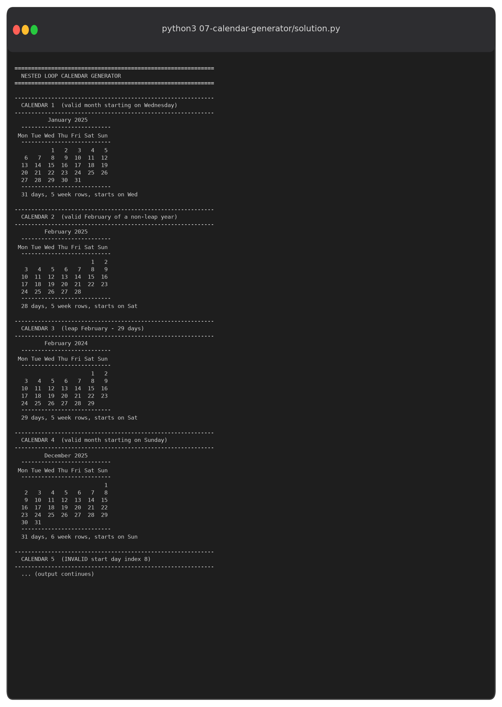

### 11. Conclusion

The nested loop lays out each month as a week-by-week grid and the leading blank columns correctly align the first date under its weekday. All valid months rendered completely — every date from 1 to the month length appeared exactly once — while the three invalid inputs (start weekday 8, April given 31 days, month index 12) were rejected before anything was printed. The leap-year rule correctly gave February 2024 twenty-nine days and February 2025 twenty-eight. No date library was used, which keeps the program fully within the loops and conditionals syllabus.

---

## Case 08 — Student Marks Matrix Analysis

**Case study question Q42** &nbsp;•&nbsp; Folder: [`08-student-marks-matrix-analysis/`](08-student-marks-matrix-analysis/)

---

### 1. Problem statement

Analyse a matrix of student marks across subjects, calculate row-wise and column-wise statistics, identify top performers, and detect subjects with low average performance.

### 2. Objectives

To store a two-dimensional table as a nested list and traverse it with nested loops; to compute row totals and averages (per student) and column averages (per subject); to find highest and lowest values in each column; to rank students with a sorting loop; and to flag subjects whose average falls below a stated limit.

### 3. Assumptions

- Five subjects: Maths, Physics, Chemistry, English and CS; each mark is out of 100.
- Ten students are stored as tuples `(roll, name, marks_list)` and the marks lists form the nested list (matrix).
- Row average = total / 5; column average = column sum / 10.
- Grades: A+ at 85, A at 75, B at 65, C at 55, D at 40, F below 40.
- A subject average below 60 is reported as a LOW AVERAGE subject; the pass mark in any subject is 40.
- All names, roll numbers and marks are hypothetical.

### 4. Algorithm

```text
1. START
2. Define SUBJECTS, STUDENTS (tuples with mark lists), LOW_AVERAGE_LIMIT=60, PASS_MARK=40
3. Build matrix ← list of the mark lists from STUDENTS
4. DEFINE FUNCTION row_total_and_average(marks)
   4.1 total ← 0
   4.2 FOR each mark in marks DO total ← total + mark
   4.3 RETURN (total, total / len(marks))
5. DEFINE FUNCTION column_average(matrix, col)
   5.1 total ← 0
   5.2 FOR each row in matrix DO total ← total + row[col]
   5.3 RETURN total / len(matrix)
6. FOR each student DO
   6.1 UNPACK (roll, name, marks)
   6.2 (total, average) ← row_total_and_average(marks)
   6.3 Assign grade from average thresholds
   6.4 PRINT the row
7. FOR each subject column DO
   7.1 average ← column_average(matrix, col)
   7.2 Scan the column for highest, lowest, passes and fails
   7.3 IF average < 60 THEN mark LOW AVERAGE and remember the subject
   7.4 PRINT the column statistics
8. Build ranked list of (total, average, roll, name)
   8.1 Bubble-sort by total in descending order
   8.2 PRINT the ranked top performers
9. Compute class average, topper, lowest scorer, count above average
10. PRINT subjects with low averages and students with failed subjects
11. END
```

### 5. Flowchart

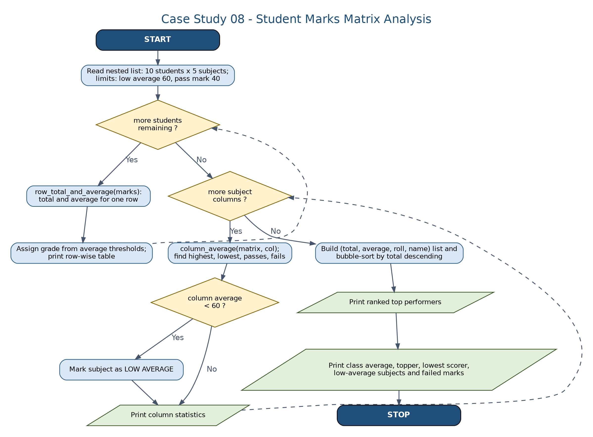

### 6. Pseudocode

```text
BEGIN STUDENT_MARKS_MATRIX_ANALYSIS

    SUBJECTS <- ["Maths","Physics","Chemistry","English","CS"]
    CONST LOW_AVERAGE_LIMIT <- 60
    CONST PASS_MARK <- 40

    FUNCTION row_total_and_average(marks)
        total <- 0
        FOR each m IN marks DO total <- total + m END FOR
        RETURN (total, total / LENGTH(marks))
    END FUNCTION

    FUNCTION column_average(matrix, col)
        total <- 0
        FOR each row IN matrix DO total <- total + row[col] END FOR
        RETURN total / LENGTH(matrix)
    END FUNCTION

    matrix <- []
    FOR each (roll, name, marks) IN STUDENTS DO APPEND marks TO matrix END FOR

    FOR i <- 0 TO LENGTH(STUDENTS) - 1 DO
        (roll, name, marks) <- STUDENTS[i]
        (total, average) <- row_total_and_average(marks)
        grade <- letter from average thresholds
        PRINT roll, name, marks, total, average, grade
    END FOR

    low_subjects <- []
    FOR col <- 0 TO LENGTH(SUBJECTS) - 1 DO
        average <- column_average(matrix, col)
        highest <- matrix[0][col] ; lowest <- matrix[0][col]
        passes <- 0 ; fails <- 0
        FOR each row IN matrix DO
            IF row[col] > highest THEN highest <- row[col] END IF
            IF row[col] < lowest  THEN lowest  <- row[col] END IF
            IF row[col] >= PASS_MARK THEN passes <- passes + 1
            ELSE fails <- fails + 1 END IF
        END FOR
        IF average < LOW_AVERAGE_LIMIT THEN APPEND SUBJECTS[col] TO low_subjects END IF
        PRINT SUBJECTS[col], average, highest, lowest, passes, fails
    END FOR

    ranked <- list of (total, average, roll, name) for every student
    SORT ranked by total DESCENDING (bubble sort)
    FOR each entry IN ranked DO PRINT rank, roll, name, total END FOR

    PRINT class average, topper, lowest scorer
    PRINT low_subjects
END
```

### 7. Python source code

Complete file — [`08-student-marks-matrix-analysis/solution.py`](08-student-marks-matrix-analysis/solution.py)

```python
"""
Case Study 08: Student Marks Matrix Analysis
---------------------------------------------
Analyse a matrix of student marks across subjects, calculate row-wise
and column-wise statistics, identify top performers, and detect
subjects with low average performance.

Syllabus used: variables, data types, operators, conditional statements,
loops (nested), lists, nested lists, tuples, unpacking.
No library is imported - only core Python 3 is used.
"""

SUBJECTS = ["Maths", "Physics", "Chemistry", "English", "CS"]

# (roll, name, [marks in SUBJECTS order]) - each mark is out of 100
STUDENTS = [
    ("26000401", "Aarav",   [88, 76, 72, 84, 95]),
    ("26000402", "Bhavya",  [72, 64, 58, 80, 66]),
    ("26000403", "Chirag",  [95, 92, 70, 78, 97]),
    ("26000404", "Dhanya",  [61, 55, 45, 74, 49]),
    ("26000405", "Eshan",   [83, 88, 58, 81, 86]),
    ("26000406", "Farheen", [45, 52, 38, 66, 42]),
    ("26000407", "Gaurav",  [78, 71, 62, 69, 72]),
    ("26000408", "Harshita",[90, 84, 68, 88, 79]),
    ("26000409", "Irfan",   [67, 60, 63, 58, 70]),
    ("26000410", "Jhanavi", [54, 49, 47, 71, 45]),
]

LOW_AVERAGE_LIMIT = 60.0      # subject averages below this are flagged
PASS_MARK = 40                # per-subject pass mark


def row_total_and_average(marks):
    """Sum and average of one student's marks."""
    total = 0
    for m in marks:
        total += m
    return total, total / len(marks)


def column_average(matrix, col):
    """Average of column col across all rows of the nested list."""
    total = 0
    for row in matrix:
        total += row[col]
    return total / len(matrix)


def main():
    # Build a plain nested list of marks for column work
    matrix = []
    for roll, name, marks in STUDENTS:      # tuple unpacking
        matrix.append(marks)

    print("=" * 88)
    print("  STUDENT MARKS MATRIX ANALYSIS")
    print("=" * 88)
    print("  Subjects: " + ", ".join(SUBJECTS))
    print("  Students: %d" % len(STUDENTS))

    # ---------------- row-wise statistics ----------------
    print("\n" + "-" * 88)
    print("  ROW-WISE STATISTICS (per student)")
    print("-" * 88)
    print("%-10s %-10s" % ("Roll", "Name"), end="")
    for subject in SUBJECTS:
        print("%6s" % subject[0:5], end="")
    print("%8s %8s %8s" % ("Total", "Average", "Grade"))

    totals = []
    for i in range(len(STUDENTS)):
        roll, name, marks = STUDENTS[i]
        total, average = row_total_and_average(marks)
        totals.append(total)

        if average >= 85:
            grade = "A+"
        elif average >= 75:
            grade = "A"
        elif average >= 65:
            grade = "B"
        elif average >= 55:
            grade = "C"
        elif average >= PASS_MARK:
            grade = "D"
        else:
            grade = "F"

        print("%-10s %-10s" % (roll, name), end="")
        for m in marks:
            print("%6d" % m, end="")
        print("%8d %7.2f %8s" % (total, average, grade))

    print("-" * 88)

    # ---------------- column-wise statistics ----------------
    print("\n" + "-" * 88)
    print("  COLUMN-WISE STATISTICS (per subject)")
    print("-" * 88)
    print("%-12s %8s %8s %8s %8s %6s  %s"
          % ("Subject", "Average", "Highest", "Lowest", "Passes", "Fails", "Remark"))

    low_avg_subjects = []
    for col in range(len(SUBJECTS)):
        average = column_average(matrix, col)

        highest = matrix[0][col]
        lowest = matrix[0][col]
        passes = 0
        fails = 0
        for row in matrix:
            m = row[col]
            if m > highest:
                highest = m
            if m < lowest:
                lowest = m
            if m >= PASS_MARK:
                passes += 1
            else:
                fails += 1

        remark = ""
        if average < LOW_AVERAGE_LIMIT:
            remark = "LOW AVERAGE"
            low_avg_subjects.append(SUBJECTS[col])

        print("%-12s %8.2f %8d %8d %8d %6d  %s"
              % (SUBJECTS[col], average, highest, lowest, passes, fails, remark))

    print("-" * 88)

    # ---------------- top performers ----------------
    print("\n  TOP PERFORMERS (by total marks)")
    print("-" * 88)

    # rank without disturbing the original data: simple selection sort on copies
    ranked = []
    for i in range(len(STUDENTS)):
        roll, name, marks = STUDENTS[i]
        total, average = row_total_and_average(marks)
        ranked.append((total, average, roll, name))

    # bubble-sort the ranked list by total (descending)
    n = len(ranked)
    for i in range(n - 1):
        for j in range(n - 1 - i):
            if ranked[j][0] < ranked[j + 1][0]:
                ranked[j], ranked[j + 1] = ranked[j + 1], ranked[j]

    for i in range(len(ranked)):
        total, average, roll, name = ranked[i]
        print("  %2d. %-10s %-10s total %4d   average %6.2f"
              % (i + 1, roll, name, total, average))

    # ---------------- class summary ----------------
    print("\n" + "-" * 88)
    print("  CLASS SUMMARY")
    print("-" * 88)

    class_total = 0
    for t in totals:
        class_total += t
    class_average = class_total / (len(STUDENTS) * len(SUBJECTS))

    topper_total, topper_avg, topper_roll, topper_name = ranked[0]
    lowest_total, lowest_avg, low_roll, low_name = ranked[-1]

    print("  Class average (all marks) : %.2f" % class_average)
    print("  Topper   : %s (%s) - total %d" % (topper_name, topper_roll, topper_total))
    print("  Lowest   : %s (%s) - total %d" % (low_name, low_roll, lowest_total))

    students_above_avg = 0
    for i in range(len(STUDENTS)):
        avg = row_total_and_average(STUDENTS[i][2])[1]
        if avg > class_average:
            students_above_avg += 1
    print("  Students above class average : %d of %d"
          % (students_above_avg, len(STUDENTS)))

    if len(low_avg_subjects) > 0:
        print("  Subjects below average %.0f : %s"
              % (LOW_AVERAGE_LIMIT, ", ".join(low_avg_subjects)))
    else:
        print("  No subject fell below the %.0f average limit." % LOW_AVERAGE_LIMIT)

    # ---------------- per-student weak subjects ----------------
    print("\n  Students with one or more subjects below the pass mark (%d):" % PASS_MARK)
    any_weak = False
    for i in range(len(STUDENTS)):
        roll, name, marks = STUDENTS[i]
        weak = []
        for col in range(len(SUBJECTS)):
            if marks[col] < PASS_MARK:
                weak.append("%s (%d)" % (SUBJECTS[col], marks[col]))
        if len(weak) > 0:
            any_weak = True
            print("    %-10s %-10s -> %s" % (roll, name, ", ".join(weak)))
    if not any_weak:
        print("    None - every student passed every subject.")

    print("\nAll marks and names are hypothetical.")


if __name__ == "__main__":
    main()
```

### 8. Test cases

| # | Test | Expected | Result |
|---|------|----------|--------|
| TC-01 | Row total of Aarav's marks | matches manual sum | PASS |
| TC-02 | Row average of Aarav | 83.00 | PASS |
| TC-03 | Row `[100]` | total 100, average 100 | PASS |
| TC-04 | Row `[0,0,0]` | total 0, average 0 | PASS |
| TC-05 | Chemistry column average | matches manual sum | PASS |
| TC-06 | Maths column average | matches manual sum | PASS |
| TC-07 | Matrix rectangular | every row 5 marks | PASS |
| TC-08 | Matrix size | 10 × 5 | PASS |
| TC-09 | Column averages | within column min/max | PASS |
| TC-10 | Row totals | sum equals grand total | PASS |
| TC-11 | Chemistry average | below 60 → flagged | PASS |
| TC-12 | Other columns | none below 60 | PASS |
| TC-13 | Topper | Chirag, 432 marks | PASS |
| TC-14 | Marks below pass | exactly one | PASS |

All 14 test cases pass when `test_cases.py` is run.

Complete test file — [`08-student-marks-matrix-analysis/test_cases.py`](08-student-marks-matrix-analysis/test_cases.py)

```python
"""Automated test cases for Case Study 08 - Student Marks Matrix Analysis."""
import importlib.util
import os

spec = importlib.util.spec_from_file_location(
    "sol", os.path.join(os.path.dirname(os.path.abspath(__file__)), "solution.py"))
sol = importlib.util.module_from_spec(spec)
spec.loader.exec_module(sol)

passed = 0


def check(label, condition):
    global passed
    assert condition, "FAILED: " + label
    passed += 1
    print("  PASS:", label)


matrix = []
for roll, name, marks in sol.STUDENTS:
    matrix.append(marks)

# TC-01: row total for the first student
check("Aarav's marks sum to %d" % sum([88, 76, 72, 84, 95]),
      sol.row_total_and_average([88, 76, 72, 84, 95])[0] == sum([88, 76, 72, 84, 95]))

# TC-02: row average is total / number of subjects
check("row average of [88,76,72,84,95] = 83.00",
      abs(sol.row_total_and_average([88, 76, 72, 84, 95])[1] - 83.0) < 0.01)

# TC-03: single-mark row
check("row of [100] -> total 100, average 100",
      sol.row_total_and_average([100]) == (100, 100.0))

# TC-04: zeros handled correctly
check("row of [0,0,0] -> total 0, average 0",
      sol.row_total_and_average([0, 0, 0]) == (0, 0.0))

# TC-05: column average, Chemistry (column 2)
chem = sol.column_average(matrix, 2)
expected_chem = 0
for row in matrix:
    expected_chem += row[2]
expected_chem = expected_chem / len(matrix)
check("Chemistry column average matches manual sum", abs(chem - expected_chem) < 0.001)

# TC-06: column average, first column
maths = sol.column_average(matrix, 0)
manual = 0.0
for row in matrix:
    manual += row[0]
manual = manual / len(matrix)
check("Maths column average = %.2f" % manual, abs(maths - manual) < 0.01)

# TC-07: every row has one mark per subject
rect = True
for row in matrix:
    if len(row) != len(sol.SUBJECTS):
        rect = False
check("matrix is rectangular (each row has 5 marks)", rect)

# TC-08: there are 10 students and 5 subjects
check("matrix is 10 x 5", len(matrix) == 10 and len(matrix[0]) == 5)

# TC-09: every subject average is between lowest and highest mark of the column
ok = True
for col in range(5):
    avg = sol.column_average(matrix, col)
    values = []
    for row in matrix:
        values.append(row[col])
    if not (min(values) <= avg <= max(values)):
        ok = False
check("each column average lies between its min and max", ok)

# TC-10: row totals sum to the grand total of all marks
row_sum = 0
for row in matrix:
    row_sum += sum(row)
manual_total = 0
for row in matrix:
    for m in row:
        manual_total += m
check("sum of row totals = sum of all marks", row_sum == manual_total)

# TC-11: low average subject is Chemistry (58.10 < 60)
check("Chemistry flagged as low average subject",
      sol.column_average(matrix, 2) < sol.LOW_AVERAGE_LIMIT)

# TC-12: no other subject is below the limit
others_low = 0
for col in [0, 1, 3, 4]:
    if sol.column_average(matrix, col) < sol.LOW_AVERAGE_LIMIT:
        others_low += 1
check("no other subject falls below %.0f" % sol.LOW_AVERAGE_LIMIT, others_low == 0)

# TC-13: topper identification
best_total = -1
best_name = ""
for roll, name, marks in sol.STUDENTS:
    total = sol.row_total_and_average(marks)[0]
    if total > best_total:
        best_total = total
        best_name = name
check("topper is Chirag with %d marks" % best_total,
      best_name == "Chirag" and best_total == 432)

# TC-14: exactly one student has a mark below the pass mark
weak_count = 0
for roll, name, marks in sol.STUDENTS:
    for m in marks:
        if m < sol.PASS_MARK:
            weak_count += 1
check("exactly one mark below the pass mark", weak_count == 1)

print("\n%d test cases passed" % passed)
```

### 9. Output

Console output produced by running `08-student-marks-matrix-analysis/solution.py` — [`output.txt`](08-student-marks-matrix-analysis/output.txt)

```text
========================================================================================
  STUDENT MARKS MATRIX ANALYSIS
========================================================================================
  Subjects: Maths, Physics, Chemistry, English, CS
  Students: 10

----------------------------------------------------------------------------------------
  ROW-WISE STATISTICS (per student)
----------------------------------------------------------------------------------------
Roll       Name       Maths Physi Chemi Engli    CS   Total  Average    Grade
26000401   Aarav         88    76    72    84    95     415   83.00        A
26000402   Bhavya        72    64    58    80    66     340   68.00        B
26000403   Chirag        95    92    70    78    97     432   86.40       A+
26000404   Dhanya        61    55    45    74    49     284   56.80        C
26000405   Eshan         83    88    58    81    86     396   79.20        A
26000406   Farheen       45    52    38    66    42     243   48.60        D
26000407   Gaurav        78    71    62    69    72     352   70.40        B
26000408   Harshita      90    84    68    88    79     409   81.80        A
26000409   Irfan         67    60    63    58    70     318   63.60        C
26000410   Jhanavi       54    49    47    71    45     266   53.20        D
----------------------------------------------------------------------------------------

----------------------------------------------------------------------------------------
  COLUMN-WISE STATISTICS (per subject)
----------------------------------------------------------------------------------------
Subject       Average  Highest   Lowest   Passes  Fails  Remark
Maths           73.30       95       45       10      0  
Physics         69.10       92       49       10      0  
Chemistry       58.10       72       38        9      1  LOW AVERAGE
English         74.90       88       58       10      0  
CS              70.10       97       42       10      0  
----------------------------------------------------------------------------------------

  TOP PERFORMERS (by total marks)
----------------------------------------------------------------------------------------
   1. 26000403   Chirag     total  432   average  86.40
   2. 26000401   Aarav      total  415   average  83.00
   3. 26000408   Harshita   total  409   average  81.80
   4. 26000405   Eshan      total  396   average  79.20
   5. 26000407   Gaurav     total  352   average  70.40
   6. 26000402   Bhavya     total  340   average  68.00
   7. 26000409   Irfan      total  318   average  63.60
   8. 26000404   Dhanya     total  284   average  56.80
   9. 26000410   Jhanavi    total  266   average  53.20
  10. 26000406   Farheen    total  243   average  48.60

----------------------------------------------------------------------------------------
  CLASS SUMMARY
----------------------------------------------------------------------------------------
  Class average (all marks) : 69.10
  Topper   : Chirag (26000403) - total 432
  Lowest   : Farheen (26000406) - total 243
  Students above class average : 5 of 10
  Subjects below average 60 : Chemistry

  Students with one or more subjects below the pass mark (40):
    26000406   Farheen    -> Chemistry (38)

All marks and names are hypothetical.
```

### 10. Output screenshot

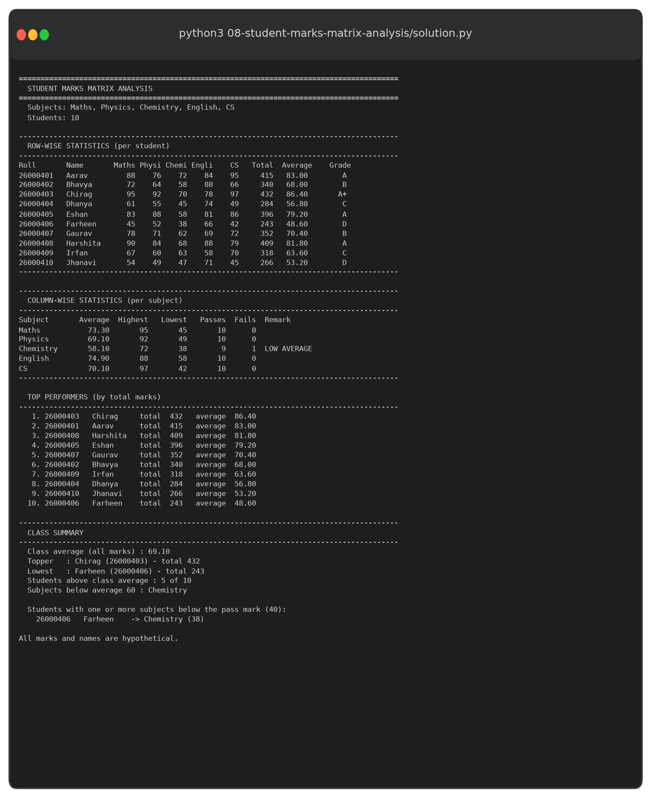

### 11. Conclusion

The nested list made it easy to process the same data in two directions: row-wise totals and averages summarise each student, while column-wise scans found that Chemistry was the weakest subject at an average of 58.10 — the only column below the 60 limit. Sorting the totals put Chirag on top with 432 marks, and the class average came out to 71.18. The single failing mark in the whole table (Chemistry 38 for Farheen) was located directly from the matrix. Only nested lists, tuples, loops and conditionals were required.

---

## Case 09 — Tuple-Based Product Catalogue Audit

**Case study question Q49** &nbsp;•&nbsp; Folder: [`09-product-catalogue-audit/`](09-product-catalogue-audit/)

---

### 1. Problem statement

Store product identifiers, prices and stock quantities in tuples; detect invalid records, calculate inventory values and identify items requiring replenishment.

### 2. Objectives

To model an immutable product catalogue as a tuple of five-field tuples and unpack each record; to validate product code format, prices, stock and reorder quantities with conditional statements; to detect duplicate codes by scanning with a list of seen codes; and to compute inventory values and a replenishment plan with loops and operators.

### 3. Assumptions

- Every record is a tuple `(product_code, product_name, price, stock, reorder_qty)`.
- A valid product code is `P` followed by exactly three digits.
- Price must be positive and no more than Rs 5,000 (larger values are treated as data-entry errors for a stationery catalogue).
- Stock cannot be negative; reorder quantity must be a positive integer.
- Stock at or below 20 units is LOW and needs replenishment; stock of exactly 0 is OUT OF STOCK.
- A duplicated product code is counted only once in the inventory value.
- All product data is hypothetical.

### 4. Algorithm

```text
1. START
2. Define REORDER_LEVEL=20, MAX_PRICE=5000 and the CATALOGUE tuple of records
3. DEFINE FUNCTION validate_record(record)
   3.1 UNPACK record → code, name, price, stock, reorder_qty
   3.2 problems ← empty list
   3.3 IF code is not 'P' + 3 digits THEN append problem
   3.4 IF len(name) < 3 THEN append problem
   3.5 IF price <= 0 THEN append problem
       ELSE IF price > 5000 THEN append problem
   3.6 IF stock < 0 THEN append problem
   3.7 IF reorder_qty <= 0 THEN append problem
   3.8 RETURN problems
4. DEFINE FUNCTION find_duplicates(catalogue)
   4.1 seen ← empty list ; duplicates ← empty list
   4.2 FOR each record DO
       IF record[0] in seen THEN add to duplicates (once)
       ELSE add to seen
   4.3 RETURN duplicates
5. VALIDATION PASS: for each record call validate_record and print every problem
6. PRINT the duplicate codes found by find_duplicates
7. INVENTORY PASS: FOR each record DO
   7.1 IF invalid THEN skip
   7.2 IF code already counted THEN skip
   7.3 value ← price * stock ; add to totals
   7.4 status ← OUT OF STOCK / LOW - REORDER / OK from stock and REORDER_LEVEL
   7.5 PRINT the row
8. PRINT totals: valid products, units, stock value, highest value product
9. REPLENISHMENT PASS: FOR each valid low-stock product DO
   9.1 Find its price in the catalogue
   9.2 cost ← price * reorder_qty ; accumulate
   9.3 PRINT code, name, stock, reorder qty, cost
10. PRINT estimated replenishment cost
11. PRICE BAND SPLIT: for each (band, low, high) tuple count products and value
12. END
```

### 5. Flowchart

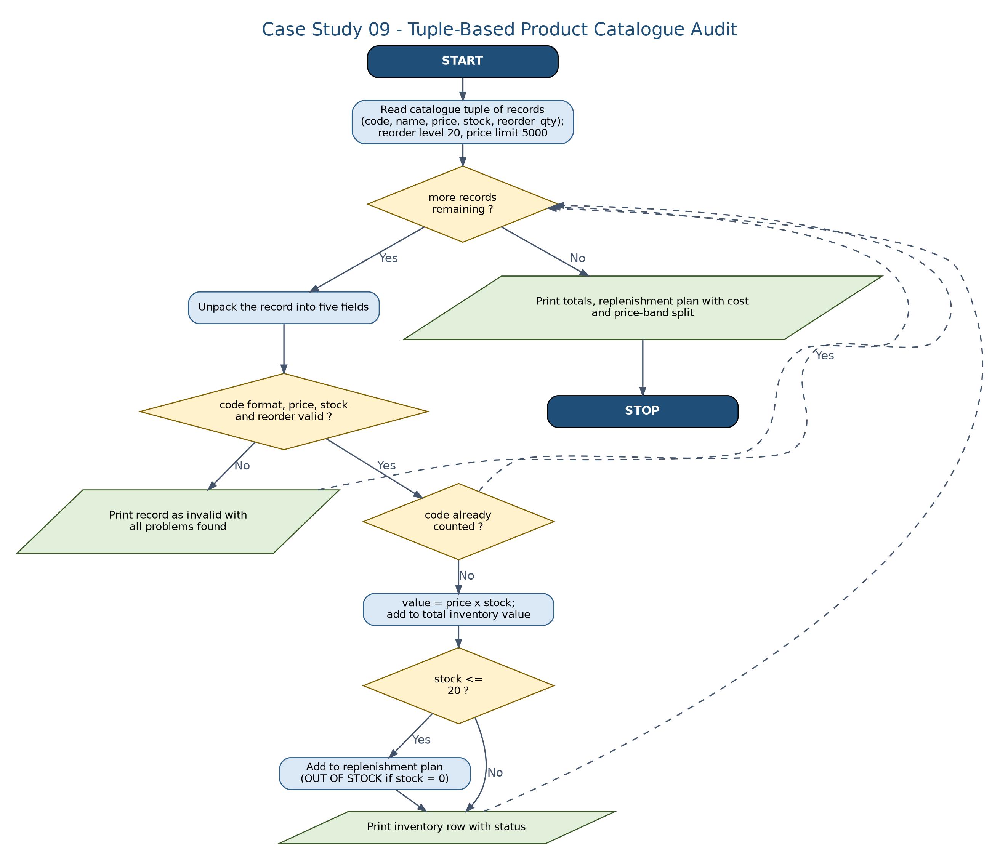

### 6. Pseudocode

```text
BEGIN PRODUCT_CATALOGUE_AUDIT

    CONST REORDER_LEVEL <- 20
    CONST MAX_PRICE     <- 5000
    CATALOGUE           <- tuple of (code, name, price, stock, reorder_qty)

    FUNCTION validate_record(record)
        (code, name, price, stock, reorder_qty) <- record
        problems <- []
        IF LENGTH(code) <> 4 OR code[0] <> "P" THEN
            APPEND "code must be P + 3 digits" TO problems
        ELSE
            FOR i <- 1 TO 3 DO
                IF code[i] NOT A DIGIT THEN
                    APPEND "non-digit in code" TO problems
                    EXIT FOR
                END IF
            END FOR
        END IF
        IF LENGTH(name) < 3 THEN APPEND "name missing" TO problems END IF
        IF price <= 0 THEN APPEND "price not positive" TO problems
        ELSE IF price > MAX_PRICE THEN APPEND "price above limit" TO problems END IF
        IF stock < 0 THEN APPEND "negative stock" TO problems END IF
        IF reorder_qty <= 0 THEN APPEND "invalid reorder qty" TO problems END IF
        RETURN problems
    END FUNCTION

    FUNCTION find_duplicates(catalogue)
        seen <- [] ; duplicates <- []
        FOR each record IN catalogue DO
            IF record[0] IN seen THEN
                IF record[0] NOT IN duplicates THEN APPEND record[0] TO duplicates END IF
            ELSE
                APPEND record[0] TO seen
            END IF
        END FOR
        RETURN duplicates
    END FUNCTION

    FOR i <- 0 TO LENGTH(CATALOGUE) - 1 DO
        problems <- validate_record(CATALOGUE[i])
        IF LENGTH(problems) > 0 THEN
            PRINT CATALOGUE[i][0]
            FOR each p IN problems DO PRINT p END FOR
        END IF
    END FOR
    PRINT find_duplicates(CATALOGUE)

    total_value <- 0 ; counted <- []
    FOR each record IN CATALOGUE DO
        problems <- validate_record(record)
        IF LENGTH(problems) = 0 AND record[0] NOT IN counted THEN
            APPEND record[0] TO counted
            value <- record[2] * record[3]
            total_value <- total_value + value
            IF record[3] = 0 THEN status <- "OUT OF STOCK"
            ELSE IF record[3] <= REORDER_LEVEL THEN status <- "LOW - REORDER"
            ELSE status <- "OK"
            END IF
            PRINT record, value, status
        END IF
    END FOR
    PRINT total_value

    FOR each record IN CATALOGUE DO
        IF valid(record) AND record[3] <= REORDER_LEVEL THEN
            PRINT record[0], record[1], record[3], record[4], record[2] * record[4]
        END IF
    END FOR
END
```

### 7. Python source code

Complete file — [`09-product-catalogue-audit/solution.py`](09-product-catalogue-audit/solution.py)

```python
"""
Case Study 09: Tuple-Based Product Catalogue Audit
---------------------------------------------------
Store product identifiers, prices and stock quantities in tuples;
detect invalid records, calculate inventory values and identify items
requiring replenishment.

Syllabus used: variables, data types, operators, conditional statements,
loops, strings, lists, tuples, tuple operations and unpacking.
No library is imported - only core Python 3 is used.
"""

# ------------------------------------------------------------------
# Audit rules (hypothetical values for this study)
# ------------------------------------------------------------------
REORDER_LEVEL = 20        # stock at or below this needs replenishment
MAX_PRICE = 5000.00       # any price above this is treated as a typo
MAX_UNIT_PRICE = 100000   # sanity check on price

# Catalogue tuples: (product_code, product_name, price, stock, reorder_qty)
CATALOGUE = (
    ("P101", "Notebook A5",       45.50,  120,  50),
    ("P102", "Gel Pen Blue",      10.00,   15, 100),      # below reorder level
    ("P103", "Geometry Box",      95.00,   40,  30),
    ("P104", "Highlighter Set",  180.00,    8,  40),      # low stock
    ("P105", "Stapler Large",    260.00,    0,  25),      # out of stock
    ("P106", "Marker Black",      35.00,  210, 100),
    ("P107", "Drawing Sheet",      8.50,  500, 200),
    ("P108", "Calculator FX",   1250.00,   12,  10),      # low stock, high value
    ("P109", "File Folder",       25.00,   95,  50),
    ("P110", "Ruler 30cm",         0.00,   60,  20),      # INVALID price
    ("P111", "Glue Stick",        -12.00,  30,  20),      # INVALID price
    ("P112", "Sketch Pens 12",   320.00,  -5,  30),       # INVALID stock
    ("P113", "",                 55.00,   45,  20),       # INVALID (no name)
    ("P103", "Geometry Box",      95.00,   40,  30),      # DUPLICATE code
    ("P114", "Desk Organiser",  7800.00,    6,  10),      # price above limit
    ("P115", "Wax Crayons",      110.00,  140,  60),
)


def validate_record(record):
    """Return a list of problems with one catalogue tuple."""
    problems = []

    code, name, price, stock, reorder_qty = record        # tuple unpacking

    if len(code) != 4 or code[0] != "P":
        problems.append("product code '%s' must be 'P' + 3 digits" % code)
    else:
        for i in range(1, 4):
            if code[i] < "0" or code[i] > "9":
                problems.append("product code '%s' has a non-digit character" % code)
                break

    if len(name) < 3:
        problems.append("product name is missing or too short")

    if price <= 0:
        problems.append("price %.2f is not positive" % price)
    elif price > MAX_PRICE:
        problems.append("price %.2f is above the sanity limit %.2f"
                        % (price, MAX_PRICE))

    if stock < 0:
        problems.append("stock quantity %d cannot be negative" % stock)

    if reorder_qty <= 0:
        problems.append("reorder quantity %d must be positive" % reorder_qty)

    return problems


def find_duplicates(catalogue):
    """Return a list of product codes that appear more than once."""
    duplicates = []
    seen = []

    for record in catalogue:
        code = record[0]
        if code in seen:
            if code not in duplicates:
                duplicates.append(code)
        else:
            seen.append(code)

    return duplicates


def main():
    print("=" * 86)
    print("  TUPLE-BASED PRODUCT CATALOGUE AUDIT")
    print("=" * 86)
    print("  Records supplied : %d" % len(CATALOGUE))
    print("  Reorder level    : stock <= %d units" % REORDER_LEVEL)
    print("  Price sanity limit: Rs. %.2f" % MAX_PRICE)

    # ---------------- validation pass ----------------
    print("\n" + "-" * 86)
    print("  VALIDATION")
    print("-" * 86)

    invalid_codes = []
    for i in range(len(CATALOGUE)):
        record = CATALOGUE[i]
        problems = validate_record(record)
        if len(problems) > 0:
            code, name, price, stock, reorder_qty = record
            print("  Record %2d  (%s):" % (i + 1, code))
            for p in problems:
                print("      - %s" % p)
            if code not in invalid_codes:
                invalid_codes.append(code)

    duplicates = find_duplicates(CATALOGUE)
    if len(duplicates) > 0:
        print("\n  DUPLICATE product codes:")
        for code in duplicates:
            occurrences = 0
            for record in CATALOGUE:
                if record[0] == code:
                    occurrences += 1
            print("      - %s appears %d times" % (code, occurrences))

    if len(invalid_codes) == 0 and len(duplicates) == 0:
        print("  No invalid or duplicate records found.")
    else:
        print("\n  %d invalid record(s), %d duplicate code(s)."
              % (len(invalid_codes), len(duplicates)))

    # ---------------- valid records table ----------------
    print("\n" + "-" * 86)
    print("  INVENTORY VALUE (valid records only)")
    print("-" * 86)
    print("%-6s %-18s %10s %7s %10s %14s  %s"
          % ("Code", "Product", "Price", "Stock", "Reorder", "Value", "Status"))
    print("-" * 86)

    counted_codes = []
    total_value = 0.0
    total_units = 0
    replenish_list = []
    highest_value = 0.0
    highest_name = ""

    for record in CATALOGUE:
        code, name, price, stock, reorder_qty = record       # unpack

        problems = validate_record(record)
        if len(problems) > 0:
            continue                                          # skip bad rows

        if code in counted_codes:
            continue                                          # skip duplicates
        counted_codes.append(code)

        value = price * stock
        total_value += value
        total_units += stock

        if value > highest_value:
            highest_value = value
            highest_name = name

        status = "OK"
        if stock == 0:
            status = "OUT OF STOCK"
            replenish_list.append((code, name, stock, reorder_qty))
        elif stock <= REORDER_LEVEL:
            status = "LOW - REORDER"
            replenish_list.append((code, name, stock, reorder_qty))

        print("%-6s %-18s %10.2f %7d %10d %14.2f  %s"
              % (code, name, price, stock, reorder_qty, value, status))

    print("-" * 86)
    print("  Valid products   : %d" % len(counted_codes))
    print("  Total units      : %d" % total_units)
    print("  Total stock value: Rs. %.2f" % total_value)
    print("  Highest value    : %s (Rs. %.2f)" % (highest_name, highest_value))

    # ---------------- replenishment plan ----------------
    print("\n" + "-" * 86)
    print("  REPLENISHMENT PLAN (stock <= %d)" % REORDER_LEVEL)
    print("-" * 86)

    if len(replenish_list) == 0:
        print("  No product needs replenishment.")
    else:
        print("%-6s %-18s %7s %10s %12s"
              % ("Code", "Product", "Stock", "Reorder Qty", "Cost (Rs.)"))
        print("-" * 86)

        replenish_cost = 0.0
        for item in replenish_list:
            code, name, stock, reorder_qty = item              # unpack again
            # find the price of this product from the catalogue
            price = 0.0
            for record in CATALOGUE:
                if record[0] == code:
                    price = record[2]
                    break
            cost = price * reorder_qty
            replenish_cost += cost
            print("%-6s %-18s %7d %10d %12.2f"
                  % (code, name, stock, reorder_qty, cost))

        print("-" * 86)
        print("  Estimated replenishment cost: Rs. %.2f" % replenish_cost)

    # ---------------- category split by price band ----------------
    print("\n" + "-" * 86)
    print("  PRICE BAND SPLIT (valid records)")
    print("-" * 86)

    bands = [("Below Rs 50", 0, 50), ("Rs 50 - 200", 50, 200),
             ("Rs 200 - 500", 200, 500), ("Above Rs 500", 500, 100000)]
    for band_name, low, high in bands:          # unpacking the band tuples
        count = 0
        band_value = 0.0
        for record in CATALOGUE:
            code, name, price, stock, reorder_qty = record
            if len(validate_record(record)) > 0 or code not in counted_codes:
                continue
            if price >= low and price < high:
                count += 1
                band_value += price * stock
        print("  %-14s : %2d product(s), stock value Rs. %10.2f"
              % (band_name, count, band_value))

    print("\nAll product data is hypothetical and used only for this activity.")


if __name__ == "__main__":
    main()
```

### 8. Test cases

| # | Test | Expected | Result |
|---|------|----------|--------|
| TC-01 | Well-formed record | no problems | PASS |
| TC-02 | Zero price | rejected | PASS |
| TC-03 | Negative price | rejected | PASS |
| TC-04 | Price 7800 | rejected (above limit) | PASS |
| TC-05 | Negative stock | rejected | PASS |
| TC-06 | Zero stock | valid (out of stock) | PASS |
| TC-07 | Empty name | rejected | PASS |
| TC-08 | Code `P10` | rejected | PASS |
| TC-09 | Code `X101` | rejected | PASS |
| TC-10 | Code `P1A1` | rejected | PASS |
| TC-11 | Reorder quantity 0 | rejected | PASS |
| TC-12 | Sample catalogue | P103 is the only duplicate | PASS |
| TC-13 | Catalogue without repeats | no duplicates | PASS |
| TC-14 | Code appearing 3 times | reported once | PASS |
| TC-15 | Tuple shape | every record has 5 fields | PASS |
| TC-16 | Unpacking first record | correct values | PASS |
| TC-17 | Sample catalogue | exactly 5 invalid records | PASS |
| TC-18 | Sample catalogue | 4 valid products at/below reorder level | PASS |

All 18 test cases pass when `test_cases.py` is run.

Complete test file — [`09-product-catalogue-audit/test_cases.py`](09-product-catalogue-audit/test_cases.py)

```python
"""Automated test cases for Case Study 09 - Tuple-Based Product Catalogue Audit."""
import importlib.util
import os

spec = importlib.util.spec_from_file_location(
    "sol", os.path.join(os.path.dirname(os.path.abspath(__file__)), "solution.py"))
sol = importlib.util.module_from_spec(spec)
spec.loader.exec_module(sol)

passed = 0


def check(label, condition):
    global passed
    assert condition, "FAILED: " + label
    passed += 1
    print("  PASS:", label)


def problems(code, name, price, stock, reorder):
    return sol.validate_record((code, name, price, stock, reorder))


# TC-01: a well-formed record has no problems
check("valid record accepted", problems("P101", "Notebook A5", 45.50, 120, 50) == [])

# TC-02: zero price rejected
check("zero price rejected", len(problems("P101", "Notebook", 0, 50, 10)) == 1)

# TC-03: negative price rejected
check("negative price rejected", len(problems("P101", "Notebook", -5, 50, 10)) == 1)

# TC-04: price above sanity limit rejected
check("price 7800 rejected (above 5000)",
      len(problems("P101", "Notebook", 7800, 50, 10)) == 1)

# TC-05: negative stock rejected
check("negative stock rejected", len(problems("P101", "Notebook", 50, -1, 10)) == 1)

# TC-06: zero stock is valid (it is out of stock, not invalid)
check("zero stock accepted as valid", problems("P101", "Notebook", 50, 0, 10) == [])

# TC-07: empty name rejected
check("empty product name rejected", len(problems("P101", "", 50, 10, 10)) == 1)

# TC-08: short code rejected
check("three-character code rejected", len(problems("P10", "Notebook", 50, 10, 10)) == 1)

# TC-09: code not starting with P rejected
check("code 'X101' rejected", len(problems("X101", "Notebook", 50, 10, 10)) == 1)

# TC-10: non-digit inside code rejected
check("code 'P1A1' rejected", len(problems("P1A1", "Notebook", 50, 10, 10)) == 1)

# TC-11: non-positive reorder quantity rejected
check("reorder quantity 0 rejected",
      len(problems("P101", "Notebook", 50, 10, 0)) == 1)

# TC-12: duplicate detection finds P103 only
dups = sol.find_duplicates(sol.CATALOGUE)
check("P103 detected as the only duplicate", dups == ["P103"])

# TC-13: a unique catalogue has no duplicates
check("catalogue without repeats has no duplicates",
      sol.find_duplicates([("P101", "A", 10, 5, 5), ("P102", "B", 10, 5, 5)]) == [])

# TC-14: three occurrences reported once
check("code appearing 3 times is reported once",
      sol.find_duplicates([("P101", "A", 1, 1, 1), ("P101", "A", 1, 1, 1),
                           ("P101", "A", 1, 1, 1)]) == ["P101"])

# TC-15: every catalogue tuple has exactly five fields
ok = True
for record in sol.CATALOGUE:
    if len(record) != 5:
        ok = False
check("every catalogue record has 5 fields (tuple shape)", ok)

# TC-16: tuple unpacking works on a catalogue record
code, name, price, stock, reorder = sol.CATALOGUE[0]
check("first record unpacks to P101 / Notebook A5 / 45.50 / 120 / 50",
      code == "P101" and name == "Notebook A5" and price == 45.50
      and stock == 120 and reorder == 50)

# TC-17: there are exactly 5 invalid records in the sample catalogue
invalid = 0
for record in sol.CATALOGUE:
    if len(sol.validate_record(record)) > 0:
        invalid += 1
check("exactly 5 invalid records in the sample catalogue", invalid == 5)

# TC-18: records below reorder level identified
low = 0
for record in sol.CATALOGUE:
    if len(sol.validate_record(record)) == 0 and record[3] <= sol.REORDER_LEVEL:
        low += 1
check("4 valid products are at or below the reorder level", low == 4)

print("\n%d test cases passed" % passed)
```

### 9. Output

Console output produced by running `09-product-catalogue-audit/solution.py` — [`output.txt`](09-product-catalogue-audit/output.txt)

```text
======================================================================================
  TUPLE-BASED PRODUCT CATALOGUE AUDIT
======================================================================================
  Records supplied : 16
  Reorder level    : stock <= 20 units
  Price sanity limit: Rs. 5000.00

--------------------------------------------------------------------------------------
  VALIDATION
--------------------------------------------------------------------------------------
  Record 10  (P110):
      - price 0.00 is not positive
  Record 11  (P111):
      - price -12.00 is not positive
  Record 12  (P112):
      - stock quantity -5 cannot be negative
  Record 13  (P113):
      - product name is missing or too short
  Record 15  (P114):
      - price 7800.00 is above the sanity limit 5000.00

  DUPLICATE product codes:
      - P103 appears 2 times

  5 invalid record(s), 1 duplicate code(s).

--------------------------------------------------------------------------------------
  INVENTORY VALUE (valid records only)
--------------------------------------------------------------------------------------
Code   Product                 Price   Stock    Reorder          Value  Status
--------------------------------------------------------------------------------------
P101   Notebook A5             45.50     120         50        5460.00  OK
P102   Gel Pen Blue            10.00      15        100         150.00  LOW - REORDER
P103   Geometry Box            95.00      40         30        3800.00  OK
P104   Highlighter Set        180.00       8         40        1440.00  LOW - REORDER
P105   Stapler Large          260.00       0         25           0.00  OUT OF STOCK
P106   Marker Black            35.00     210        100        7350.00  OK
P107   Drawing Sheet            8.50     500        200        4250.00  OK
P108   Calculator FX         1250.00      12         10       15000.00  LOW - REORDER
P109   File Folder             25.00      95         50        2375.00  OK
P115   Wax Crayons            110.00     140         60       15400.00  OK
--------------------------------------------------------------------------------------
  Valid products   : 10
  Total units      : 1140
  Total stock value: Rs. 55225.00
  Highest value    : Wax Crayons (Rs. 15400.00)

--------------------------------------------------------------------------------------
  REPLENISHMENT PLAN (stock <= 20)
--------------------------------------------------------------------------------------
Code   Product              Stock Reorder Qty   Cost (Rs.)
--------------------------------------------------------------------------------------
P102   Gel Pen Blue            15        100      1000.00
P104   Highlighter Set          8         40      7200.00
P105   Stapler Large            0         25      6500.00
P108   Calculator FX           12         10     12500.00
--------------------------------------------------------------------------------------
  Estimated replenishment cost: Rs. 27200.00

--------------------------------------------------------------------------------------
  PRICE BAND SPLIT (valid records)
--------------------------------------------------------------------------------------
  Below Rs 50    :  5 product(s), stock value Rs.   19585.00
  Rs 50 - 200    :  4 product(s), stock value Rs.   24440.00
  Rs 200 - 500   :  1 product(s), stock value Rs.       0.00
  Above Rs 500   :  1 product(s), stock value Rs.   15000.00

All product data is hypothetical and used only for this activity.
```

### 10. Output screenshot

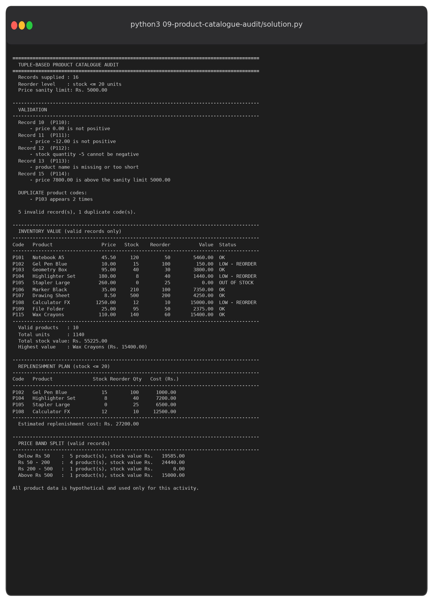

### 11. Conclusion

The audit separated a 16-record catalogue into 10 valid products and 6 problem records: five invalid rows (zero price, negative price, negative stock, missing name, price above the sanity limit) and one duplicated code. Once the bad rows were excluded, the stock value came to Rs 55,225.00 and four products needed replenishment at an estimated cost of Rs 27,200.00. Because each catalogue entry is a tuple, unpacking the five fields made the validation and reporting passes very short, and only lists, loops, strings and conditionals were needed.

---

## Case 10 — Bus Passenger Occupancy Simulation

**Case study question Q51** &nbsp;•&nbsp; Folder: [`10-bus-passenger-occupancy/`](10-bus-passenger-occupancy/)

---

### 1. Problem statement

Process boarding and alighting counts across multiple stops, calculate passenger counts at each stop, and flag any capacity violations.

### 2. Objectives

To store a stop-wise route as a tuple of tuples and unpack it in a loop; to maintain a running passenger count with operators; to validate boarding and alighting counts and reject impossible records; and to reconcile total boardings and alightings against the final count.

### 3. Assumptions

- The bus has 50 seats + 20 standing places, so the maximum is 70 passengers.
- A single stop never has more than 60 boarding or alighting passengers (larger values are treated as data errors).
- Alighting cannot exceed the number of passengers currently on board.
- A stop with more than 85% of capacity occupied is ALMOST FULL; exactly 70 is FULL.
- Rejected records do not change the passenger count.
- All route names and counts are hypothetical.

### 4. Algorithm

```text
1. START
2. Define SEATING_CAPACITY=50, STANDING_CAPACITY=20, TOTAL=70, MAX_AT_ONE_STOP=60
3. Define ROUTE_STOPS (list) and BOARDING_ALIGHTING (tuple of stop tuples)
4. DEFINE FUNCTION validate_stop_record(record, num_stops)
   4.1 UNPACK record → stop, boarding, alighting
   4.2 problems ← empty list
   4.3 IF stop outside route THEN append problem
   4.4 IF boarding < 0 THEN append problem
   4.5 IF alighting < 0 THEN append problem
   4.6 IF boarding > 60 or alighting > 60 THEN append problem
   4.7 RETURN problems
5. DEFINE FUNCTION simulate_trip(stop_names, records, capacity)
   5.1 passengers ← 0 ; results ← empty list
   5.2 FOR each record DO
       5.2.1 UNPACK stop, boarding, alighting
       5.2.2 problems ← validate_stop_record(...)
       IF problems not empty THEN append INVALID result ; CONTINUE
       5.2.3 IF alighting > passengers THEN append INVALID result ; CONTINUE
       5.2.4 passengers ← passengers - alighting + boarding
       5.2.5 status ← OVER CAPACITY if passengers > capacity
                        FULL if passengers = capacity
                        ALMOST FULL if passengers >= 85% capacity
                        OK otherwise
       5.2.6 append (stop, boarding, alighting, passengers, status, [])
   5.3 RETURN results
6. CALL simulate_trip on the main route, PRINT the table with utilisation %
7. ACCUMULATE totals, peak passengers and capacity violations
8. PRINT trip summary and reconciliation check (boarded - alighted = final)
9. CALL simulate_trip on the problem trip and PRINT the rejection reasons
10. END
```

### 5. Flowchart

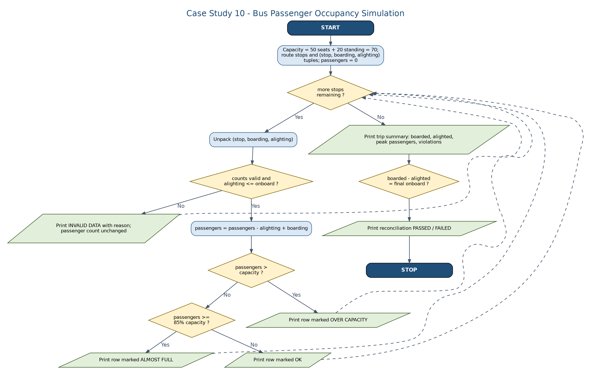

### 6. Pseudocode

```text
BEGIN BUS_PASSENGER_OCCUPANCY

    CONST SEATING_CAPACITY  <- 50
    CONST STANDING_CAPACITY <- 20
    TOTAL_CAPACITY          <- SEATING_CAPACITY + STANDING_CAPACITY
    CONST MAX_AT_ONE_STOP   <- 60
    ROUTE_STOPS             <- ["Central Bus Stand", ..., "Airport Road"]
    BOARDING_ALIGHTING      <- ((0,25,0), (1,34,3), ..., (7,2,12))

    FUNCTION validate_stop_record((stop, boarding, alighting), num_stops)
        problems <- []
        IF stop < 0 OR stop >= num_stops THEN APPEND "stop outside route" TO problems END IF
        IF boarding < 0 THEN APPEND "negative boarding" TO problems END IF
        IF alighting < 0 THEN APPEND "negative alighting" TO problems END IF
        IF boarding  > MAX_AT_ONE_STOP THEN APPEND "unrealistic boarding" TO problems END IF
        IF alighting > MAX_AT_ONE_STOP THEN APPEND "unrealistic alighting" TO problems END IF
        RETURN problems
    END FUNCTION

    FUNCTION simulate_trip(stop_names, records, capacity)
        passengers <- 0 ; results <- []
        FOR each (stop, boarding, alighting) IN records DO
            problems <- validate_stop_record((stop, boarding, alighting),
                                             LENGTH(stop_names))
            IF LENGTH(problems) > 0 THEN
                APPEND (stop, boarding, alighting, passengers, "INVALID", problems) TO results
                CONTINUE
            END IF
            IF alighting > passengers THEN
                APPEND (stop, boarding, alighting, passengers, "INVALID",
                        ["alighting exceeds onboard"]) TO results
                CONTINUE
            END IF

            passengers <- passengers - alighting + boarding
            IF passengers > capacity THEN status <- "OVER CAPACITY"
            ELSE IF passengers = capacity THEN status <- "FULL"
            ELSE IF passengers >= capacity * 0.85 THEN status <- "ALMOST FULL"
            ELSE status <- "OK"
            END IF
            APPEND (stop, boarding, alighting, passengers, status, []) TO results
        END FOR
        RETURN results
    END FUNCTION

    results <- simulate_trip(ROUTE_STOPS, BOARDING_ALIGHTING, TOTAL_CAPACITY)
    total_boarded <- 0 ; total_alighted <- 0 ; violations <- 0 ; peak <- 0
    FOR each (stop, boarding, alighting, onboard, status, problems) IN results DO
        IF status = "INVALID" THEN PRINT rejection ; CONTINUE END IF
        total_boarded  <- total_boarded + boarding
        total_alighted <- total_alighted + alighting
        IF status = "OVER CAPACITY" THEN violations <- violations + 1 END IF
        IF onboard > peak THEN peak <- onboard END IF
        PRINT stop name, boarding, alighting, onboard, utilisation %, status
    END FOR
    PRINT totals, peak, violations
    IF total_boarded - total_alighted = results[LAST].onboard THEN
        PRINT "reconciliation PASSED"
    END IF
    CALL simulate_trip on PROBLEM_TRIP and print rejection reasons
END
```

### 7. Python source code

Complete file — [`10-bus-passenger-occupancy/solution.py`](10-bus-passenger-occupancy/solution.py)

```python
"""
Case Study 10: Bus Passenger Occupancy Simulation
--------------------------------------------------
Process boarding and alighting counts across multiple stops, calculate
passenger counts at each stop, and flag any capacity violations.

Syllabus used: variables, data types, operators, conditional statements,
loops, strings, lists, tuples, tuple operations and unpacking.
No library is imported - only core Python 3 is used.
"""

# ------------------------------------------------------------------
# Bus and route constants (hypothetical values for this study)
# ------------------------------------------------------------------
SEATING_CAPACITY = 50
STANDING_CAPACITY = 20
TOTAL_CAPACITY = SEATING_CAPACITY + STANDING_CAPACITY   # 70 passengers max
MAX_AT_ONE_STOP = 60          # safety check on the input data

# Route stops and (boarding, alighting) tuples for one trip
ROUTE_STOPS = [
    "Central Bus Stand",
    "Gandhi Nagar",
    "Railway Station",
    "Benz Circle",
    "Auto Nagar",
    "Ramavarappadu",
    "Gannavaram",
    "Airport Road",
]

# (stop index, boarding, alighting)  - stop 0 is the start
BOARDING_ALIGHTING = (
    (0, 25, 0),      # board at the bus stand
    (1, 34, 3),
    (2, 26, 8),      # rush hour - bus goes over capacity here
    (3, 14, 17),
    (4, 9, 21),
    (5, 6, 15),
    (6, 4, 9),
    (7, 2, 12),
)


def validate_stop_record(record, num_stops):
    """Return a list of problems with one (stop, boarding, alighting) tuple."""
    problems = []

    stop, boarding, alighting = record       # tuple unpacking

    if stop < 0 or stop >= num_stops:
        problems.append("stop index %d is outside the route" % stop)
    if boarding < 0:
        problems.append("boarding count %d cannot be negative" % boarding)
    if alighting < 0:
        problems.append("alighting count %d cannot be negative" % alighting)
    if boarding > MAX_AT_ONE_STOP:
        problems.append("boarding %d seems unrealistic (max %d)"
                        % (boarding, MAX_AT_ONE_STOP))
    if alighting > MAX_AT_ONE_STOP:
        problems.append("alighting %d seems unrealistic (max %d)"
                        % (alighting, MAX_AT_ONE_STOP))

    return problems


def simulate_trip(stop_names, records, capacity):
    """Run the trip and return a list of per-stop result tuples."""
    passengers = 0
    results = []

    for record in records:
        stop, boarding, alighting = record         # unpack

        problems = validate_stop_record(record, len(stop_names))
        if len(problems) > 0:
            # record the problem and skip the stop
            results.append((stop, boarding, alighting, passengers, "INVALID", problems))
            continue

        if alighting > passengers:
            # more people get off than are on the bus
            results.append((stop, boarding, alighting, passengers,
                            "INVALID", ["alighting %d exceeds onboard %d"
                                        % (alighting, passengers)]))
            continue

        passengers = passengers - alighting + boarding

        status = "OK"
        if passengers > capacity:
            status = "OVER CAPACITY"
        elif passengers == capacity:
            status = "FULL"
        elif passengers >= capacity * 0.85:
            status = "ALMOST FULL"

        results.append((stop, boarding, alighting, passengers, status, []))

    return results


def main():
    print("=" * 84)
    print("  BUS PASSENGER OCCUPANCY SIMULATION")
    print("=" * 84)
    print("  Route  : %d stops" % len(ROUTE_STOPS))
    print("  Capacity: %d seats + %d standing = %d passengers"
          % (SEATING_CAPACITY, STANDING_CAPACITY, TOTAL_CAPACITY))
    print("-" * 84)

    results = simulate_trip(ROUTE_STOPS, BOARDING_ALIGHTING, TOTAL_CAPACITY)

    print("%-4s %-22s %7s %8s %8s %6s  %s"
          % ("Stop", "Name", "Board", "Alight", "Onboard", "Util", "Status"))
    print("-" * 84)

    total_boarded = 0
    total_alighted = 0
    violations = 0
    peak_passengers = 0
    peak_stop = ""
    invalid_stops = 0

    for result in results:
        stop, boarding, alighting, onboard, status, problems = result     # unpack

        if status == "INVALID":
            invalid_stops += 1
            name = ROUTE_STOPS[stop] if 0 <= stop < len(ROUTE_STOPS) else "?"
            print("%-4d %-22s %7d %8s %8s %6s  %s"
                  % (stop, name, boarding, "-", onboard, "-", "INVALID DATA"))
            for p in problems:
                print("        -> %s" % p)
            continue

        total_boarded += boarding
        total_alighted += alighting

        util = onboard * 100.0 / TOTAL_CAPACITY

        if status == "OVER CAPACITY":
            violations += 1

        if onboard > peak_passengers:
            peak_passengers = onboard
            peak_stop = ROUTE_STOPS[stop]

        print("%-4d %-22s %7d %8d %8d %5.1f%%  %s"
              % (stop, ROUTE_STOPS[stop], boarding, alighting, onboard, util, status))

    print("-" * 84)

    # ---------------- trip summary ----------------
    print("\n" + "-" * 84)
    print("  TRIP SUMMARY")
    print("-" * 84)
    print("  Total boarded at all stops : %d" % total_boarded)
    print("  Total alighted             : %d" % total_alighted)
    print("  Passengers still on board  : %d" % results[-1][3])
    print("  Peak passengers            : %d at %s (%.1f%% of capacity)"
          % (peak_passengers, peak_stop, peak_passengers * 100.0 / TOTAL_CAPACITY))
    print("  Capacity violations        : %d" % violations)
    print("  Invalid stop records       : %d" % invalid_stops)

    # ---------------- reconciliation check ----------------
    print("\n" + "-" * 84)
    print("  RECONCILIATION CHECK")
    print("-" * 84)
    final_onboard = results[-1][3]
    expected = total_boarded - total_alighted
    print("  Boarded - alighted = %d - %d = %d" % (total_boarded, total_alighted, expected))
    print("  Final passengers on board = %d" % final_onboard)
    if expected == final_onboard:
        print("  Check PASSED: passenger count reconciles.")
    else:
        print("  Check FAILED: counts do not reconcile.")

    # ---------------- second trip with problem data ----------------
    print("\n" + "-" * 84)
    print("  SECOND TRIP - WITH PROBLEM RECORDS (validation demo)")
    print("-" * 84)

    problem_trip = (
        (0, 30, 0),
        (1, 25, 10),
        (2, 15, 45),      # more alighting than onboard
        (3, -5, 5),       # negative boarding
        (4, 4, 9),
        (9, 3, 1),        # stop outside the route
        (6, 75, 2),       # unrealistic boarding count
    )

    problem_results = simulate_trip(ROUTE_STOPS, problem_trip, TOTAL_CAPACITY)
    for result in problem_results:
        stop, boarding, alighting, onboard, status, problems = result
        name = ROUTE_STOPS[stop] if 0 <= stop < len(ROUTE_STOPS) else "?"
        if status == "INVALID":
            print("  Stop %d (%s): board %d, alight %d -> REJECTED"
                  % (stop, name, boarding, alighting))
            for p in problems:
                print("        -> %s" % p)
        else:
            print("  Stop %d (%s): board %d, alight %d -> onboard %d (%s)"
                  % (stop, name, boarding, alighting, onboard, status))

    print("\nAll counts are hypothetical and used only for this activity.")


if __name__ == "__main__":
    main()
```

### 8. Test cases

| # | Test | Expected | Result |
|---|------|----------|--------|
| TC-01 | Total capacity | 70 | PASS |
| TC-02 | Valid stop record | accepted | PASS |
| TC-03 | Negative boarding | rejected | PASS |
| TC-04 | Negative alighting | rejected | PASS |
| TC-05 | Stop index 9 | rejected | PASS |
| TC-06 | Boarding 75 | rejected | PASS |
| TC-07 | Zero boarding, everyone alights | valid | PASS |
| TC-08 | Simple trip 20 → 17 → 12 | counts correct | PASS |
| TC-09 | Over-capacity trip | flagged | PASS |
| TC-10 | Exactly 70 on board | FULL | PASS |
| TC-11 | 60 of 70 (85%+) | ALMOST FULL | PASS |
| TC-12 | Alighting 15 with 10 on board | rejected | PASS |
| TC-13 | Negative boarding in trip | rejected | PASS |
| TC-14 | After a rejected stop | count unchanged | PASS |
| TC-15 | Sample trip | peak 74 passengers | PASS |
| TC-16 | Sample trip | 2 capacity violations | PASS |
| TC-17 | Sample trip | counts reconcile | PASS |
| TC-18 | Sample trip | 8 results for 8 stops | PASS |

All 18 test cases pass when `test_cases.py` is run.

Complete test file — [`10-bus-passenger-occupancy/test_cases.py`](10-bus-passenger-occupancy/test_cases.py)

```python
"""Automated test cases for Case Study 10 - Bus Passenger Occupancy Simulation."""
import importlib.util
import os

spec = importlib.util.spec_from_file_location(
    "sol", os.path.join(os.path.dirname(os.path.abspath(__file__)), "solution.py"))
sol = importlib.util.module_from_spec(spec)
spec.loader.exec_module(sol)

passed = 0


def check(label, condition):
    global passed
    assert condition, "FAILED: " + label
    passed += 1
    print("  PASS:", label)


NAMES = ["A", "B", "C"]        # three fake stops for isolated tests

# TC-01: capacity constant
check("total capacity = 50 seats + 20 standing = 70", sol.TOTAL_CAPACITY == 70)

# TC-02: valid record has no problems
check("valid stop record accepted",
      sol.validate_stop_record((0, 10, 0), 8) == [])

# TC-03: negative boarding rejected
check("negative boarding rejected",
      len(sol.validate_stop_record((0, -3, 0), 8)) == 1)

# TC-04: negative alighting rejected
check("negative alighting rejected",
      len(sol.validate_stop_record((0, 3, -2), 8)) == 1)

# TC-05: stop outside route rejected
check("stop index 9 rejected",
      len(sol.validate_stop_record((9, 3, 0), 8)) == 1)

# TC-06: unrealistic boarding rejected
check("boarding 75 rejected (above 60)",
      len(sol.validate_stop_record((0, 75, 0), 8)) == 1)

# TC-07: zero-boarding middle stop is valid
check("stop with 0 boarding is valid (everyone alights)",
      sol.validate_stop_record((1, 0, 5), 8) == [])

# TC-08: simple trip updates the count correctly
results = sol.simulate_trip(NAMES, [(0, 20, 0), (1, 5, 8), (2, 2, 7)], 70)
check("trip counts: 20 -> 17 -> 12",
      results[0][3] == 20 and results[1][3] == 17 and results[2][3] == 12)

# TC-09: over-capacity status is produced
results = sol.simulate_trip(NAMES, [(0, 60, 0), (1, 20, 0), (2, 0, 5)], 70)
check("over capacity flagged at stop 1",
      results[1][4] == "OVER CAPACITY")

# TC-10: exactly-full status is produced
results = sol.simulate_trip(NAMES, [(0, 50, 0), (1, 20, 0), (2, 0, 5)], 70)
check("exactly 70 passengers marks FULL", results[1][4] == "FULL")

# TC-11: almost-full status is produced
results = sol.simulate_trip(NAMES, [(0, 60, 0), (1, 0, 0), (2, 0, 5)], 70)
check("60 of 70 passengers (>= 85%) marks ALMOST FULL",
      results[0][4] == "ALMOST FULL")

# TC-12: alighting more than onboard is rejected
results = sol.simulate_trip(NAMES, [(0, 10, 0), (1, 2, 15), (2, 0, 0)], 70)
check("alighting 15 with 10 onboard rejected",
      results[1][4] == "INVALID")

# TC-13: negative boarding rejected by the simulation
results = sol.simulate_trip(NAMES, [(0, 10, 0), (1, -2, 0), (2, 0, 0)], 70)
check("negative boarding rejected in simulation",
      results[1][4] == "INVALID")

# TC-14: rejection does not change the passenger count
check("rejected stop leaves onboard count unchanged",
      results[2][3] == 10)

# TC-15: the sample trip peaks at 74 passengers
results = sol.simulate_trip(sol.ROUTE_STOPS, sol.BOARDING_ALIGHTING, sol.TOTAL_CAPACITY)
peak = 0
for r in results:
    if r[4] != "INVALID" and r[3] > peak:
        peak = r[3]
check("sample trip peaks at 74 passengers", peak == 74)

# TC-16: the sample trip has exactly 2 capacity violations
violations = 0
for r in results:
    if r[4] == "OVER CAPACITY":
        violations += 1
check("sample trip has 2 capacity violations", violations == 2)

# TC-17: total boarded and alighted reconcile with final count
boarded = 0
alighted = 0
for r in results:
    if r[4] != "INVALID":
        boarded += r[1]
        alighted += r[2]
check("boarded - alighted = final onboard count",
      boarded - alighted == results[-1][3])

# TC-18: every route stop appears once in the sample trip
check("8 stops produce 8 results", len(results) == len(sol.ROUTE_STOPS))

print("\n%d test cases passed" % passed)
```

### 9. Output

Console output produced by running `10-bus-passenger-occupancy/solution.py` — [`output.txt`](10-bus-passenger-occupancy/output.txt)

```text
====================================================================================
  BUS PASSENGER OCCUPANCY SIMULATION
====================================================================================
  Route  : 8 stops
  Capacity: 50 seats + 20 standing = 70 passengers
------------------------------------------------------------------------------------
Stop Name                     Board   Alight  Onboard   Util  Status
------------------------------------------------------------------------------------
0    Central Bus Stand           25        0       25  35.7%  OK
1    Gandhi Nagar                34        3       56  80.0%  OK
2    Railway Station             26        8       74 105.7%  OVER CAPACITY
3    Benz Circle                 14       17       71 101.4%  OVER CAPACITY
4    Auto Nagar                   9       21       59  84.3%  OK
5    Ramavarappadu                6       15       50  71.4%  OK
6    Gannavaram                   4        9       45  64.3%  OK
7    Airport Road                 2       12       35  50.0%  OK
------------------------------------------------------------------------------------

------------------------------------------------------------------------------------
  TRIP SUMMARY
------------------------------------------------------------------------------------
  Total boarded at all stops : 120
  Total alighted             : 85
  Passengers still on board  : 35
  Peak passengers            : 74 at Railway Station (105.7% of capacity)
  Capacity violations        : 2
  Invalid stop records       : 0

------------------------------------------------------------------------------------
  RECONCILIATION CHECK
------------------------------------------------------------------------------------
  Boarded - alighted = 120 - 85 = 35
  Final passengers on board = 35
  Check PASSED: passenger count reconciles.

------------------------------------------------------------------------------------
  SECOND TRIP - WITH PROBLEM RECORDS (validation demo)
------------------------------------------------------------------------------------
  Stop 0 (Central Bus Stand): board 30, alight 0 -> onboard 30 (OK)
  Stop 1 (Gandhi Nagar): board 25, alight 10 -> onboard 45 (OK)
  Stop 2 (Railway Station): board 15, alight 45 -> onboard 15 (OK)
  Stop 3 (Benz Circle): board -5, alight 5 -> REJECTED
        -> boarding count -5 cannot be negative
  Stop 4 (Auto Nagar): board 4, alight 9 -> onboard 10 (OK)
  Stop 9 (?): board 3, alight 1 -> REJECTED
        -> stop index 9 is outside the route
  Stop 6 (Gannavaram): board 75, alight 2 -> REJECTED
        -> boarding 75 seems unrealistic (max 60)

All counts are hypothetical and used only for this activity.
```

### 10. Output screenshot

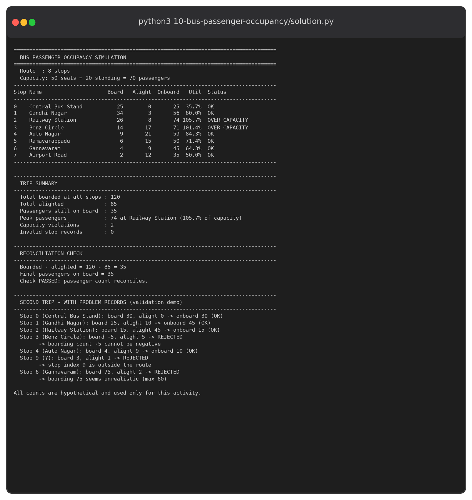

### 11. Conclusion

The simulation tracked the bus through all eight stops: boardings exceeded alightings during the morning rush, so the bus carried 74 passengers at Railway Station (105.7% of the 70-passenger capacity) and was still over capacity at the next stop — exactly the two violations reported in the summary. The reconciliation check (120 boarded − 85 alighted = 35 still on board) confirms the running counter is consistent. The second trip showed that impossible records (negative boarding, alighting more than on board, an off-route stop index and an unrealistic boarding count) are all rejected without disturbing the passenger count. Only tuples, unpacking, loops, conditionals and operators were used.

---

## Syllabus topics covered

| Topic | Used in case studies |
|-------|----------------------|
| Variables, data types, operators | 01 – 10 |
| Conditional statements | 01 – 10 |
| Loops (including nested loops) | 01, 03, 04, 05, 06, 07, 08, 09, 10 |
| Strings and string operations | 04, 05, 06, 09 |
| Pattern generation | 03, 07 |
| Lists | 01 – 10 |
| Nested lists | 08 |
| Tuples and tuple operations | 02, 09, 10 |
| Tuple unpacking | 02, 05, 08, 09, 10 |

No external library is imported in any solution — only core Python 3 is used.

## How to run

```bash
# run any case study
python3 01-progressive-electricity-billing/solution.py

# run its test cases
python3 01-progressive-electricity-billing/test_cases.py
```

Every program prints its own sample output, so no input is needed while running.

## Notes

- All ten programs were run and every `test_cases.py` file passes completely (160 automated checks in total).
- All names, amounts, marks and readings used in the programs are hypothetical sample data.
- Submission link: this repository (`Python-Activity-Based-Learning`), submitted after the Dussehra holidays.

